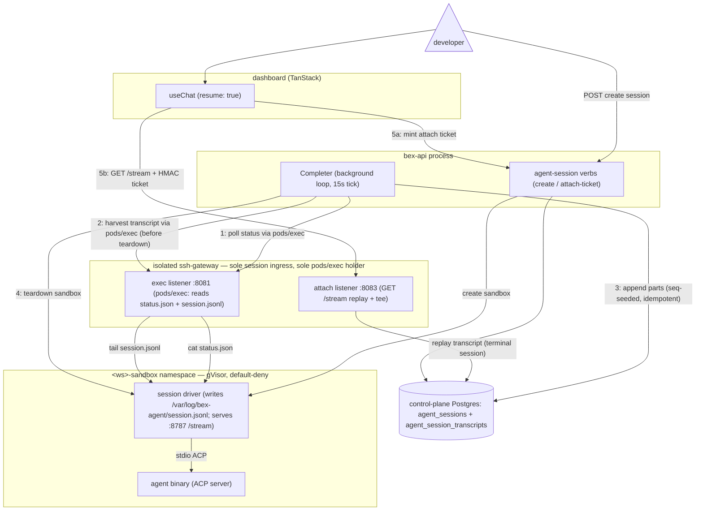

# ADR051 — Agent-session conversation transcript persistence

**Status:** Accepted and shipped — implemented in **w3/m77**, revised 2026-08-08 to the log-harvest path, and production-verified 2026-08-18 (`scripts/agent-session-verify.sh`; terminal fire-and-forget replay returned 121 durable parts + `[DONE]`). Splits the D10 "headless recorder" decision out of [ADR047](ADR047-cloud-coding-agent-sessions.md) into a dedicated ADR because transcript persistence is a distinct concern from the session lifecycle. ADR047 D3/D9 own the **live-attach** conversation plane (shipped w3/m43); this ADR owns the **durable chat history** for the shipped **fire-and-forget** product, which the live-attach tee never captures.

> **Revision (2026-08-08).** The first w3/m77 implementation had the Completer trigger a gateway `/agent-record` endpoint that made a **separate** network dial to the driver's `:8787/stream`. That path was never verified on prod and prod sessions kept showing "No conversation yet." It is replaced by the **log-harvest** path below: the Completer reads the driver's on-disk transcript log over the **same `pods/exec` boundary it already uses for the status read** — the one proven working in prod (sessions finalize through it). The gateway `/agent-record` endpoint, its `RecordSecret`, and `BEX_AGENT_RECORD_URL` are removed. The live-attach tee (ADR047 D9) is unchanged.
>
> **Recovery amendment (2026-08-17, w5/m72).** A terminal Pod is now a first-class incomplete-history outcome. The gateway replays all durable turns/parts and ends `[DONE]` without dialing a Failed/Succeeded/terminated Pod. The Completer marks the current turn incomplete/truncated with a bounded reason and reclaims the dead sandbox immediately. It never fabricates the assistant output that died with the Pod. The installed gateway role is reconciled after migrations and startup-preflighted for `agent_session_turns`, closing the production SQLSTATE `42501` replay outage.

> **Item-model amendment (2026-10-26, w10/m16).** The durable transcript stores **completed items**, not stream chunks. See [§ Item model](#item-model-amendment-2026-10-26-w10m16) below.

---

## Context

### The product surface

An agent session's conversation — the plans, reasoning, tool calls, terminal output, and diffs the agent streams as it works — is a first-class deliverable, not just a live view. The dashboard's session detail page (`dashboard/src/features/agent-sessions`) renders it from the AI SDK **UI-message stream** via `useChat` with `resume: true`, and ADR047 D9 makes the stream's replay mode "the single history source for terminal and running sessions alike." So a completed session must be able to replay its whole conversation long after its sandbox is gone.

### The gap (found in prod 2026-08-06)

The w3/m43 conversation plane persists a transcript only as a **side effect of a live attach**. The sole writers of `agent_session_transcripts` are the gateway tee on the `GET` splice and the `POST` turn (`lego/backend/internal/sshgateway/agentattach/agentattach.go` — both call `store.AppendAgentSessionTranscript`), and both run only while a browser is attached to a still-running driver.

But the shipped **phase-1 product is fire-and-forget** (ADR047 D8): the driver runs its turn **headless with no client stream** (bex-api sets `BEX_AGENT_EXIT_AFTER_TURN=0` and no attach happens — `lego/backend/internal/agentsessions/service.go`; `runHeadlessTurn`, `lego/agent-image/driver/src/session.ts`), and the Completer tears the sandbox down the moment the turn finishes (`lego/backend/internal/agentsessions/completion.go` → `teardown` → `CancelAgentSessionSandbox`). So unless a viewer happened to hold the conversation page open for the **entire** run, nothing is ever teed; by the time the session is opened it is terminal, the pod (and its in-memory hub) is gone, and `GET /stream` replays an **empty** transcript then `[DONE]` — the dashboard shows **"No conversation yet."** for every completed fire-and-forget session.

ADR047 D3's "the gateway tees the session stream into a transcript" and D9's replay-mode claim both silently assumed a persister the phase-1 path never runs. This ADR specifies that persister.

### What already exists (the fix is mostly wiring)

- **The driver keeps the whole turn available until teardown.** It retains the full in-memory `#history` and serves `GET /stream` on port 8787 for as long as the pod lives (`lego/agent-image/driver/src/stream-hub.ts`; the fire-and-forget failure path in `main.ts` is explicit that the driver MUST stay alive so the Completer can read it). `hub.attach` replays the **entire** history — plus `[DONE]`, since a headless turn closes the hub — to any attacher that arrives before teardown. One attach any time before teardown captures the complete transcript in a single shot.
- **The gateway already holds the exact tee.** `spliceDriverStream` dials `http://<podIP>:8787/stream` and appends every part idempotently by the driver's emission ordinal (`ON CONFLICT (session_id, seq) DO NOTHING`, `store/agentsessions.go`). Gateway→driver:8787 ingress is sanctioned by the cluster-wide `sandbox-agent-driver-ingress` Cilium policy. Nothing in the tee needs a browser except the pod/ns/session identity, which today rides the attach ticket.
- **The Completer already crosses the boundary every tick.** It reads the driver status file over the gateway sandbox-exec boundary (`c.Sandbox.ReadSessionStatus` → `sandbox/service.go` `mintAndDial` → gateway `:8081` exec) under the trusted system subject `system:agent-session-completer`, and it owns the teardown. bex-api never holds `pods/exec`.
- **The store is ready.** `AppendAgentSessionTranscript` (idempotent, seq-keyed), `AgentSessionTranscript` (replay read), and `AgentSessionTranscriptMaxSeq` (resume cursor) all exist; the `GET /stream` replay already serves terminal sessions from them.

The only missing piece is a **non-browser trigger** for the tee.

---

## Decision

**Persistence is decoupled from live attach by a server-side recorder the Completer triggers before teardown.**

### Core path

### Mechanism (log harvest over the proven exec boundary)

- **The Completer harvests-before-teardown** in `completion.go` `teardown`, immediately before `CancelAgentSessionSandbox`. It reads the driver's per-part log through **`ReadSessionTranscript`** — the exact same `mintAndDial` → gateway `:8081` `pods/exec` path it already uses each tick for `ReadSessionStatus`, just `tail`-ing `/var/log/bex-agent/session.jsonl` instead of `cat`-ing `status.json`. This is the decisive reliability choice: if a session finalizes at all, that exec path is working, so the harvest works too — no separate, unverified gateway→driver `:8787` dial.
- **The driver already produces the source.** It writes every UI-message part to the log through one bounded append sink per turn (`lego/agent-image/driver/src/turn-log.ts`, used from `session.ts`), redacted, and the log survives scrub (`credentials.ts` replaces credential bytes in place, never deletes). _Superseded by [ADR090](ADR090-agent-owned-delivery.md) (2026-10-22): the driver scrub and redaction are deleted because the sandbox holds only the ADR062 placeholder; the log is written as-is._ bex-api parses each `{…,"part":{…}}` line and keeps only the `.part` payload — the shape the `GET /stream` replay re-frames for a Vercel AI SDK client. Since w4/m87 that payload may include an additive ISO-8601 UTC `at` (and `providerMetadata.bex.at` / `endAt`); harvest still stores the JSON as `text` and never synthesizes a timestamp.
- **Live tee batches without blocking the browser (w5/m77).** During attach, the gateway forwards each accepted part immediately and persists bounded batches through the existing `AppendAgentSessionTranscript` slice API. One writer flushes at 32 parts, 1 MiB, or 100 ms, with a 32-slot queue and 2 MiB outstanding-byte cap. It preserves batch order, flushes queued parts on cancellation with bounded independent append contexts, and flushes before terminal `[DONE]`. On an append failure it stops persisting later batches so sequence allocation cannot jump ahead of the missing suffix. Completion harvest remains the universal suffix backstop when live tee or client disconnect leaves gaps. Completer compares bounded harvested ordinals against one atomic progress snapshot, charges only missing identities, and can recover holes left by historical concurrent writers without renumbering durable cursors. Replay charges the durable prefix only once and suppresses only ordinals actually delivered to this client, so a concurrent tee cannot hide a new part between durable replay and live splice.
- **Idempotent partial merge (w5/m71 amendment, 2026-08-17).** A fresh sandbox restarts its driver ordinal, so transcript identity is `(session_id, turn, part_index)` while the store allocates monotonic per-session `seq` cursors under an advisory lock. The Completer parses the whole current-turn log on every needed harvest and inserts missing local indexes. It never treats “one live-teed part exists” as proof the whole turn exists.
- **Failure is explicit, never a hang.** The session still finalizes and tears down, but the durable turn records whether its assistant transcript is complete, truncated, and why. Provisioning, transport/read, parse/part-count, driver-log, store, and 64 MiB session-quota failures can therefore replay retained content without masquerading as complete history.
- **A dead source is replay-only.** `KubePodIPResolver` and the exec gateway reject a terminal Pod/container even when Kubernetes retains its PodIP. Attach still emits stored user prompts and assistant parts, then `[DONE]`; it never turns a missing live tail into the generic “conversation stream unavailable” state. Concurrent Completers use one active-phase compare-and-set, so exactly one observer records the terminal result and teardown side effects.
- **One coherent bound.** The driver keeps a bounded 16 MiB JSONL log. `ReadSessionTranscript` tails the same 16 MiB and uses a dedicated 17 MiB trusted exec buffer; any buffer truncation is an error. The ordinary sandbox-exec response retains its independent 2 MiB cap.

### Role-correct frontend replay

The stored UI-message response chunks encode assistant output, not the submitted user role. The gateway therefore interleaves durable `agent_session_turns` as `data-user-prompt` parts and normalizes nested per-turn `start`/`finish` chunks into one response envelope. The dashboard renders those prompt parts as user messages and surfaces incomplete-history reasons. React optimistic state is only an in-flight echo, never history.

### Transcript as the agent re-priming source (w5/m84, 2026-08-30)

The transcript's purpose widens from "human replay + audit" to **the authoritative fallback context for the agent itself**: ADR047 D3's continuity ladder (rung 2) derives a bounded re-priming preamble from it whenever a fresh agent generation lacks its own `session/load` state — post-hibernation resume with a missing/empty snapshot, and steer-driven redispatch alike. `ags-da9mh5vj596c73en5eq0` is the motivating incident: the dashboard replayed durable history while the fresh agent received only "try again" and asked what to retry. Consequences for this store: the redacted, re-wrapped harvest (accepted above for terminal replay) is also sufficient for re-priming — the agent needs prompts + assistant text, not verbatim wire bytes; truncation/summary policy lives in the **driver** (newest-first under an explicit byte budget), not in the store; and the preamble is annotated on the new turn so replay never double-renders it as fresh conversation.

### Item model (amendment 2026-10-26, w10/m16)

A 10-minute production turn (`ags-dbf8nggkbcjs73a5r3u0`, turn 1) stored **5,602 rows / 2.9 MB**, one per AI-SDK chunk. 3,835 `reasoning-delta` rows carried 51 KB of text, and transient `data-acp-info` rows were 35% of the bytes. Replaying that burst crashed the dashboard, and the 5,000-part harvest cap marked the turn truncated. Industry practice persists finished parts, not tokens: the Vercel AI SDK stores final `UIMessage` parts, and the Codex App Server stores `item/completed` items.

**Decision.** One shared coalescer, `lego/backend/internal/agenttranscript`, folds a turn's chunk stream into items. Both writers use it: the gateway tee (`agentattach` `spliceDriverStream` / `forwardAgentTurn`, via `turnTee`) and the Completer harvest (`parseTranscriptLog` → `agenttranscript.Coalesce`). The same chunks therefore give byte-identical items on both paths.

| Chunks | Stored item |
| --- | --- |
| `text-start/delta/end`, `reasoning-*` | one UIMessage `text` / `reasoning` part (`id`, `text`, `state`, final `providerMetadata`) |
| `tool-input-*` + `tool-output-available/error/denied` per id | one `dynamic-tool` (or `tool-<name>`) part: input, output/error, title, state, call/result meta |
| `data-acp-diff`, `data-acp-terminal` | latest snapshot per tool and path/terminal, final when its tool finishes |
| non-transient `data-*` with an `id` (`data-acp-plan`) | latest snapshot, final at the turn's `finish` |
| `data-acp-usage-update` | the turn's last value only |
| other transient chunks (`data-acp-info`, available-commands, session-info-update) | not stored |
| everything else (`start`, `finish`, `error`, `data-bex-*`, …) | stored as-is |

- **Identity.** An item's `part_index` is the turn-local ordinal of its **first** chunk. It does not depend on where a reader started counting, so the `(session_id, turn, part_index)` idempotent merge still works across tee, harvest and reattach.
- **Order.** The coalescer releases a finished item only when every lower-index item is final, so writers append in index order. The UI part order is `(turn, part_index)`; `seq` is the write (revision) order. The gateway replay and continuity re-priming read `AgentSessionTranscriptReplay`, keyset-paged by `(turn, part_index)`. The poll API (REST/GraphQL/MCP) stays seq-keyset. Its clients render parts in `(turn, partIndex)` order, and a later part with the same `(turn, partIndex)` supersedes the earlier one (amended 2026-10-27, w10/005).
- **Partial items.** At stream end, quota stop or disconnect, the tee flushes in-flight items as partial rows (`item_state = 2`). The harvest deletes a partial row and inserts its complete copy under a **new** `seq` with the same `(turn, part_index)`. A poll client already past the partial's `seq` therefore still receives the completed item, and ordered replay keeps it in place. This DELETE is bex-api only: the gateway role keeps `SELECT, INSERT`. The dashboard renders a still-pending tool in a terminal session's settled replay as **Interrupted**, with no spinner; live sessions keep the spinner. It renders `output-denied` as **Denied** and counts it as a failure in the group line.
- **Replay** (`agenttranscript.Expand`) re-emits each item as standard Vercel AI SDK v6 chunks. Text becomes `text-start` + one `text-delta` + `text-end`, and reasoning works the same way. A tool becomes `tool-input-available` (original `toolName`/`title`/`input`/`dynamic`) plus `tool-output-available`, `tool-output-error` or `tool-output-denied`. There is no new wire type. Live delivery is unchanged: raw chunks are forwarded verbatim. A reattach suppresses the driver's chunks for items it already replayed.
- **Tool output cap.** Output text longer than 30,000 characters is stored as the first 15,000 characters, then `\n\n[bex: N chars clipped]\n\n`, then the last 15,000 (N = removed characters). The item gets `truncated: true`. This applies to string outputs, to every string inside structured outputs, to `errorText`, and to terminal output. Diffs are not clipped.
- **Caps.** The harvest cap counts **items** (`maxTranscriptItems = 5000`; the sample turn is 410). The 64 MiB session byte quota stays the backstop. A tee holding more than 16 MiB of in-flight items stops and leaves the turn to the harvest. Truncation reasons: `driver log parse failed`, `transcript item limit reached`.
- **Measured** on the recorded turn: 5,602 rows / 2.84 MB became **410 rows / 1.21 MB** (7.3% of the rows, 43% of the bytes). The remaining bytes are almost all genuine tool output (0.89 MB, none over the cap). Replay rebuilds identical UIMessage parts: 13 text, 96 reasoning and 299 tool parts. The test fixture is `agenttranscript/testdata`.
- **Driver log stays chunk-level.** The driver's `session.jsonl` keeps one record per chunk. It also feeds the driver's own `/stream` history for live attach. Keeping it raw means one coalescer, in Go, serves both the live and harvest paths, the driver needs no change, and the log stays bounded at 16 MiB.
- **Backfill.** `store.CompactAgentSessionTranscripts` runs once in the background at bex-api startup (`compactAgentTranscripts`): a dry run that logs its counts, then the rewrite. Each settled turn still holding legacy rows (`item_state = 0`, every pre-migration row) is rewritten in its own transaction under the transcript append lock. Each item keeps the `seq` and `created_at` of its first chunk, so cursors and order survive. A possibly-running turn is skipped; the harvest replaces its legacy rows. The legacy rows are the marker: once the partial index `agent_session_transcripts_legacy_idx` is empty, a start costs one index probe. A turn flagged `driver log parse/part limit reached` has the flag cleared only when its rows prove it complete: contiguous ordinals ending in `finish`.

---

## Alternatives considered

- **Vercel `@ai-sdk/harness-acp` meta-adapter** (2026-08-22, w5/m77): rejected for bex — it targets AI SDK v7, owns sandbox orchestration, and duplicates the in-pod direct-ACP driver the platform already hardened in w5/m66. The retained lesson is the declarative profile manifest (`lego/backend/internal/agentsession/agent-profiles.json`), not the harness runtime.
- **Gateway `/agent-record` endpoint that dials the driver's `:8787/stream`** (the original w3/m77 implementation): the Completer POSTed an exec-secret-signed ticket to a new gateway route, which resolved the pod IP and reverse-proxied+teed the driver's live `/stream` replay verbatim. Its appeal was byte-exact parts (composes with the live tee). **Superseded 2026-08-08**: it introduced a second, never-prod-verified network path (gateway→driver:8787 direct dial + a new listener route + `BEX_AGENT_RECORD_URL`), and prod sessions stayed blank. The log-harvest rides the already-working status-read boundary instead. The trade-off accepted: harvested parts are **redacted and re-wrapped** (not the verbatim `data:` bytes ADR047 D3 promises) — fine for terminal replay, where the client just needs the parts.
- **Driver pushes parts to the gateway** (a new driver→gateway write path): rejected — it puts untrusted tenant code on the transcript write path (the store comment deliberately keeps the driver out, `store/agentsessions.go`), and the sandbox's **sole** open in-cluster egress port is the credential broker's `:8082`.
- **Create-time recorder** (record the whole turn live from dispatch): rejected as heavier — a long-lived per-session server-side subscriber with its own reconnection/lifecycle — when a one-shot harvest before teardown suffices because the driver's log is complete by then.

---

## Consequences

- The gateway `/agent-record` route, `agentattach.Server.RecordSecret`, and `BEX_AGENT_RECORD_URL` are removed; capture is a bex-api-only concern riding the existing exec boundary. No new env var and no new gateway listener/route.
- Phase-2 live attach optimizes real-time viewing; the harvest is the universal backstop; both write the same idempotent `(session_id, turn, part_index)` identity while `seq` remains the global replay cursor.
- Retention rides the existing audit sweep (`PruneAgentSessionTranscripts`, `BEX_AUDIT_RETENTION_DAYS` lineage) and the `ON DELETE CASCADE` with the session.
- Multi-turn/redispatch sessions concatenate by the store-allocated cursor; every driver log record carries its turn and local part index.
- Residual limit: capture happens at completion, so a sandbox lost before teardown has no assistant log to harvest. Its accepted user prompt still survives and is settled visibly incomplete.
