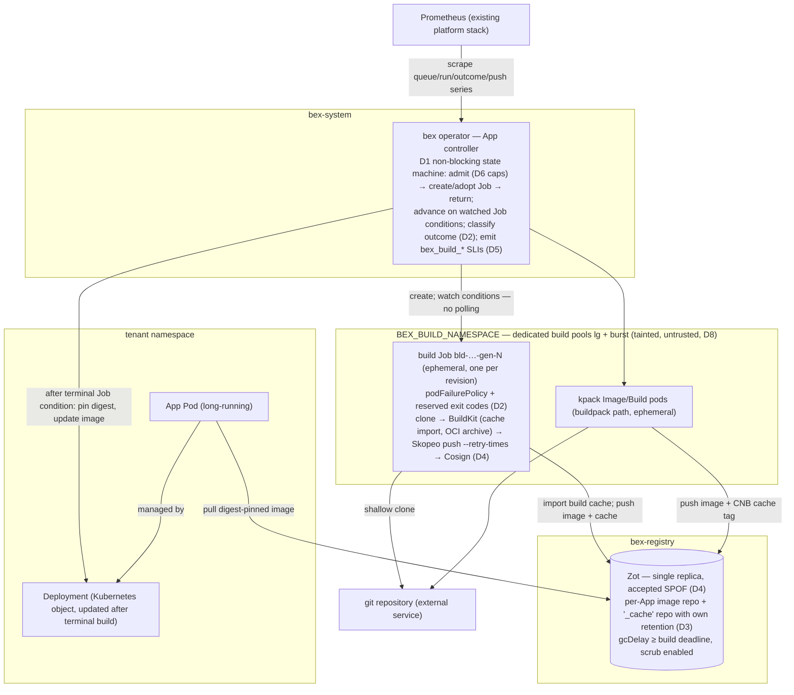

# ADR060 — Build-worker reliability and performance: async dispatch, failure classes, remote cache, and build SLOs

**Status:** Proposed · 2026-08-15

Refines [ADR034](ADR034-scalable-build-pipeline.md), which accepted the ephemeral-builder architecture and explicitly deferred three follow-ups: the non-blocking reconcile, atomic admission, and remote cache. This ADR turns those deferrals — plus the reliability and observability gaps found since — into one coherent plan, informed by how the current fast-build platforms (Depot, Namespace, Docker Build Cloud, Railway, Fly.io) and the Kubernetes-native build systems (kpack, Tekton, Kueue) solve the same problems.

## Context

### What exists today

The build plane is `lego/operator/internal/build/` dispatched from the App controller. One admitted build is one ephemeral Kubernetes Job (`bld-<name>-gen-<generation>`) in `BEX_BUILD_NAMESPACE`: a shallow-clone init container, a rootless-confined BuildKit init container exporting an OCI archive, a Skopeo push, and optional Cosign signing — the serial credential-isolated topology whose security closure is recorded in ADR034. The buildpack extension is a kpack `Image`. Deterministic names give idempotent adopt-on-restart; newest-wins cancellation, the best-effort `BEX_MAX_CONCURRENT_BUILDS` workspace cap, a 30-minute `activeDeadlineSeconds`, UID-scoped teardown, and the Pending-vs-Building budget split (added after the 2026-08-11 false-timeout incident) all work as ADR034 specified.

### What the evidence says is wrong

An audit of the build plane (2026-08-15) against current industry practice found the following, in descending order of leverage:

1. **Builds still block a reconcile worker.** `build.Build` polls the Job in-line for up to 30 minutes (`build/build.go`), so platform-wide build concurrency equals `BEX_APP_RECONCILE_WORKERS`. ADR034 §5 named the non-blocking refactor as "the next scaling step"; it has not happened. This synchronous-wait-in-Reconcile shape is a documented operator anti-pattern that Eclipse Che and the GitLab operator each had to refactor away from, and every surveyed build system (kpack, Tekton, Argo Workflows) is a watch-driven state machine that never blocks. Railway's non-Kubernetes equivalent is a Temporal workflow per build with heartbeats.
2. **One attempt, no failure classification.** Build Jobs run with `backoffLimit: 1` and no `podFailurePolicy`. A transient infrastructure disruption (node drain, preemption, registry blip) fails the tenant's deploy exactly like a genuinely broken `npm build` — both surface flatly as `BuildFailed`. The `safe-to-evict: "false"` annotation patched one known transient cause (cluster-autoscaler eviction killed builds repeatedly in production) but nothing classifies the rest. Kubernetes 1.31 made the correct primitive GA: `podFailurePolicy` rules over exit codes and pod conditions.
3. **Every Dockerfile/native build is a clean build.** BuildKit configures no `cache-from`/`cache-to` (ADR034 §6 acknowledged this). Only the kpack path has a registry cache (`<image>-cache` tag), though each release turned out to cache under its own tag, so none restored another's: see w5/m134 under D3. Meanwhile every commercial fast-builder treats cache as the product: Depot attaches per-project NVMe-backed volumes, Namespace forks copy-on-write cache volumes per build, Railway pins projects to warm buildkitd cells via rendezvous hashing. The cheapest first step for bex — registry-backed cache in the Zot we already run — is unimplemented.
4. **Zero build-plane metrics.** ADR034 declared queue wait, active/queued counts, duration/outcome, scheduling latency, and push latency "required operational signals." The operator emits none of them (its only Prometheus collector is the egress meter). Diagnosis is kubectl archaeology; `build_seconds` metering in bex-api is billing data, not an SLI.
5. **The production baseline is ambient, not checked in.** The code defaults are one reconcile worker and an **unlimited** workspace cap (`lego/operator/cmd/manager/main.go`); neither `BEX_APP_RECONCILE_WORKERS` nor `BEX_MAX_CONCURRENT_BUILDS` is set anywhere in `deploy/gitops/`. (Verified live 2026-08-15: production **does** run ADR034's 2/2 baseline, via out-of-band env — so this is an auditability gap, not an active misconfiguration. D7 closes it.)
6. **Registry weather is unhandled.** The Skopeo push runs without `--retry-times`; transient 5xx during push is normal registry behavior. Zot is a single-replica StatefulSet on one RWO PVC that has already filled once (40 Gi → opaque 500s on every concurrent push, since grown to 100 Gi), and recent Zot releases changed GC defaults (untagged manifests now deleted after `gcDelay`, default 1h) — exactly the class of change that can eat in-flight pushes or a future build cache.

Four production incidents already shape this plane: the two OOM/node-loss incidents that produced the node-exclusive 7 Gi request (ADR034 §3), the autoscaler-eviction failures that produced `safe-to-evict: "false"`, and the Pending-time misattribution that produced the queued/building split. Each was fixed reactively; this ADR is the proactive pass.

### Non-goals

- The platform's own GitHub Actions CI (`.github/workflows/`) is out of scope; this ADR is about the tenant build plane. (Its ad-hoc per-step retry loops would benefit from a shared primitive, but that is a separate, smaller change.)
- Multi-arch/native-arm builders, and build compute tiers as a paid product knob (Render's "Performance" pipeline), are product decisions deferred to pricing work.

## Decision

Eight decisions, ordered by leverage. D1–D2 are the reliability core, D3–D4 the performance core, D5 makes both observable, D6–D8 close configuration, admission, and capacity-topology gaps.

### Target architecture



The structural change versus ADR034's as-built diagram is the operator→Job edge: "create; poll status every 3s" becomes "create; watch conditions" — the reconcile returns immediately and re-enters on Job events, while retry/timeout policy moves into the Job spec itself (D2) and the cache round-trip is a new Job↔Zot edge (D3).

### D1 — Non-blocking build state machine in the App controller

App reconciliation stops waiting on builds. The reconcile path becomes the level-triggered shape ADR034 §5 sketched:

1. validate and admit the requested build;
2. create or adopt the deterministic Job (or kpack Image);
3. record `Building` (or `BuildQueued`) in App status and **return from Reconcile**;
4. re-enter from watch events — the controller adds `Owns(&batchv1.Job{})` (with the build-namespace cache scope) so Job condition transitions trigger reconciliation; a bounded `RequeueAfter` covers the kpack path and clock-based deadlines;
5. on a terminal Job condition, classify the outcome (D2), resolve the pushed digest, and continue the rollout exactly as today.

All state the wait loop currently holds in-process (elapsed budget, queued-vs-building, cancellation) moves into App status + Job observation, which also removes the restart wart where a manager restart granted an adopted build a fresh 30-minute operator-side clock while the Job's own deadline kept running.

After D1, `BEX_APP_RECONCILE_WORKERS` returns to being a plain control-plane responsiveness knob (ADR034's stated end-state), and build parallelism is governed solely by admission (D6) and node capacity. The App-deletion fast-path (today: uncached read every poll) is subsumed by the watch on the App itself.

The pre-deploy Job observer is already non-blocking (single `Get` + requeue in `internal/predeploy`); D1 brings builds to the same shape rather than inventing a new one.

#### D1a — Supersede semantics: run-to-completion, single latest-pending slot

ADR034 shipped "newest-wins per App: a newer revision **cancels the older active build** before starting" (`build.CancelActiveBuilds`). That preempts in-flight work: whenever push cadence is shorter than build duration, every build is killed before it finishes, so the plane can spin indefinitely with **zero completed deploys** — a livelock, not a slowdown, observed in production as continuous cancel/redeploy churn. Adding capacity does not fix it; the semantics are wrong under load.

**Decision.** Supersede acts on **pending** work only, never on an in-flight build — the model Render and Vercel both use (a newer push replaces a _queued_ deploy; an _in-progress_ build runs to completion). Concretely, once D1's non-blocking state machine drives the build phase:

1. **Run-to-completion.** The generation whose build Job is already running (the _active build_, recorded in App status) is never canceled by a newer generation. It runs to a terminal Job condition and — once its image is pushed (the **point of no return**) — rolls out.
2. **Single latest-pending slot.** While a build is active, a newer requested generation does not advance the release generation or start a second Job; it is coalesced into one implicit pending slot (the current spec, whose release fingerprint differs from the active release's). Intermediate generations between the active build and the latest request are skipped, never queued individually.
3. **Promotion.** When the active build reaches terminal state — succeeded-and-rolled-out, or failed — the reconcile advances to the latest pending generation and dispatches its build.
4. **Preserved preemptions (the only two that touch a running Job):** the explicit user Cancel verb (`w2/m10` — human intent, not supersede) and the Job's own `activeDeadlineSeconds` (30-minute stuck-build reap). A failed or timed-out build releases the slot immediately.

**Rolled out means served (w8/m119, 2026-10-19).** Point 3 says the next generation is promoted once the active one has succeeded and rolled out. The operator used to promote it as soon as the active build resolved. The active release's Deployment then rolled out while the newer release was already current, so `status.activeRevision` (written only for the current release) never recorded it. Its pods served while its deploy read `canceled`, and a Restart in that window re-released an older one. `releaseInFlight` now keeps the release pinned while it builds and, until it has served, through its pre-deploy step and rollout (phase `Deploying`). Promotion follows once it serves, or once it settles failed, parks asleep or has its own deploy canceled; a pinned rollout that never becomes healthy still settles at its progress deadline. Static sites and cron jobs record their revision when they publish or schedule, so they release the slot the same way. The rendered template is unchanged, because a pinned rollout projected the current spec before this fix too.

**A held release runs as it was adopted (w8/m120, w8/m121, 2026-10-19).** A pinned release used to keep reading the saved spec, which a newer save had moved on. The m119 sentence above described that. Its effects:

- a Docker build ran with the newer start command and env;
- its release record named the newer settings;
- a build still queued, or held for a registry credential, fetched the newer commit or branch under the release's own generation;
- an Update Source over a queued build rolled the previous image as the new revision.

Now, on the adoption pass, the release's configuration snapshots and its record are written with its whole spec. While the release is held, the reconcile runs on a view: the saved spec, with every field `AppSpecIdentityClasses` does not class operational taken from the adopted spec. So the release builds its own ref and inputs, runs its own pre-deploy command against its own snapshots, resolves its own image, and renders and records its own settings. That holds even after a switch to a prebuilt image. Operational fields still follow the saved spec: replicas, suspend, autoscaling, domains and the disk lifecycle. A view whose release identity no longer matches `status.releaseFingerprint` is not used, as for a disk remounted since adoption. A saved Rollback or Restart, which selects a release, still overrides the release in flight instead of waiting behind it. A release adopted before this shipped has no stored spec and keeps the earlier behavior.

**Canceling the pending slot ends only that deploy (w8/m117).** A user Cancel of the deploy waiting in the latest-pending slot ends that deploy alone. bex-api looks up which older deploy is still open ahead of it and names that release in the cancel stamp (`app.bex.co/surviving-release-generation`). It also restores the saved commit to the one that deploy's row records, so a build that has not started yet checks out the right commit (w5/138). The operator drops the slot and keeps the named release pinned through its build and rollout (`survivorInFlight`). Once that release has served, the cancel settles on it. If its build fails, it stays a failed generation. Settling the cancel at once had rewound the App below both releases: the older deploy's build was abandoned, and its row sat open until the gate timeout (about 35 minutes).

Every later cancel restates the name. A cancel that also ends the named release removes it, whether that is a second Cancel of the older deploy or the suspend that ends its rollout. The operator then settles at once and stops that release's build along with the canceled one's, and a canceled release never comes back on resume. A deploy opened between the cancel's lookup and its stamp is newer than both, so that cancel names nothing and leaves the new deploy's commit alone. Only a source build is carried, because the pinned release rolls out with the saved settings. The pending deploy must have brought nothing but a source to build (a manual deploy, a deploy hook or a push), and the deploy ahead must not select a recorded image (a rollback or a restart). A canceled configuration change or blueprint sync therefore still ends the deploy ahead of it, rather than shipping as a side effect (w1/m152). Image-backed services and direct static publishes have no build to pin, and a suspended App is never pinned. Nor is a release the operator never adopted or had already moved past. In all of these cases the operator stops the older release's build, and its row closes as "Canceled along with" the canceled deploy as soon as the cancel settles below it, rather than at its gate timeout.

**Guarantee.** In any window of roughly one build duration, at least one deploy completes; after pushes stop, the App converges to the latest requested commit within one build cycle. This is strictly weaker than "every commit deploys" (intermediate commits are coalesced, as on Render/Vercel) and strictly stronger than the shipped behavior (which guaranteed nothing under sustained pushes).

**Spent revisions are retired (w5/129).** Each buildpack release builds its own kpack Image, service account and credential Secrets, which used to last as long as the App: every build list grew with release history, and kpack rebuilt each Image whenever its branch moved or the ClusterBuilder changed. Because a build runs to completion before the next release dispatches, none of the App's other builds is in flight once a release's artifact is stored, so the pass that stores it deletes the kpack artifacts of every other revision, including an Image kpack is rebuilding on its own; kpack's Builds go with their Image. A failed prune is retried by the next stored build, and anything left is swept with the App.

**Cancel reaches buildpack builds (w5/136).** A kpack Image's name hashes the App's UID with its revision. bex-api's cancel deleted an Image named like the build Job instead, which did not exist, so a canceled buildpack build ran to the end and held a build-cap slot. bex-api now selects the canceled release's Image by the label keys the operator stamps, shared in `lego/types` (`ReleaseBuildLabels`), rather than re-deriving its hashed name; an operator test pins that the Image matches. A failed Job delete no longer spares the Image either. A cancel whose service was deleted and recreated under its name since its caller read it refuses as the service having changed. It stamps nothing on the namesake and stops none of its builds (w5/157). bex-api's delete is the fast path, run once after the stamp lands. The operator's canceled passes retry the stop until one succeeds, then remember it (w5/149). They stop the build Job while it runs, retries included, and the kpack Image, selected by the App's UID, so a namesake's build of the same revision stays. A build a pass dispatched after bex-api's delete, or one whose delete failed, no longer runs to the end holding a build-cap slot.

**Rejected alternative — webhook-intake debounce.** Coalescing pushes in a time window at the bex-api webhook intake reduces build churn but does not provide a forward-progress guarantee (a push exactly per window still starves), and it hides the real generation history. It stays available as a future pressure-relief knob layered _on top of_ this semantics fix, not a substitute for it.

**Render-parity check (w2/m72 + w2/018).** The operator and backend preserve the deploy-status wire vocabulary unchanged across REST/GraphQL/MCP — `BuildQueued`→`queued`, `Building`→`build_in_progress`, `Deploying`→`update_in_progress`, `Running`+active→`live`, failures→`*_failed` (`internal/store/reconciler.go` `observedDeployStatus`) — so the dashboard renders no bex-only state. The backend now mirrors the operator's run-to-completion/latest-pending model instead of force-closing the active deploy row at trigger time: one executing row remains open, one latest pending row is `queued`, and another push cancels only the replaced queued row. The reconciler processes both rows but applies App evidence only to the matching `status.releaseGeneration`, so the intermediate generation that actually serves traffic reaches `live`; when the queued generation later reaches `live`, the earlier row becomes `deactivated`. This matches Render's documented [Wait overlap policy](https://render.com/docs/deploys#handling-overlapping-deploys) without inventing a twelfth `superseded` API value. Separate partial unique indexes enforce one active plus one queued row per App, and the App-row lock makes concurrent trigger coalescing deterministic.

### D2 — Failure classification: distinct exit codes + `podFailurePolicy`, retry only what retrying can fix

The principle, applied uniformly by GitHub Actions/GitLab/Buildkite postmortem practice: **never auto-retry a deterministic user failure; always absorb infrastructure disruption.** Concretely:

- The build phases adopt **reserved exit codes**: the clone, BuildKit, push, and sign containers each exit with a distinct code for "tenant input failed" (bad ref, Dockerfile error, build command failed) versus their transient classes (network/registry 5xx). The wrapper scripts are already ours; this is shell-level work. `terminationMessagePolicy: FallbackToLogsOnError` captures the tail for status messages.
- Build Jobs gain a `podFailurePolicy` (GA since Kubernetes 1.31):
  - `Ignore` on the `DisruptionTarget` pod condition — node drain, preemption, taint eviction retry **without** consuming the backoff budget. This generalizes the `safe-to-evict` patch and is the prerequisite for ever using interruptible capacity for builds.
  - `FailJob` on the tenant-error exit codes — fail immediately, zero wasted retries, unambiguous attribution to the user.
  - Everything else counts against a raised `backoffLimit: 2` — up to two automatic attempts for unclassified/transient infra failures.
- **OOM (exit 137) is deterministic at this size.** No retry; the failure message states the build exceeded its memory tier. (Note `DisruptionTarget` is never set for OOM, so the policy above already gets this right.)
- **Pre-deploy Jobs keep `backoffLimit: 0` with no `Ignore` rule.** A disruption can strike mid-migration; re-running a partially applied non-idempotent migration is worse than failing the deploy. ADR004's stance stands; the reliability cliff is accepted and documented.
- The classified outcome — `succeeded | user_failed | infra_failed | canceled | timeout` — is surfaced in three places: the App CR condition reason (splitting today's flat `BuildFailed`), the deploy record in bex-api, and the D5 metrics. The infra/user split is what makes a build **SLO** definable at all.

#### Reserved exit codes as implemented (w7/m82 t001)

Two codes, not one per phase — **which** phase failed is already carried by the container name in the pod status, so a class plus that name is a complete classification with no per-phase code space to keep in sync.

| code | class | meaning | podFailurePolicy |
| --- | --- | --- | --- |
| `90` | `ExitTenantError` | deterministic failure caused by tenant input | `FailJob` — no retry |
| `91` | `ExitTransient` | network / registry 5xx / DNS; a retry may genuinely fix it | counts against `backoffLimit` |
| anything else | unclassified | treated as possibly-transient | counts against `backoffLimit` |

The band is deliberately below 126 (the shell's "not executable"/"not found") and below 128 (so it can never collide with a 128+N signal exit — 137 OOM and 143 SIGTERM must stay distinguishable from a classified failure).

**Only the phases that can produce a tenant error classify:** `clone` (the repo URL and ref are tenant input) and `buildkit` (the Dockerfile and build command are tenant input). `push` and `sign` keep their natural exit codes on purpose — after D4's push retries a failure there is the platform's, and an unclassified non-zero exit is exactly what the backoff budget should retry. If they ever emitted `ExitTenantError`, a registry outage would be blamed on the tenant.

**Classification is by matched error text, defaulting to tenant.** The two misclassifications are not symmetric: calling a transient failure "tenant" costs one free retry, while calling a tenant failure "transient" burns two doomed attempts each holding a 7 GiB node-exclusive slot — the exact production waste measured on 2026-08-17. Infrastructure disruption proper (eviction, preemption, drain) never reaches the classifier: it surfaces as the `DisruptionTarget` pod condition, which the policy ignores before any exit code is considered.

The wrapper passes each phase's arguments through `"$@"` as discrete positional parameters, so tenant-controlled values (context dir, Dockerfile path) never become shell syntax — preserving the property the signing path's original comment protected by avoiding `sh -c` entirely. Phase output still streams unbuffered (the exit code is written inside the brace group rather than read from the pipeline, since `set -o pipefail` is not portable across the busybox shells these images ship), so build logs keep reaching the log shipper live.

### D3 — Per-App remote build cache in Zot (registry backend, `mode=max`)

The Dockerfile and native paths gain what kpack already has. BuildKit is invoked with:

```
--export-cache type=registry,ref=<registry>/<app-repo>-cache,mode=max,image-manifest=true,compression=zstd
--import-cache type=registry,ref=<registry>/<app-repo>-cache
```

- `mode=max` because bex builds are typically multi-stage (the native path always is: build stage + runtime copy); the default `min` mode discards exactly the intermediate layers we need. `image-manifest=true` stores the cache as an OCI image manifest — required for OCI-strict registries and the safe choice for Zot.
- **Scope = per-App repository**, `<app-repo>-cache`, reusing the existing per-App Zot ACL and credential machinery (w7/m36): a workspace can never read another workspace's cache layers, satisfying ADR034 §6's isolation requirement with zero new authz surface. The cache write uses the same push credential path as the image push; BuildKit still never holds it — the cache export lands in the OCI archive step's boundary (implementation detail to be settled in the milestone: either Skopeo copies the cache artifact too, or the cache export is granted through the same push-phase container).
- **Retention is independent of deploy images** (ADR034 §6): `-cache` repos are exempted from the `mostRecentlyPushedCount` per-App retention policy and get their own policy (most-recent-1 plus a time bound), so image retention can never silently delete a hot cache and cache growth can never evict deployable generations.
- **Cache loss must never change a build's result** — only its speed. The import flag is best-effort by construction; a missing/corrupt cache is a clean build, which is today's behavior.

`RUN --mount=type=cache` package-manager caches do **not** export to registry caches; making those hit requires persistent local state and is explicitly deferred (see Deferred work) rather than half-solved here.

#### D3 amendment (w7/m86) — the settled shape, and three premises measurement changed

D3 above left one thing open: "either Skopeo copies the cache artifact too, or the cache export is granted through the same push-phase container". Implementing it settled that, and measuring it corrected three things the original decision assumed. Everything below was measured against the pinned images the build plane actually runs (`moby/buildkit:v0.30.0`, `quay.io/skopeo/stable:v1.22.2`) with a real Zot, not reasoned about.

**Decision: BuildKit exports the cache locally; skopeo carries it.** The flags become

```
--export-cache type=local,dest=/cache-out,mode=max,image-manifest=true,compression=zstd,ignore-error=true
--import-cache type=local,src=/cache-in            # added at run time, only if a layout was restored
```

with two new best-effort skopeo phases: `cache-restore` (an initContainer after `clone`) pulls `<registry>/<app-repo>-cache:cache` into `/cache-in`, and `cache-save` (a main container beside `push`) stores `/cache-out` back. This preserves the pipeline's founding invariant exactly: **BuildKit — the one container that executes tenant-authored `RUN` steps — still holds no credential that can write to the registry.** The cache export lands in an emptyDir the same way the image already lands in an OCI archive, and the credentialed phases stay credential-only.

_Rejected:_ `--export-cache type=registry`, the obvious form. It requires BuildKit to authenticate to Zot, which inverts that invariant for a performance feature. _Rejected:_ giving BuildKit a read-only cache credential for the import half — cheaper, but it puts a registry credential inside tenant-executing code for no gain over a skopeo pull. _Residual risk:_ a tenant can poison **its own** cache, bounded by the per-App scope below and by the cache-loss invariant; nothing lets it reach another workspace's.

**Correction 1 — the restored layout must be re-tagged, or the cache is silently inert.** BuildKit's local cache exporter writes `index.json` with `org.opencontainers.image.ref.name: latest` on its manifest descriptor, and its importer selects on that annotation. A registry round-trip drops it. Restoring to an untagged layout therefore yields a build that succeeds, logs nothing unusual, and gets **zero** cache hits — measured: four of four steps rebuilt. Restoring to `oci:/cache-in:latest` instead: four of four `CACHED`. There is no error and no warning distinguishing the two, which is why this is pinned by its own test rather than left as folklore.

**Correction 2 — the retention exemption D3 asked for is unnecessary, and a tightening policy is not expressible.** D3 said `-cache` repos must be exempted from the `mostRecentlyPushedCount` policy or "cache pushes would consume the retention window and silently delete deployable image tags". That cannot happen: Zot applies retention **per repository**, and the cache is a different repository from the image, so cache pushes never touch the image's window. What D3 also wanted — a tighter cache-specific policy (most-recent-1 plus a time bound) — was implemented and measured, and **it does not work**: with a global `**` policy present, a more specific policy did not tighten it in either ordering. Eight tags were pushed to `tea-w1/app-cache` under a `**`-count-5 policy plus a `**-cache`-count-1 policy; five survived, and Zot's own log attributed them to `mostRecentlyPushedCount:5`, both with the specific policy listed first and with it listed last. (With **only** the cache policy present, the same repository dropped to one tag — so the glob matches; it simply does not win.) Adding a policy that provably does nothing would be worse than not adding it.

What bounds cache growth instead is structural, and stronger: **the cache occupies exactly one tag (`:cache`), rewritten every build.** A cache repository holds one manifest no matter how many builds run; each push leaves its predecessor untagged, and the existing `deleteUntagged: true` plus `gcDelay` (already ≥ the build deadline, per D4) reclaims it. So cache growth cannot evict a deployable generation, and image retention cannot delete a hot cache, without any policy change at all. _Reopens if:_ the cache ever needs more than one tag (per-branch or per-architecture caches), at which point the retention question becomes real and Zot's policy-selection semantics have to be revisited first.

**Correction 3 — "same image digest" is the wrong invariant for the cache-loss case, because it is already false without a cache.** D3's rule is right — cache loss must change only speed — but it cannot be tested as digest equality across a cache wipe: two clean builds of the same commit **already** produce different manifest digests today (measured, on a deliberately deterministic Dockerfile), because BuildKit stamps build-time metadata. The testable invariant, which does hold, is narrower and is what actually matters:

| build | cache | result |
| --- | --- | --- |
| cold (produces the cache) | — | manifest `b25a0b39…` |
| warm | imported | **identical** manifest and layer digests |
| cache repository deleted | restore fails, no import | succeeds, equivalent image |
| cache manifest corrupted | import of garbage | succeeds, equivalent image |

So: a cache hit reproduces exactly the image the cache was built from, and neither a missing nor a corrupt cache can fail a build. `ignore-error=true` on the export is load-bearing for the second half — without it a failed cache export fails a build that had already produced its image.

**Measured result (w7/m86 t006).** A multi-stage Node service whose dependency install dominates (`npm install` of eight real packages, `node:22-bookworm` build stage → `-slim` runtime), same commit built twice, same pinned images, Zot with dedupe on:

|  | cold | warm |
| --- | --- | --- |
| build | 55.2s | **20.5s** — every dependency step `CACHED` |
| cache restore | — | 1.2s |
| cache store | 1.5s | 1.5s (runs beside the 0.8s image push, not before it) |
| **net wall clock** | 56.7s | **23.2s (−59%)** |

The time result is unambiguous and the escalation to per-workspace persistent cache volumes is therefore **not** triggered — the hit rate is not the weak point.

**The storage cost is the unfavorable half, and it is large.** `mode=max` keeps the intermediate stages, which for this shape means the whole build-stage filesystem: the cache is **512 MB against a 90 MB image**, and the registry's total footprint for the App went from 90 MB to 512 MB — **+422 MB per App** after dedupe shared what it could. That is inherent to `mode=max` rather than a defect (the alternative, `min`, discards precisely the dependency layers that produced the win above), but it is a 5.7× multiplier on per-App registry storage, and D4 already records single-replica Zot's PVC as an operational duty with a manual growth step. **Two consequences, both deliberate:** the feature stays behind `BEX_BUILD_CACHE` rather than defaulting on, and enabling it estate-wide is a capacity decision — at ~0.5 GB per actively-built App — not just a flag flip. The one-tag-per-cache-repo bound above is what keeps that number per-App rather than per-build.

**Two things to know before turning it on.** First, **the cache ACL has to be live in the running Zot before the first cached build stores anything.** Zot reads its config only at process start, and the existing activation probe checks the App's _image_ repository — which is already live for an existing App, so writing the cache grant does not by itself trigger a bounce. Until Zot picks the new config up, cache pushes are denied, the best-effort wrapper swallows it, and builds succeed with no cache: the visible symptom is `bex: build cache step failed` in the build log and no speedup. Second, **the build pod's ephemeral-storage ceiling rises from 16G to 24G**, because a pod's limit is the sum of its regular containers' and the cache phase carries its own 8G bound (deliberately not the push phase's 16G, which would have doubled the ceiling silently). The cache emptyDirs are bounded at 8G for the same reason an over-limit volume is dangerous here: eviction sets `DisruptionTarget`, which the failure policy ignores, so a disk-filling build becomes a retry loop rather than a failure.

**On-cluster follow-up — 2026-09-05.** Real build Jobs measured through the D5 histograms completed same-commit cold/warm pairs: dashboard Dockerfile **179s → 38s (−78.8%)**, dependency-focused native Node API **75s → 64s (−14.7%)**; queue time was zero for all four. Both warm builds reused dependency steps and reproduced their cold image digest. The dashboard added **173,078,026 bytes** of unique cache content (3.81× combined/image footprint); the single-stage native build added only **5,825 bytes**, but still restored roughly 517 MB of shared content. Cache-save phases took 4s/1s and 3s/1s respectively. The native result is honestly modest: transfer/materialization/export costs remain after installation is cached. Persistent cache volumes are **not triggered by insufficient hits**. The gate stays opt-in; estate-wide capacity remains a workload-mix decision. See the [drill record](drills/2026-09-05-build-cache.md) for fixtures, phase timings, measurement limits and cleanup. Only the isolated drill reconciler enabled caching; the production manager gate remained unset.

**Native environment cache key (w7/m87).** Secret mount contents do not invalidate BuildKit's instruction cache. The native path therefore embeds an opaque `NativeEnvRevision` inside the env-dependent `RUN` (persisted on the App-owned `<app>-native-env` Secret) so an environment-only change at a fixed commit cannot reuse a layer baked under different values. Cache-loss and gate-off behavior are unchanged. Evidence: [2026-09-08-native-env-cache.md](drills/2026-09-08-native-env-cache.md).

**Clear-cache deploys (w7/m88).** Render's `clearCache=clear` is release-scoped, not a sticky App boolean. The API stamps `app.bex.co/clear-cache-release-generation` on the opened release; the operator sets `SkipCacheImport` only when that marker equals the current release generation. Behavior:

| `clearCache` | `BEX_BUILD_CACHE` | native / Dockerfile | kpack (w5/m134) | image-backed |
| --- | --- | --- | --- | --- |
| omit / `do_not_clear` | `registry` | restore + import; export + save | restore + save the App's kpack tag | accept |
| `clear` | `registry` | purge (best-effort) + **no** import; still export + save | move to a new tag, which later releases keep | accept |
| either | off / unset | accept; no cache phases | as above; kpack's cache is not gated | accept |

Retry of the same clear release keeps the marker; a successful build consumes it so a later normal deploy cannot inherit `SkipCacheImport`. A superseding ordinary trigger deletes the marker. Clear-cache dispatch deletes other active build Jobs for the App so an older `cache-save` cannot reinstall pre-clear layers after the reset exports a fresh `:cache` (narrow exception to D1a's let-in-flight-finish rule). Evidence: [2026-09-08-clear-cache.md](drills/2026-09-08-clear-cache.md).

**kpack's cache (w5/m134).** Each release's kpack Image cached under its own `<image>:gen-N-cache` tag, which no later release read, so every buildpack build was cold. Those tags also used two of the image repository's five retained tags per release, so a buildpack service kept about two releases' images for rollback. Every kpack Image of an App now caches under one tag in the App's image repository, `<repo>:kpack-cache`. Every build pushes it again, so retention never evicts it, and it costs one of the five slots: four release images stay for rollback. The tag stays beside the release tags rather than in the cache repository, so a tag a clear leaves ages out with them. When w5/m134 chose it, that repository was also the image repository of any App named `<name>-cache` (renamed by w5/m135, below). kpack reads and writes its one tag and cannot skip a restore, so a clear-cache release moves the App to `kpack-cache-gen-<release>`. The App's `status.buildCacheGeneration` records that before the build starts, since the clear marker goes on the next deploy. The tag it leaves is never pushed again and ages out with old release tags. The win is the layers buildpacks mark `cache`: each release's Image is new, with no previous image, so launch-only layers still rebuild. Under D1a one build of the App runs at a time. A kpack rebuild of an older release's Image, before its prune, can still write the tag, which at worst costs a cache miss: buildpacks decide from each restored layer's metadata whether to reuse it. As before, kpack's cache is not behind `BEX_BUILD_CACHE`, so it counts toward Zot's capacity for every buildpack App.

**Estate enablement status (w7/m89) — held, gate off as of 2026-09-15.** Both correctness fixes above are live in production: the manager runs a digest built from `1cb1f2d27dda`, which contains `1343b7f17070` (m87) and `3aea3310212f` (m88). Capacity was re-checked the same day against the trial's admission budget and passes on the expected footprint — Zot at 41.49% of 98.31 GiB, retained-window peak 44.62%, leaving 20.03 GiB above that peak to the 65% ceiling, against an expected steady-state cache growth of 6–9 GiB (an analytic projection from the live catalog, not a measurement: `BEX_BUILD_CACHE` is manager-wide, so no per-App switch exists to measure a single production shape with). The all-3× worst case (~17.9 GiB) fits only without a concurrent rebuild transient and would rely on the trial's 70%-for-10-minutes stop rule rather than the 65% reserve. `BEX_BUILD_CACHE` **remains unset in production** as of that date, but the reason it stayed unset — the trial needed a named observer for 48–72 hours and a human to run the rollback — no longer holds. The stop rules are now enforced by the operator itself.

**Cache repository name (w5/m135).** `<repo>-cache` was also the image repository of any App named `<name>-cache` in the same workspace. The two Apps' exclusive grants overwrote each other on every reconcile, and each overwrite reset the losing App's activation, which could end in a rate-limited registry restart. Deleting one App deleted the other's images and its access rule. Kubernetes names never contain `_`, so the cache now lives in `<repo>_cache`, which no App's image repository can be. On upgrade, each App's next credential pass grants the new repository and gives back its claim on the old name in a single config write. Zot honors the new grant only after its next restart; until then cache phases fail open and builds run uncached, and every BuildKit cache starts cold once. Deletion leaves the old name alone: the App's own credential stops reaching it once Zot honors the release, and another App may own it. Deletion treats a 403 on the new cache repository as nothing to reclaim, because cache-save pushes with that same credential. Revocation removes only the deleted App's own user from the old name, including the legacy unlabeled names another tenant's App can own. The old repositories still hold the caches of builds from the w7/047 trial, and for an unlabeled pair those layers sit in another tenant's image repository. Reclaiming them takes a one-time cleanup with the registry's builder credential (w5/151).

**Bounded production trial (w7/047) — started 2026-09-17 at 02:41:04 UTC.** Commit `94246d5b9` enabled the gate and an absolute hard stop of **2026-09-20T02:34:30Z**; the manager rolled successfully through its Argo application. Fresh admission measured 42.135% PVC use, a retained peak of 45.138%, and 19.527 GiB reserve above that peak to the 65% ceiling. The first review is due around **2026-09-19T02:41:04Z**. The original trial expired without a recoverable estate-performance decision. **Disposition, 2026-10-26 UTC:** rollback verified in production; both trial variables are absent and `bex_build_cache_enabled` is zero. The original-window monitoring is no longer retained, so no permanent-enable or performance conclusion is claimed. A repeat trial needs fresh admission data and a new bounded deadline. The [drill record](drills/2026-09-09-build-cache-enablement.md) carries verification and limitations.

**The trial breaker.** `internal/controller/build_cache_trial.go` holds the gate `BEX_BUILD_CACHE` opens and withdraws it without anyone watching, on three rules: the hard stop (`BEX_BUILD_CACHE_TRIAL_DEADLINE`, an absolute RFC3339 instant so a manager rollout cannot restart the clock), push p95 above 60s over ≥5 samples in 15 minutes, and ≥3 push failures in 15 minutes. All three read signals the operator already collects — the same per-build `PushSeconds` that feeds `bex_build_push_seconds` — so the breaker adds no dependency, least of all on Prometheus. Two design points worth stating because they are not obvious:

- **It withdraws the cache behind an unchanged env var.** The overlay belongs to Argo, so an operator that removed its own `BEX_BUILD_CACHE` would be reverted on the next sync and the two would fight for the length of the trial. Git keeps saying "trial requested", the operator says "trial over", and the second wins where it matters — at build dispatch. The cost is that a tripped trial is invisible from Git alone, which is what `bex_build_cache_enabled` and the `BuildCacheTrialWithdrawn` alert exist to fix.
- **A withdrawal lasts for the manager process's lifetime; it never decides the outcome.** Latency/error history is process-local, so a restart can re-arm those rules before the absolute deadline. The deadline continues to apply across restarts. Retaining the feature is a judgement about measured benefit that stays with a person.

The push-latency rule also has a fleet-facing half, `BuildPushTimeHigh`, which the estate lacked entirely: the push phase is platform-owned end to end, and the cache adds a `cache-save` push to every build, so it is where a cache regression surfaces first. The 60s ceiling sits far above the measured ~27s baseline, and the alert unit tests pin both directions — a regression fires, the measured baseline stays silent.

What is still a human decision is only the start: setting the gate and the deadline in the production overlay, and reading the result at the end. Numbers, thresholds, and the procedure: [2026-09-09-build-cache-enablement.md](drills/2026-09-09-build-cache-enablement.md).

**Scope is unchanged** from D3: per-App `<app-repo>-cache` (`<app-repo>_cache` since w5/m135), derived from the same `internal/identity` helper as the image repository so the two can never land in different workspaces' columns, and carrying the same exclusive Zot ACL grant to the same per-App user. That grant is not merely defence in depth — in per-App mode it is load-bearing, because Zot honours only the longest repository match, so the builder's `**` rule does not reach a repository a tenant user owns. With `BEX_REGISTRY_NS` unset (the shared-credential dev path) the cache works through the existing `bex-builder` adminPolicy and needs no ACL entry; isolation in that mode comes from the same place it already does for images — the credential never enters BuildKit — so the cache is **supported in both modes**, not silently shared in one.

### D4 — Registry hardening for the build path

- Skopeo pushes (image and, per D3, cache) run with `--retry-times 3`. Whole-blob retry, not chunked-upload resume — resume is unreliable across the registry ecosystem and nobody ships it.
- The operator-managed `zot-config` pins `gcDelay` comfortably above the worst-case push duration (≥ the 30-minute build deadline), and each Zot upgrade gets a read of the release's GC-default changes before rollout — the recent untagged-manifest default flip is precisely the kind of change that would eat D3's cache or an in-flight push.
- Zot's `scrub` extension (periodic hash verification) is enabled on the build registry.
- **Zot missing-metadata GC defect — fixed in production by 2.1.22 (w7/m158, 2026-10-26 UTC).** App teardown deletes every manifest, and the next GC past `gcDelay` would remove the blobs and the directory. If Zot restarts in between (credential activation restarts it routinely), startup rebuilds metaDB only from manifests on disk, so the empty repository gets **no repo meta**; every GC run then fails in the retention step (`failed to get repoMeta … repo metadata not found for given repo name`, `pkg/storage/gc/gc.go` `removeTagsPerRetentionPolicy`) and its blobs leak. Repair, without touching the filesystem: as `bex-builder`, push any tiny artifact to that repository and delete its manifest by digest (`oras push` / `oras manifest delete` through a port-forward to `svc/zot`) — this recreates the repo meta, the next GC collects the stranded blobs, and the one after `gcDelay` removes the repository. Verified in production 2026-09-28 (9 blobs reclaimed at the first run). The lasting fix is [project-zot#4500](https://github.com/project-zot/zot/pull/4500), released in 2.1.22: missing metadata skips metadata-dependent retention deletes, preserving content whose retention cannot be evaluated, while allowing unreferenced-blob cleanup to finish. The pinned production image completed 57 successful per-repository GC runs with zero errors; retained-image and cross-workspace auth checks passed. The bounded repair above remains historical recovery evidence; do not treat an unknown metadata state as permission to delete live tags.
- **`bex_build_push_seconds`, `bex_build_push_errors_total` and `bex_build_retries_total{reason}` are deferred to the D5 milestone (w7/m83), not dropped.** `retries_total` joins them for the same reason: attributing a retry to `disruption` versus `transient` requires knowing which pod failed and why, which is pod-level state, and a `reason` label that cannot be populated correctly is worse than an absent series. True push duration and push-phase attribution need per-container states from the build pod, which is the same pod read `bex_build_queue_seconds` requires. Implementing them in w7/m82 would have meant either a second pod-read path or — worse — registering an always-zero `push_errors_total`, which reads as "no push errors have ever occurred" rather than "nothing measures this". One pod read now serves both series.
- Single-replica Zot remains an **accepted** single point of failure at current scale; the D5 push-latency/error metrics are the tripwire that reopens HA (or a pull-through cache tier) as its own decision. Growing the PVC before it fills again is an operational duty, now alarmable.

#### Registry GC recurrence

`ZotGarbageCollectionFailure` warns on the **first fresh observation** of the known GC signature: JSON `level=error`, `module=gc`, `message="failed to get repoMeta"`, and `error="repo metadata not found for given repo name"`. The metric is an observation-time gauge, `bex_zot_gc_failure_last_observed_timestamp_seconds`, not an event counter or GC-run count. Each accepted match refreshes its value. Prometheus retains the latest observed value over 3h and compares that timestamp with the current time: the condition clears 3h after the last observation even if Alloy later exposes the old gauge again. This preserves evidence across collector reloads without resurrecting an expired incident.

Alloy keeps idle gauge series for 5m. Its separate metrics branch ignores log entries whose original timestamps are older than 5m; the original Loki path still retains those lines. Replaying a matching entry within that freshness allowance can refresh the observation window by up to 5m, so the signal deliberately means **recently observed recurrence**, not distinct failures. The 3h observation window spans more than two observed 72–73m GC cycles; it is an operational window, not a notification guarantee.

`ZotGarbageCollectionTelemetryMissing` separately warns when fresh collection evidence has been unavailable for 10m. Evidence requires a Zot log observation newer than 5m from an Alloy instance whose current scrape is successful. The `bex_zot_log_last_observed_timestamp_seconds` gauge advances on any fresh Zot line, including normal probe traffic; no GC failure is required. The **Zot GC log collection** tile shows FRESH or UNKNOWN. A zero recurrence state is displayed only with fresh collection; a retained recent failure remains visible even during a collection outage. Warning email follows ADR010's digest schedule, independently of these rule windows.

**Deployed coverage (2026-09-29 05:39–05:40 UTC, `c2ae35611`):** all 11 Alloy collectors were scraped successfully, the Zot observation timestamp advanced and collection was FRESH, both rules were loaded/healthy/inactive, and panels 15–17 matched the revision. No current matching failure was observed. The exact structured LogQL query matched six retained September 28 failures; real-image fixtures exercised failure, replay, reload and expiry without altering production registry data.

Start in **Cluster capacity → Zot GC failure logs**, or query the retained platform stream directly:

```logql
{namespace="bex-registry", service="zot", type="platform"}
  | json gc_level="level", gc_module="module", gc_message="message", gc_error="error"
  | gc_level="error" | gc_module="gc"
  | gc_message="failed to get repoMeta"
  | gc_error="repo metadata not found for given repo name"
```

The line carries the repository identity and `removeTagsPerRetentionPolicy` caller; repository names remain in logs, never metric labels. Compare failure times with later successful GC messages for the same repository and with the adjacent PVC fill/headroom panels. Healthy storage headroom does not disprove this failure: the alert is meant to expose stranded artifacts before capacity becomes critical.

For UNKNOWN collection, inspect `kubectl -n bex-registry get pods -o wide`, then the Alloy pod on Zot's node (`kubectl -n monitoring get pods -l app.kubernetes.io/instance=log-shipper -o wide`). Check that pod's Alloy logs/configuration, the node-scoped `platform_pods` discovery, and its `alloy` target in Prometheus. Compare the raw observation timestamp with `up` for the **same instance**; another node's healthy collector cannot stand in for Zot's collector. A successful scrape without fresh Zot lines does not prove the log pipeline is working. The whole-Prometheus outage remains outside these rules' detection ability.

Confirm the missing-repository-metadata mechanism and inspect the repository's current manifests and owning App before following D4's bounded artifact push/delete repair above. Verify recovery with successful collection and eventual repository removal in the retained logs; alert clearance alone proves neither repair nor reclaimed bytes. This detection remains in place after the upstream correction shipped in w7/m158. It never automatically pushes repair artifacts, deletes registry content or changes retention.

### D5 — Build-plane SLIs, emitted by the operator

The "required operational signals" ADR034 listed become real Prometheus series on the manager's existing metrics endpoint:

| Series | Meaning |
| --- | --- |
| `bex_build_queue_seconds` (histogram) | admission → build pod scheduled (the capacity/platform signal) |
| `bex_build_run_seconds` (histogram) | pod scheduled → terminal (predominantly tenant-code time) |
| `bex_builds_total{outcome}` | D2's classes: `succeeded/user_failed/infra_failed/canceled/timeout` |
| `bex_build_retries_total{reason}` | automatic retries by cause (`disruption`, `transient`) |
| `bex_builds_active` / `bex_builds_queued{}` | live gauge of the admission picture |
| `bex_build_push_seconds` / `..._errors_total` | registry health as seen by builds (D4's tripwire) |

Rules that follow from them:

- **Queue time and run time are separate SLIs with separate owners.** Queue time is the platform's; run time is mostly the tenant's. Conflating them was exactly the 2026-08-11 incident, fixed then in status attribution and fixed here in measurement.
- **The build SLO is on infrastructure success rate**: fraction of terminal builds not `infra_failed` (initial target 99.5%). `user_failed` builds are excluded — a tenant's broken Dockerfile is not a platform failure. Track p50/p95 durations, never averages, and exclude failures from duration series.
- **Correlated failures are a platform incident.** Infra causes manifest as synchronized failures across independent Apps/workspaces (clustered by node or registry); user errors are isolated and deterministic per commit. An alert on the `infra_failed` rate across ≥ N distinct workspaces in a short window is the flake-vs-user discriminator.
- **Queue time gets two alerts, split by urgency** (shipped w7/m83, `deploy/gitops/base/prometheus.yaml`): `BuildQueuedTooLong` on `bex_build_queue_oldest_seconds > 480` for 2m — the acute case, deliberately timed to fire at ~10 minutes of queueing so there is still head room before bex-api's 18-minute `DeployGateTimeout` fails a build that is perfectly healthy — and `BuildQueueTimeHigh` on the p95 of `bex_build_queue_seconds` over 30m, the chronic case, which is a capacity decision rather than a page. A histogram of finished builds cannot answer "is a build stuck right now?", which is why the gauge (age of the longest-currently-queued build) exists alongside it.

### D6 — Admission stays the concurrency authority; Kueue is the designated escalation

After D1, admission — not reconcile threads — is the only logical concurrency control, so it must be honest:

- Near term, the existing per-workspace list-then-create gate is retained, with its documented benign race. Post-D1 the global worker count no longer masks overshoot, so the gate gains a cheap tightening: re-count after create and delete-newest on overshoot (self-correcting, still not a distributed lock), plus a **global** active-build ceiling (new `BEX_MAX_ACTIVE_BUILDS`, cluster-wide) so total build fan-out is bounded even with many workspaces — dispatch storms saturating shared capacity is the recurring theme of the 2026 GitHub Actions outages.
- Admission gates only a new dispatch (w5/108). A pass that just observes the App's own build is never held: one still active, or this release's own Job or kpack Image once it finished, which needs no slot any more. Both are per revision (w5/119 for kpack). The pass that finds a build succeeded stores the artifact before anything else can end it, and meters the build only after that write. Later passes reuse the artifact instead of observing, re-admitting and re-metering the finished build.
- When strict plan-tier enforcement, priorities, or multi-manager dispatch arrive, the bespoke gate is replaced by **Kueue** (LocalQueue per workspace → one build ClusterQueue): job-level admission (pods not created until quota admits), StrictFIFO/fair-sharing, and decayed-usage Admission Fair Sharing solve tenant fairness with an off-the-shelf, well-maintained component. ADR034 already reserved this slot; this ADR confirms Kueue as the selection so the follow-up is an implementation milestone, not another design round. We still do not adopt it for the current build volume.

### D7 — The baseline is checked in, not ambient

- `BEX_APP_RECONCILE_WORKERS` and `BEX_MAX_CONCURRENT_BUILDS` (and the new `BEX_MAX_ACTIVE_BUILDS`) are set explicitly in the deploy manifests/gitops path rather than relying on out-of-band env, so the ADR034 baseline is auditable in git. Until D1 lands, the safe production shape remains `2 / 2`; after D1, workers can drop back to a pure responsiveness setting while the caps carry the policy.
- The native runtime's floating base tags (`node:24-bookworm`, `python:3.13-bookworm`, …) join the digest-pinning inventory (ADR058-security-review round-7 deferred item): a floating base means two builds of the same commit can differ, which is both a reproducibility and a reliability defect.
- Pinning cadence is a **reviewed** re-resolve, not an automatic upgrade. `lego/operator/internal/build/toolchain-freshness.json` records each builder, native-base, and helper pin with its upstream tag, committed digest, affected files, and last-reviewed `resolved_at`. `python3 scripts/lib/toolchain-freshness.py resolve` (and the weekly `.github/workflows/build-toolchain-freshness.yml`) detect digest movement and open one tracking issue carrying exact old→new replacements. The workflow has no production-cluster credential and never edits the tree. Accepting a digest is an explicit commit:
  1. Review the observed digest (provenance, CVE notes, architecture list).
  2. Replace the committed digest in every file listed for that inventory id.
  3. Set that entry's `resolved_at` to the review time (UTC RFC3339 `YYYY-MM-DDTHH:MM:SSZ`) in the same commit.
  4. Run `bash scripts/build-toolchain-freshness.sh validate` before merge.
- Freshness SLO: a ClusterBuilder pin older than **30 days**, or missing/malformed resolution metadata, fires the warning `ClusterBuilderImageStale`. The 30-day window is the review cadence grounded in toolchain-CVE risk — long enough not to churn on every Paketo rebuild, short enough that a silently rotting builder cannot freeze old CVEs into every buildpack tenant indefinitely.
- The kpack `ClusterBuilder` is also observed live: the operator exports `bex_build_clusterbuilder_present` / `bex_build_clusterbuilder_ready` / `bex_build_clusterbuilder_image_resolved_timestamp_seconds` (no labels). `ClusterBuilderNotReady` fires when the builder is missing, unknown, or not Ready for 15m — independent of pin age. A Ready builder can still be stale; a recently reviewed pin can still be unready.

#### D7 addendum — native runtime version lines (w8/m51, 2026-10-05)

A native build no longer has exactly one base per runtime. Each runtime offers a small set of **reviewed version lines**, each one a digest-pinned inventory entry like any other D7 pin. A build selects a line from the service's own version signal, using Render's mechanism for that runtime. Nothing outside the table is ever pulled.

| Runtime | Lines (default **bold**) | Signals, in precedence order |
| --- | --- | --- |
| Python | 3.7, 3.8, 3.9 (w8/173), 3.10, 3.11, 3.12, **3.13**, 3.14 | `PYTHON_VERSION` → `.python-version` |
| Node | 14 (bullseye), 16, 18, 20 (w8/173), 22, **24**, 26 | `NODE_VERSION` → `.node-version` → `.nvmrc` → `package.json` `engines.node` |
| Ruby | 3.0 (bullseye), 3.1, 3.2 (w8/173), 3.3, **3.4**, 4.0 | `Gemfile.lock`/`gems.locked` `RUBY VERSION` → `.ruby-version` → `.tool-versions` `ruby` → `Gemfile` `ruby` directive (Render's order, w8/m85) |
| Elixir | 1.17 (OTP 27), **1.18** (OTP 28), 1.19 (OTP 28), 1.20 (OTP 29, w8/173) | `ELIXIR_VERSION`; `ERLANG_VERSION` must match the chosen line's OTP major, and a minor or patch (`28.3`) is installed exactly (w8/197) |
| Go | **1.27** (latest stable, tracked) | none (Render offers no native Go version selection and builds with Go's latest stable release; the image's `GOTOOLCHAIN=local` means a `go.mod` newer than the line fails, so the line follows each release — w5/m144) |
| Rust | **1** (stable) | none at the image level: rustup inside the image applies Render's `RUSTUP_TOOLCHAIN` / `rust-toolchain` signals itself |
| Bun (companion, any native runtime) | 1.2, 1.3, **1.4** (Render's default, w5/m144) | opt-in only: `BUN_VERSION` → `.bun-version` → a `bun.lock`/`bun.lockb` lockfile (default line); no signal adds no Bun |
| Poetry (Python companion, always) | **2.1.3** (any exact 1.x/2.x release) | `POETRY_VERSION` (exact release) → default; installed from PyPI, not an image |
| uv (Python companion, uv projects) | **0.12.10** (any exact release) | opt-in only: a `uv.lock` in the service's root directory, then `UV_VERSION` (exact release) → default; installed from PyPI, not an image |
| Node/npm/Yarn/pnpm (Ruby + Python companion, always) | Node **24** (22, 24, 26); Yarn 1.22.22; pnpm 10.34.7 | `NODE_VERSION` → `.node-version` → `.nvmrc` → `engines.node` → default; copied from the pinned node images (pnpm from its pinned tarball) |
| pnpm (companion, every Node build) | **10.34.7** | none: always present on Node, as on Render; `packageManager` is pnpm's own business (w8/m73) |
| FFmpeg/ffprobe (companion, every native build) | **9.0.2** (static) | none: always present on every native runtime and static site, as on Render; copied from the pinned `mwader/static-ffmpeg` image (w8/m82) |

**Resolution rules:**

- **Plain versions (amended w8/175, 2026-10-22).** A version that names only a line (`3.11`, `18`, `.python-version` `3.11`) maps onto its line: by major.minor for Python, Ruby and Elixir, and by major for Node, to the line's reviewed pin. A fully qualified version inside a supported line (`PYTHON_VERSION=3.11.9`, `NODE_VERSION=18.18.0`, `.nvmrc` `v20.1.0`, `.ruby-version`, `ELIXIR_VERSION`) that differs from the reviewed patch builds on exactly that release, as on Render. The resolve phase derives the official tag from the line's own tag (`python:3.11.9-bookworm`), reads its manifest digest anonymously from Docker Hub (`DockerHubResolver`; only the `python`, `node`, `ruby` and `elixir` repositories and well-formed tags are ever requested), and pins the FROM by that digest, so the digest the build used is recorded in the Dockerfile and the narration (`==> Using Python 3.11.9 (from PYTHON_VERSION=3.11.9)`). Ranges, aliases and lockfile signals keep the line's pin. **Exact Erlang/OTP (w8/197, 2026-10-29).** An `ERLANG_VERSION` finer than a major (`28.3`, `28.3.1`, `OTP-28.5.0.6`) is installed exactly, as on Render. The official elixir images carry whatever OTP of the major they were built on (`elixir:1.19.5` had 28.5.0.6), so the build instead runs on the official `erlang` image of the newest matching OTP release, by its four-part tag (`erlang:28.3.3.0`), the only form that names one release. That image is the official elixir image's own base, so the Debian toolchain, `rebar3` and the `/usr/local` layout are unchanged. Elixir's tree is copied from hexpm's build of the same Elixir on the same OTP (`hexpm/elixir:1.19.5-erlang-28.3.3-debian-trixie-<date>`), so no Elixir code runs on an OTP older than it was compiled on. Both images are pinned by digest at resolve time; hexpm tags are found through the Hub API's tag search, because the registry's own listing takes tens of seconds on a repository that size. The log names the OTP installed: `==> Using Elixir 1.19.5 on Erlang/OTP 28.3.3 (from ELIXIR_VERSION=1.19.5, ERLANG_VERSION=28.3)`. Unlike an exact runtime patch, nothing falls back. A combination no image provides fails the build by name (`ERLANG_VERSION=28.9 is not available with Elixir 1.19.5: no published image carries Elixir 1.19.5 on Erlang/OTP 28.9; …`), and an unreachable registry fails it as a platform error, so a build never claims an OTP it does not run. A major alone (`ERLANG_VERSION=28`) keeps the line's image. A tag that does not exist, or a registry that cannot be reached, never fails the build: it keeps the reviewed image and logs `==> No official image python:3.11.9-bookworm; using the reviewed Python 3.11 image` (or `Could not look up …`). Trust: the official namespace and the registry's content digest, without signature verification, since the official images publish none to verify; the reviewed lines keep their stronger human review. This amends D7's earlier stance that exact patches were a recorded divergence.
- **Ranges.** A range resolves to the **highest** line whose pinned toolchain version satisfies it. This covers a Node `engines` range or `.nvmrc` range and a RubyGems requirement (`~> 3.3` is ≥3.3 <4, `~> 3.3.1` is ≥3.3.1 <3.4).
- **Node aliases.** `lts`, `lts/*` and `lts/<codename>` (`jod`=22, `krypton`=24) resolve to their LTS line. `node`, `latest`, `current` and `stable` resolve to the newest line.
- **Unsupported requests fail the build by name.** Only a version Render itself does not install is refused (w8/173 widened the lines to Render's documented range; ADR018 records no other divergence). Examples: `PYTHON_VERSION=2.7.18`, `.nvmrc` `12`, Gemfile `ruby "2.7.8"`, or an `ERLANG_VERSION` the line's image does not carry. The build fails with a tenant-classified message (exit `ExitTenantError`, step "runtime version selection") that lists the supported lines. It never silently falls back to the default line. A request bex previously ignored can therefore now refuse a build that used to succeed on the default line. That is the intended correction: the old behavior ran the app on a toolchain it did not ask for.
- **No signal keeps the default.** A service with no version signal stays on today's default line, byte-identical to the pre-addendum pin. Python's default follows the service's creation date as Render's does (w8/174): a service created on or after 2026-10-23 defaults to 3.14, an older one keeps 3.13 so an operator upgrade never moves a running toolchain (residual: Render gives services created since 2026-02-11 3.14, which bex's existing ones do not get). Node's 24 matches Render's for new services; Render's 22 for services created before 2026-04-21 is not modeled. Ruby's default is Render's exact 3.4.4 for services created on or after 2026-10-23 (w8/198): the resolver swaps in `ruby:3.4.4-bookworm`, pinned by digest at build time like an explicit patch, and the log reads `Using Ruby 3.4.4 (default)`; an older service keeps the line's reviewed 3.4 patch, and a missing tag falls back to it and says so (residual: Render's older dated Ruby defaults, 2.6.8 to 3.3.6, are not modeled). Python's 3.14 default is likewise Render's exact 3.14.8 for services created on or after 2026-10-23 (w8/217): the resolver swaps in `python:3.14.8-bookworm` the same way, while `PYTHON_VERSION=3.14` keeps the line's reviewed 3.14.10. That frozen image predates the 3.14 line's Brotli base refresh (w1/136); w8/222 asks whether to keep 3.14.10 instead. The reviewed Bun pin is 1.4.4, Render's current default.
- **Mechanism.** After the preparer, a `resolve-native-runtime` init container runs bex's own image (`/native-resolve`, the same self-image pattern as `/backup-encrypt`). It reads the decoded env bundle and the checkout read-only from the service's root directory, rewrites the generated Dockerfile's single `FROM` to the chosen pin, and narrates `==> Using Python 3.11 (from PYTHON_VERSION=3.11.9)` / `(default)` into the build log. Version files are read only when they are regular files, never through a symlink, because the refusal quotes what it read and the tenant's env bundle sits beside the checkout.
- **Runtime environment defaults (w8/111, w8/112, w8/113, w8/114, w8/116, w8/117, 2026-10-16).** Render's [default environment](https://render.com/docs/environment-variables) gives a Node service `NODE_ENV=production` at runtime only; bex supplied nothing, so Express and its peers ran in development mode (view cache off) unless the start command set it. The generated primary-Node serving image now carries `ENV NODE_ENV=production` after the build `RUN` (`nativeRuntimeDefaults`), so the build still sees it unset, and as image configuration it yields to anything the service configures: a literal, a linked group's or service's value, or an explicit empty value all reach the process exactly. Static images, Dockerfile/image sources and primary Python/Ruby (whose Node companion is unchanged) get no `NODE_ENV`. A service picks it up when its artifact is next rebuilt (a new commit or build-affecting change); nothing rebuilds or restarts the fleet for it. Elixir's default differs in phase (w8/112): Render sets `MIX_ENV=prod` at build and runtime, and bex set nothing, so a Phoenix build selected `dev` and failed on a dev-only dependency left out of the production fetch. The generated primary-Elixir image now carries `ENV MIX_ENV=prod` before the build `RUN` (`nativeBuildDefaults`), so it holds for the build and the started service, while the service's own value wins in each phase: the env loader exports it over the default during the build, and container configuration overrides it at runtime, an explicit empty value included. An explicit Elixir static build gets it for its build too; other runtimes get no `MIX_ENV`. Python follows the same build-and-runtime pattern (w8/113): Render sets `GUNICORN_CMD_ARGS` so Gunicorn preloads the app and writes access lines to stdout, and bex set nothing, so a bare `gunicorn app:app` (Render's Flask guide) logged no requests. The primary-Python image now carries `ENV GUNICORN_CMD_ARGS="--preload --access-logfile -"` before the build `RUN`, with the same override rules (an explicit empty value restores Gunicorn's own defaults; an explicit command-line flag still beats the variable, per Gunicorn). Render's `--bind=0.0.0.0:10000` is deliberately left out: Gunicorn binds the platform's `PORT` by default, so the one divergence is that a `bind` in `gunicorn.conf.py` (which Render's `--bind` would override) still wins here, as it did before. As on Render, an existing service picks up `--preload` on its next rebuild, which changes behaviour for apps that open connections at import time, gevent patching and `--reload`; setting `GUNICORN_CMD_ARGS` on the service (empty, or its own flags) restores its choice. Python requests now also appear as Gunicorn lines in the app log beside the edge request log, as on Render. Python also gets Render's `FORWARDED_ALLOW_IPS="*"` (w8/116), with the same phase and override rules. Requests reach a pod from the ingress, never from loopback, so Gunicorn's loopback-only default ignored `X-Forwarded-Proto`: HTTPS requests reached Flask as `http`, `url_for(..., _external=True)` produced `http://` links, and an HTTPS-redirect policy redirected HTTPS requests to themselves. Uvicorn reads the same variable. Trusting every peer is sound here. Traefik trusts only the load balancer's PROXY protocol and no forwarded headers, so it replaces a client's `X-Forwarded-Proto`/`-For`/`-Host` with its own. Only the ingress and the platform's namespaces reach a pod from outside its workspace. A client can still send `X-Forwarded-Ssl`/`-Protocol` (or `SCRIPT_NAME`), which Gunicorn reads, but that can only fail or rescope its own request, as on Render. A configured value (empty included) or an explicit `--forwarded-allow-ips` still wins. Ruby follows the Elixir pattern (w8/114): Render sets `RAILS_ENV=production` at build and runtime. bex set nothing, so `bin/rails server` (no binding flag) booted in development, bound only `localhost`, and never answered a readiness probe or request. The primary-Ruby image now carries `ENV RAILS_ENV=production` before the build `RUN`, with the same override rules. A configured `development` or an explicit empty value wins; Rails then falls back to development on localhost, exactly as without the default. The rest of Render's Ruby defaults followed in w5/162, same phase and override rules: `RAILS_SERVE_STATIC_FILES=true` and `RAILS_LOG_TO_STDOUT=true` (a Rails app that serves its own assets and logs to stdout only when told to no longer 404s its CSS/JS or loses its log lines), `MALLOC_ARENA_MAX=2`, `PIDFILE=/tmp/puma-server.pid`, `PASSENGER_ENGINE=builtin`, `PASSENGER_ENVIRONMENT=production` and `BUNDLE_APP_CONFIG`. Two are deliberately not set: `PASSENGER_PORT`, which Render pins to its own default port while a bex service's port is `PORT`, and `GEM_PATH`, which drops RubyGems' default directory and hides the gems Ruby ships (`rake`, `minitest`); `BUNDLE_PATH` already decides where Bundler installs. As on Render, a Ruby build step that boots Rails (for example `assets:precompile`) now runs in production on its next rebuild and needs what production needs (a `SECRET_KEY_BASE`/`RAILS_MASTER_KEY` or `SECRET_KEY_BASE_DUMMY=1`); setting `RAILS_ENV` on the service restores its own choice. Rails reads `RAILS_ENV` before `RACK_ENV`, so a service that sets only `RACK_ENV` now runs in production, as on Render. Ruby also gets Render's Bundler settings (w8/117), with the same phase and override rules: `BUNDLE_DEPLOYMENT=true`, plus Render's gem directory `BUNDLE_PATH=/opt/render/project/.gems` and `BUNDLE_BIN=/opt/render/project/.gems/bin`, with that bin directory first on `PATH`. Without them, a `Gemfile.lock` that no longer matched its Gemfile was silently re-resolved and the newly resolved gems deployed. Now `bundle install` refuses it (frozen) and the build fails, as it does for a missing lock. The path settings matter because deployment mode alone would install into the app's own `vendor/bundle`, where three things go wrong. A static site publishing its root, or a Jekyll build, would pick the gems up. A bare gem executable such as `puma` would no longer resolve. With the path settings, gems live beside the source tree, and the bundle's binstubs make a bare `rake`/`puma` run the locked version (a bare `rake` on Ruby 3.4 used to be the image's own 13.2.1). As on Render, existing Ruby services change on their next rebuild: a repository must commit a current `Gemfile.lock`. Bundler's own precedence still applies. A service's `BUNDLE_DEPLOYMENT=false` or `BUNDLE_FROZEN=false` accepts a stale lock, a service's own `BUNDLE_PATH` is where gems go, and app config written with `bundle config` beats the environment. Render's `GEM_PATH`/`BUNDLE_APP_CONFIG` are not copied (the official image's `BUNDLE_APP_CONFIG` stays). As on Render, an existing Elixir app that only worked in `dev` (a prod `runtime.exs` requiring `SECRET_KEY_BASE`/`DATABASE_URL`, `mix test` or a dev-only dependency in its build) changes behaviour on its next rebuild; setting `MIX_ENV` on the service restores its own choice. Verified by `nativeruntimeenv_test.go`: placement on every Node and Elixir line, exclusions, and opt-in BuildKit gates — the Node image with the default, `staging`, an empty literal and an empty env-file value; the Elixir image asking Mix itself, with the default, `dev` or empty in the build's env, and `dev` or an empty env-file value at runtime; the Python image serving a request through a real Gunicorn whose access line reaches the container log by default and not when the variable is explicitly empty, and receiving a forwarded HTTPS request from a non-loopback peer as `https` by default and as `http` when `FORWARDED_ALLOW_IPS` is configured empty or `--forwarded-allow-ips` is given (`http` in every case before the change); the Ruby image running a real Rails 8.0.4/Puma app via `bin/rails server`, built in production and serving on the container's own address by default, and only on loopback in development when `RAILS_ENV` is configured as `development` or empty (before the change, the build saw it unset and every case ran development); real Bundler 2.6.9 installing a matched lock outside the source tree and serving the locked gem through `bundle exec` and as a bare binstub with the lock unchanged, refusing a stale lock and a missing one, and honouring a service's `BUNDLE_DEPLOYMENT=false`, `BUNDLE_FROZEN=false` and own `BUNDLE_PATH` (before the change, the stale and missing cases built).
- **`WEB_CONCURRENCY` (w5/m147, 2026-10-20).** Render sets `WEB_CONCURRENCY` on web and private services created after its cutoff, at runtime only, from the plan's CPU count. Gunicorn, Uvicorn and Rails' generated `puma.rb` read it, so before this a migrated paid-plan app ran one worker where Render runs 2–8. The operator now sets it to `max(1, ceil(plan CPUs))` (`free`/`starter`/`standard` 1, `pro` 2, `pro-plus`/`pro-max` 4, `pro-ultra` 8; a tier without a CPU count gets 1) on the app container of a web or private service (`web_concurrency.go`). Unlike the image-level defaults above, it is not baked into a native image: it applies to Docker and image services as well, and a plan change rolls the new value out with the plan's resources, with no rebuild. **Scope:** services created on or after 2026-10-21T00:00Z only, mirroring Render's cutoff, so an operator upgrade never changes a running service's worker count or memory use. **Precedence:** a container `env` entry beats every `envFrom` key, so the operator sets it only when neither the service's literals nor any Secret the pod reads (linked groups, the service's own set, or their release snapshots) names `WEB_CONCURRENCY`. An explicit empty value counts as set. Build steps and pre-deploy never see it. Verified by `web_concurrency_test.go`: the plan arithmetic and type and cutoff eligibility in unit tests, plus envtests for a new `pro` web service (2), a plan change to `pro-ultra` rolling to 8, a background worker getting none, and an empty literal, a service Secret and a linked group's Secret each winning. A real Gunicorn started two workers with `WEB_CONCURRENCY=2` (its default is one).
- **Graceful shutdown through `npm start` (w8/m88, 2026-10-16).** Render gives a service SIGTERM so it can finish in-flight requests within its shutdown delay, and lists `npm start` as an ordinary start command. Under bex the generated image ran `/bin/bash -c '<start command>'` as PID 1, so `npm start` became PID 1 with its script under `sh -c`. On SIGTERM, npm forwarded the signal to that shell, the shell died of it, and npm exited at once. The app below it never saw the signal and died with the container, so a 40 s request failed with 502 despite a 45 s shutdown delay, while `node server.js` as the start command finished it. A primary Node service image now starts its command under `native-init` (`lego/operator/cmd/native-init`), a static first-party binary from bex's own image, copied to `/native-init` in the image root. Its behaviour:

  - It runs the exact command and forwards every signal to it.
  - When the command exits on its own, `native-init` exits with the command's status (or 128 plus the signal), immediately, as before.
  - When the command exits after SIGTERM, SIGINT or SIGQUIT, `native-init` sends the same signal to every process left in the container and waits for them, bounded by the pod's grace period, which kubelet still enforces.

  An app behind npm or a compound shell command therefore drains like a directly launched one (Yarn and pnpm wrap scripts the same way but are not separately exercised), and a directly launched app still sees exactly one SIGTERM. One behaviour change follows: an app with no SIGTERM handler used to ignore SIGTERM, because it ran as PID 1, and was killed only at the end of the grace period. It now stops on SIGTERM, after the 10 s routing drain, as it would on Render.

  Delivery adds no network fetch. The resolve phase (bex's own image) stages the binary in `/native/init`, and BuildKit receives that directory as the `bex-init` named context. The tail is `COPY --link --from=bex-init /native-init /` and then an absolute `ENTRYPOINT`, after the build `RUN`. Build caching is therefore unchanged and m61's empty-PATH contract still holds. Copying into the root (no parent directory created) and staging with the release binary's mtime keep that layer byte-identical across builds of one bex release. The CMD bytes are unchanged.

  A build without the resolve phase, static sites, other primary runtimes, and Dockerfile or image sources keep `ENTRYPOINT []`, as do cron and pre-deploy runs that set an explicit Kubernetes `command` (which bypasses the image entrypoint). A native cron or worker without one also starts under `native-init`, so it gets the same forwarding and exit status. A service picks this up on its next rebuild.

  Verified by `cmd/native-init/main_test.go` (real processes, run on macOS and in the pinned Go image on Linux) and `internal/build/nativeinit_test.go`:

  - argv, stdio, environment, cwd and exit/127/126 statuses are preserved;
  - signals are forwarded;
  - the npm shape (a parent dying of SIGTERM while its child drains) is waited for;
  - an unrequested exit is not waited for;
  - Dockerfile, buildctl and resolver wiring and their exclusions are as described;
  - an opt-in gate builds the generated image through the pinned BuildKit with the Job's exact buildctl args. It stops the app mid-request under the image's own `npm start` CMD, under pnpm and Yarn, and launched directly. Each time it receives the full response after the app logs exactly one SIGTERM, its end and its close. Before the change, the npm, pnpm and Yarn cases lost the response (EOF).
  - two stagings of the same binary produce one identical layer, and two different layers without the mtime pin.

- **Ruby signals follow Render's precedence (w8/m85, 2026-10-16).** The addendum first read only a Gemfile `ruby` directive, then `.ruby-version` (m51's subset), so a Gemfile range such as `>= 3.4, < 4.1` beside a lockfile recording `ruby 3.4.7p58` built on 4.0, the newest line the range allowed. Ruby now resolves in [Render's documented order](https://render.com/docs/ruby-version): a Bundler lockfile's `RUBY VERSION` block (`gems.locked`, else `Gemfile.lock` — Bundler's own order — whichever has the block; the pre-Bundler-4 `p58` patchlevel and a JRuby engine suffix are dropped), then `.ruby-version`, then the `ruby` line of `.tool-versions` (its first listed version), then the Gemfile directive, then the default. That moves `.ruby-version` above the Gemfile, as on Render. A lockfile or `.tool-versions` without Ruby, or `.tool-versions` `ruby system`, says nothing and the next signal decides. **One deliberate exception to the refusal rule:** a lockfile recording a version no reviewed line carries (`ruby 3.2.2p53`) also defers to the next signal instead of failing the build. Bundler rewrites that block only once the Gemfile stops allowing the recorded Ruby, so it is a record of what last ran rather than a requirement, and refusing it would newly fail services that build today on their Gemfile's range. An unsupported `.tool-versions` version is refused by name, like `.ruby-version`. The plain-version rule is unchanged: a locked 3.4.7 builds on the 3.4 line's pinned patch. Files are read at the service's root directory, as the other version files are (Render reads the repository root). Verified by resolver tables and an opt-in BuildKit gate (`nativeruby_test.go`) that builds and runs the 3.4 line for that Gemfile range plus lockfile.
- **Bun companion (w8/m71, 2026-10-15).** Bun is not a primary runtime but an opt-in tool beside one. On Render, a `node` service with a Bun version or lockfile runs Bun during build and at runtime. bex adds it on any native runtime that opts in, a superset recorded here. Lockfiles are read from the service's root directory only, as the other version files are. The resolve phase picks a reviewed Bun line with the same plain-version, range and refusal rules (`BUN_VERSION=1.3.4` builds on the 1.3 line's 1.3.14, a recorded patch divergence like the others). It then inserts `COPY --from=<pinned oven/bun>` of the `bun` binary, plus a `bunx` link, right after the `FROM`, so the authored build, the pre-deploy step and the started service all find it on the image PATH. It narrates `==> Using Bun 1.3 (from BUN_VERSION=1.3.4)` after the primary line. Without an opt-in, the generated Dockerfile is unchanged.
- **Poetry in native Python (w8/m72, 2026-10-15).** Render includes Poetry in every native Python service (default 2.1.3 for new services; `POETRY_VERSION` selects any compatible release). bex's resolve phase now does the same for runtime `python`: right after the selected Python's `FROM` it inserts one `RUN` that creates a dedicated virtualenv at `/opt/bex/poetry` on that Python, installs exactly `poetry==<version>` into it and links `/usr/local/bin/poetry`. The build, pre-deploy step and started service find `poetry` on the image PATH, and the application's own interpreter, site-packages and virtualenvs never see Poetry's dependencies. The step runs under the image's environment (not the service's), sits before `COPY . .` so source changes reuse it, and a changed version is a changed instruction and therefore a cache miss. A `POETRY_VERSION` that is not an exact release (`latest`, ranges, a bare major) is refused by name before the build. Poetry publishes no reviewed image, so — unlike every other row in this table — it is an exact PyPI release rather than a digest pin, and its own dependencies resolve within Poetry's declared constraints: a recorded divergence from the digest-pinning rule, with the same trust as the tenant's own build-time `pip install`. Python/Poetry compatibility is Poetry's own; an incompatible pair fails the install step in the build log. It narrates `==> Using Poetry 2.1.3 (default)` after the Python line. **Common Bookworm bootstrap amendment (w8/m91, 2026-10-31; source implemented, common adoption pending).** The known default Poetry2.1.3 requires Python>=3.9. For a selected app Python3.7/3.8, the common route creates the same private `/opt/bex/poetry` environment with system `/usr/bin/python3`, while retaining the selected app interpreter, environment and exact Poetry release. The factory supplies `python3-venv` and an offline venv/pip smoke check. Explicit `POETRY_VERSION` keeps its compatible-version requirement, and uv keeps its existing interpreter. [Render documents automatic Poetry inclusion and compatible explicit versions](https://render.com/docs/poetry-version); [Poetry supports a separate tool environment](https://github.com/python-poetry/poetry/blob/2.1.3/docs/_index.md). Render's private bootstrap is undocumented. Recipe controls do not establish actual old-Python Poetry project/dependency compatibility, and the common production pin remains empty until artifact/generated-image qualification. The same legacy-default bootstrap also constrains its private dependency to `virtualenv<20.33.0`, within Poetry2.1.3's declared range, following [Poetry2.1.4's tagged project-interpreter workaround](https://github.com/python-poetry/poetry/blob/2.1.4/pyproject.toml). This source repair preserves every other route and does not establish legacy project or seed-mode compatibility.

- **uv in native Python uv projects (w8/m81, 2026-10-16).** Render adds uv to a Python service whose root directory has a `uv.lock` (default 0.12.10 for new services; `UV_VERSION` selects a release); bex never did, so a build starting with `uv` died with exit 127 on working Python, pip and Poetry. For runtime `python` with a regular-file `uv.lock` in the service's root directory (empty or not; read as the other version files are), the resolve phase now installs exactly `uv==<UV_VERSION or 0.12.10>` the way it installs Poetry — one `RUN` right after the selected Python's `FROM`, before the source and authored build, into its own virtualenv at `/opt/bex/uv`, linking `/usr/local/bin/uv` and `/usr/local/bin/uvx` — and narrates `==> Using uv 0.12.10 (from uv.lock)` or `(from UV_VERSION=…)`. The build, pre-deploy step and started service find both; uv discovers interpreters itself and never uses its own virtualenv: the selected Python on the PATH serves a project whose pin it satisfies, while a project pinning a different patch (bex builds each line's reviewed patch) gets the CPython uv downloads for that pin, as uv does anywhere. A `uv sync` `.venv` built in the source tree is part of the image the service starts from. As on Render, without the lockfile nothing is added and `UV_VERSION` is not read, so no existing service can newly fail on it; with the lockfile, a `UV_VERSION` that is not an exact release (`latest`, `0.12`, a range) fails the build by name, and an incompatible pair fails the install step by name. Like Poetry, uv is an exact PyPI release rather than a digest-pinned image, the same recorded D7 divergence; a changed version is a changed instruction and therefore a cache miss. Poetry and uv share one install step generator. Verified by `nativeuv_test.go`, including an opt-in BuildKit gate that runs `uv sync --locked` at build and `uv run` at runtime with the network off, beside Poetry, Node and an opted-in Bun. The install step follows Poetry's, so a uv version change leaves Poetry's layer cached.
- **JavaScript tools in native Ruby and Python (w8/m77, 2026-10-15).** Render's native-runtime tools contract lists Node, npm, Yarn and pnpm for native runtimes at build and runtime, and Rails/Django frontend builds rely on them; the pinned Ruby and Python images carry none, so `node`/`yarn` died with exit 127. For runtimes `ruby` and `python` the resolve phase now picks a Node line with primary Node's own precedence and refusal rules, then inserts — right after the primary `FROM`, before the source and authored build — `COPY --link` of that line's `node` binary and global `node_modules` (npm, plus Corepack where the line has it), `COPY --link` of `/opt/yarn-v1.22.22` from the default Node image (Yarn 1 is plain JavaScript and Node 26's image has none), the npm/npx/yarn/yarnpkg links the official node images use, and the pinned pnpm install shared with m73. Every image is already in the reviewed table, so nothing new is pulled and the freshness inventory is unchanged. The Ruby/Python and Node images share one Debian release, so the copied binary links against the primary image's own libraries. It narrates `==> Using Node 24 (default)` after the primary (and Poetry) lines.
- **JavaScript tools in native Go, Rust and Elixir (w4/m213, 2026-10-16).** QA found the same exit-127 failure for Go, Rust and Elixir services whose build ran a JavaScript asset step (`node`, `npm`, `yarn`, `pnpm` absent while the primary toolchain worked). Those three runtimes joined `nativeJSCompanionRuntimes`, so they get the same supplier, insertion point, Node selection (`NODE_VERSION` → `.node-version` → `.nvmrc` → `engines.node`, default 24) and refusals as Ruby/Python. A secondary Node signal in a Go/Rust/Elixir repo, previously ignored, is now effective, and an unsupported one fails by name before the authored build. Primary selection is untouched: Go's single line, Rust's rustup/`RUSTUP_TOOLCHAIN`/`rust-toolchain` handling, and Elixir's `ELIXIR_VERSION` with its OTP compatibility refusals. The Node images are Debian bookworm, as are Go, Rust and Elixir 1.17. Elixir 1.18/1.19 are trixie, whose glibc 2.41 and libstdc++ run the bookworm-built binary. `TestNativeImageRunsJSToolsBesidePrimaries` builds and runs every Go, Rust and Elixir line (plus the Ruby/Python controls) with node/npm/Yarn/pnpm versions and package-script runs at build and runtime beside the primary versions. It was run on arm64 only. amd64 execution, Node 22/26 with these primaries, and non-web service types are covered by the shared code path but were not executed here. Primary Node 26's missing Yarn is fixed separately (w4/320, below).
- **Yarn in native Node 26 (w4/320, 2026-10-16).** The pinned official Node 26 image ships no Yarn (no `yarn`, `yarnpkg` or Corepack), so a Node 26 build running `yarn` died with exit 127. The same commands were Live on Node 24. Primary Node now gets the same Yarn layer as the companion runtimes: `nativeYarnInstall` copies `/opt/yarn-v1.22.22` from the named reviewed source line (`nativeYarnSourceLine`, Node 24, rather than "the default image", so a later 26 default cannot drop it) and links `yarn`/`yarnpkg`. It sits right after `FROM` beside the pnpm layers, before the source and authored build, so the build, pre-deploy and runtime all have it. On Node 22/24 it lays down the same 1.22.22 their images carry. Node version selection, Bun opt-in and the exact authored PATH are unchanged. `TestNativeImageRunsPnpm` now requires `yarn`, `yarnpkg` and a Yarn package script at build and runtime on every Node line (default and narrow PATH), and a Node 26 static build publishes the Yarn version. It fails without the layer. Executed on arm64. `YARN_VERSION` and Corepack/`packageManager` dispatch are out of scope.
- **pnpm companion (w8/m73, 2026-10-15).** Render's native Node environment has pnpm at build and runtime with no opt-in; the official node images carry none (Node 22/24 bundle a Corepack with no pnpm launcher enabled, Node 25+ bundle no Corepack at all). Every Node build, static sites included, therefore installs one reviewed pnpm: the generator inserts `ADD --link --checksum=sha256:… https://registry.npmjs.org/pnpm/-/pnpm-10.34.7.tgz` plus a `RUN` that unpacks it into npm's global prefix (`/usr/local/lib/node_modules/pnpm`, `pnpm`/`pnpx` links in `/usr/local/bin`) right after the `FROM`, before the source. The tarball is pure JavaScript with no dependencies or install scripts (engines `node>=18.12`), so one checksum serves every reviewed line and architecture, and the resolve phase's `FROM` rewrite leaves it in place. The pin is a cache input: an unchanged pin keeps the layers warm across env edits; a changed pin changes the Dockerfile. It is inventoried as kind `npm-package` (`native-pnpm`, upstream `registry.npmjs.org/pnpm:latest-10`), which the freshness resolver checks by hashing the tarball that dist-tag names. npm and the image's own Yarn are untouched (Node 26's official image ships no Yarn, a pre-existing gap this does not change). Unverified: pnpm's `packageManager`-driven self-switching (its own runtime download) and Render's exact pnpm version; other native runtimes get no pnpm.
- **FFmpeg in every native build (w8/m82, 2026-10-16).** Render's native runtimes all include `ffmpeg` at build and runtime (its tools table, Debian 12); the official toolchain images ship none, so a Pydub WAV→MP3 export, which shells out to `ffmpeg` and `ffprobe`, died with `FileNotFoundError`. The generator now emits, for every native build on every line and runtime and for static sites, `COPY --link --from=mwader/static-ffmpeg:9.0.2-1@sha256:… /ffmpeg /ffprobe /` plus a `RUN` linking both into `/usr/local/bin`, after the base's other generated steps and before the source and authored build. The build, pre-deploy step and started service find both on the image PATH, and the resolve phase's `FROM` rewrite keeps the step in place. The binaries are fully static (libmp3lame, libopus, libvpx, x264 and the rest compiled in), so no library closure is copied and one multi-arch pin (linux/amd64 + linux/arm64, inventoried as `native-ffmpeg`) serves every base. The copy targets `/` on purpose: a `--link` copy into `/usr/local/bin` recreates `/usr`, `/usr/local` and `/usr/local/bin` with the build's timestamps, so every cold build produced a new ~110 MB (compressed) blob, whereas a copy that creates no parent directory is byte-reproducible. Every native image therefore carries one identical ffmpeg layer per architecture (~226 MB uncompressed) that the registry stores once and a node pulls once, and the links are a few bytes on top. Each cold build still fetches the pin from Docker Hub, as it does its base image. A changed pin is a changed instruction and therefore a cache miss. Recorded divergences: the release is FFmpeg 9.0.2 rather than Debian bookworm's 5.1.x that Render's apt-based environment carries, and only `ffmpeg`/`ffprobe` are supplied — the rest of Render's tools table (ImageMagick, pandoc, sqlite3, …) is not a blanket bundle here. Verified by `nativeffmpeg_test.go`: placement on every runtime and line, resolved and static; an opt-in BuildKit gate that encodes MP3 at build (CLI and Pydub on Python 3.12, CLI on Node 24) and decodes and probes it at runtime with the network off; and an opt-in gate that cold Python and Node images both contain the exact layer the copy makes alone. The pin is a fixed release tag, so the freshness drift check reports only a rebuilt release, and a new FFmpeg release is a reviewed bump.
- **Hugo in every native static build (w8/m106, 2026-10-17).** Render's Hugo quickstart builds with a bare `hugo`; static builds now carry Hugo 0.111.3 extended (Debian 12's, which Render's quickstart theme needs), through per-architecture `ADD --checksum` helper stages selected by `TARGETARCH`, unpacked by the pinned busybox and `COPY --link`ed to `/hugo`, so, like FFmpeg's, the layer is byte-identical on every base and fetched once whatever the base. The resolve phase's base rewrite now requires its one default-image `FROM` rather than a single `FROM` overall. Details and limits in [ADR029](ADR029-static-sites.md). Inventory kind `release-asset` (`github.com/<owner>/<repo>/<asset>:<tag>`, digest of the served asset) is new for this pin; the freshness check hashes the asset, so drift means a re-uploaded release, and a newer Hugo is a reviewed bump.
- **Rust exception, verified 2026-10-05.** On the pinned `rust:1` image (rustup 1.29.1), `RUSTUP_TOOLCHAIN=1.80.0` ran cargo 1.80.0 and a `rust-toolchain` file containing `1.81.0` ran cargo 1.81.0. rustup **downloads** that toolchain from static.rust-lang.org at build time. It is Render's own mechanism and predates this addendum, but it is an unpinned fetch outside the line table, recorded here rather than closed.
- **Lines follow the reviewed parity inventory.** End-of-life status alone does not remove a Render-compatible version or change a user's selection. Adding or retiring a line is a reviewed inventory change; D1=A (2026-10-29) accepts targeted platform backports for the retained legacy lines, as described below.

#### D7 addendum — platform security backports (w1/m188, 2026-10-29)

User decision D1=A accepts platform maintenance of security patches for frozen native runtime images while preserving the user's selected language version. Patch the shared image once at publication; do not run apt or a compiler to patch each tenant build. Reuse `deploy/native-base/` and `native-base-image.yml`, including the production runner's existing credential boundary. Both system libraries and runtime-bundled copies need evidence; upgrading system Brotli does not fix Node's static decoder.

The initial scope is CVE-2026-111497 in eleven reviewed legacy line images. Bookworm/Trixie use their signed security packages; Bullseye builds Debian's checksum-locked fixed source against its own libc, replacing shared and static packages. The four EOL Node releases rebuild the exact original Node source with Google's matching security backport and compare the interpreter, module ABI, V8, OpenSSL, ICU and npm versions. The sources and probes remain in the image. This is a targeted backport, not a claim that EOL runtimes or tenant-installed dependencies are generally secure. Other explicitly selected exact patches retain their existing official-image behavior and are not covered by a line-image verdict.

Publication requires behavioral validation on amd64 and arm64, including malformed Brotli input rejected as a permanent block-switch error and a healthy round trip. Candidates retain build provenance, both architecture SBOMs, full vulnerability reports and workflow-identity signatures. Only verified candidates reach a discovery tag; adoption is a separate reviewed immutable-pin change with source/inventory synchronization. Build, scan, signature or compatibility failure never changes an adopted pin. The build-plane maintainer reviews official upstream drift and verified platform releases, reruns these gates on changed sources, and returns to official images only after equivalent fixes are proven. Live rollout and any affected-service rebuild still require their own acceptance evidence.

**Common foundation takes precedence (user decision 2026-10-29, applied 2026-10-31).** Final tenant images use one Bookworm tools foundation with the selected exact runtime installed above it. Already-started per-language publications may finish and retain their patch, runtime-donor and security evidence; they do not authorize interim per-language tenant bases. Production adoption waits for the common artifact and actual generated-image qualification, including same-version legacy runtime libraries, headers and companions on both architectures. D1=A retains platform patch maintenance and version preservation within this architecture. An unqualified legacy path remains open; publishing eleven line images does not establish common integration or live remediation.

### D8 — Dedicated build pool: tainted lg/burst, serving overflow grows the stable pool

Build capacity is physically reserved, not shared with serving (2026-08-15, follows the live incident below; realizes ADR034 §3 step 4's "dedicated untrusted build node pool"):

- **`bex-tenant-lg` (cx43, min1/max1) is the always-warm build node: two 7 Gi build slots** (2 × 7 Gi fits its ~15.1 Gi allocatable), taking the p50 build's queue time to zero. Its original charter allowed "one build + ordinary tenant workloads"; that sharing mode is retired — a long-lived serving pod there eats the second warm slot.
- **`bex-tenant-burst` (cx33, min0/max2) is the purely elastic build pool**: concurrent builds 3 and 4 trigger scale-from-zero and the node is reclaimed after. Physical build concurrency target: **4** (2 warm + 2 elastic); `BEX_APP_RECONCILE_WORKERS` moves to 4 with it while the synchronous reconcile still equates workers with builds (pre-D1).
- **Both pools register a `bex.co/build-only=true:NoSchedule` taint at bootstrap** (`bex-tenant-build` KubeadmConfigTemplate — the tenant bootstrap plus the taint), and **only build pods tolerate it** (`execution.TolerateBuildPool`, applied to the BuildKit Job and the kpack Image build; deliberately not to pre-deploy/publish/serving pods). The MachineDeployments carry the matching `capacity.cluster-autoscaler.kubernetes.io/taints` hint so scale-from-zero simulation respects the taint. `scripts/clusterapi-validate.sh` guards both.
- **Serving overflow grows the stable pool instead**: `bex-tenant-0` is min1/**max8**, so tenant workloads and rollout surge can add a stable node while build nodes remain reserved for builds. The original max2 was raised on 2026-09-09 after both serving nodes filled their CPU/memory reservations: `eden-cms-v2` images built successfully, but each replacement pod stayed unschedulable and deploys ended `update_failed`. A third node provides room for the 1 CPU / 2 GiB replacement alongside the live revision; the autoscaler still owns replicas and can reclaim unneeded capacity. **Raised to max5 on 2026-10-24**: from 2026-10-23 22:00 UTC no serving node had room for a standard (1 CPU / 2 GiB) instance, every `beancount-cms-v2` deploy ended `update_failed`, and the w5/174 node roll then evicted its only pod, whose replacement stayed `Pending` until capacity was added (beancount.io answered Traefik's `no available server`). **Raised to max8 on 2026-10-29 (user decision, w2/m171)**: high-availability Postgres now places primary and standby on distinct nodes (CNPG `podAntiAffinityType: required`), and the largest pair (`2c-4g`, 2 CPU per instance) needs two nodes with 2 CPU free while the four running cx33 nodes had at most ~1.9 CPU free; 8 rather than 6 leaves rollout surge and room for more than one HA customer.
- **Deploy ordering is load-bearing**: the operator toleration must be live before any machine boots from the tainted template, or builds go Pending and mis-scale the serving pool.

Why this is a reliability decision, not just capacity hygiene — the incident that forced it: after the 2026-08-09 node rotation, three **single-instance tenant Postgres pods** (CNPG) landed on the burst node. CNPG's per-primary PodDisruptionBudget allows zero disruptions, so the cluster-autoscaler could never drain the node: a min0 "elastic" pool sat pinned at one node for six days, and every rollout risked re-pinning it. The taint makes the class of failure impossible (nothing undrainable can land on a build node); the companion fix — the operator setting CNPG `enablePDB: false` for single-instance clusters, whose PDB blocks drains while protecting nothing (one instance moves with the same brief downtime either way) — **shipped 2026-09-15 (`w7/m90`)**: `cnpgClusterSpec` projects `enablePDB: false` whenever the Cluster has exactly one instance, HA Clusters (≥2 instances) omit the key so CNPG's default protection keeps a standby alive through a drain, and the annotation-tracked projection flips the existing single-instance estate on its next reconcile and withdraws the key again if a Cluster grows to HA (no one-shot script). Datastore pods therefore no longer pin **any** autoscaled node; the autoscaler can drain a single-instance Postgres with the same brief interruption a rollout already costs it.

The one-time rebalance was executed live on 2026-08-15: the three CNPG pods and three serving pods moved off the burst node (per-database interruption 1–3 minutes), tenant-0's max was raised to 2, and the burst pool scaled back toward zero. A 2.5 GB tenant image observed pulling from Zot in 3m39s during the move is a data point for D5's push/pull-latency series.

#### Measured node arithmetic (hetzner-prod, 2026-08-17) — and its guard

The claim that a 7 Gi build fits a cx33 was, until this measurement, an assumption. An earlier revision of `.pm/w7/builder-issues.md` argued the opposite and recommended deleting the burst pool and rotating lg — reasoning that assumed cilium and the other node DaemonSets carried meaningful memory requests. Measured, they request **0**. The recommendation was withdrawn; these are the numbers it was wrong about, recorded so the next reader does not have to re-measure a live cluster to check an arithmetic question.

| quantity | measured |
| --- | --- |
| cx33 capacity / **allocatable** memory | 7,937,236Ki / **7,834,836Ki (7.47 GiB)** |
| cx43 capacity / **allocatable** memory | 15,988,560Ki / **15,886,160Ki (15.15 GiB)** |
| build pod **effective** memory request | `max(initContainers)` = **7Gi** (the `buildkit` initContainer; `push`'s 128Mi never dominates) |
| DaemonSet memory requests on a tainted build node | log-shipper **128Mi + 50Mi** (the chart's config-reloader sidecar) |
| cilium · cilium-envoy · hcloud-csi-node · kube-proxy | **0Mi requested each** |
| build-image-prewarm (added by w7/m83) | 8Mi |

So a cx33 fits one build with **~297 MiB** spare, a cx43 fits two with **~1.0 GiB** spare, and the CA hint (`8G` = 7,812,500Ki) sits slightly _below_ real allocatable — scale-from-zero simulation is conservative, which is the correct direction.

That margin is thin enough to erode silently: if a DaemonSet request grows, another DaemonSet gains the build toleration, or the build request rises, a cx33 stops fitting and **cluster-autoscaler declines to scale up without emitting an error**. `scripts/clusterapi-validate.sh` therefore computes the floor — build request (read from `build.go`, never a copied literal) + the summed requests of every repository-declared DaemonSet that tolerates the build taint + the off-repo sidecar — and fails closed if any build pool's hint drops below it, if the hint ever exceeds measured allocatable, or if a build pool appears on a server type whose allocatable is not recorded here. `scripts/clusterapi-validate.test.sh` proves it red in each of those directions.

### Addendum (w8/m129, 2026-10-29) — builds that migrate their own database

Render's free-plan recipe runs `migrate` at the end of the build command, so a build now depends on a datastore. Three effects on the build plane:

- **Inputs.** `fromDatabase` and Key Value `fromService` variables (`spec.env` `SecretKeyRef`) join the App-owned merged env Secret that native and Dockerfile builds already mount. They feed the native cache revision like any other env byte, so a rotated password re-runs the env-dependent `RUN`. They never appear in the Job spec. kpack is unchanged (w1/121).
- **Admission.** Before dispatch, a build whose linked database is still `Pending`/`Provisioning`, or whose connection Secret does not exist yet, reports `BuildQueued` and requeues every 10 s instead of failing. As with any queued wait (D6), the control plane's build budget restarts on the queued→building edge.
- **Network.** While the build runs, two operator-owned NetworkPolicies let only this App's build pods reach datastore ports in their own workspace namespace. They are converged at dispatch and removed at the terminal observation ([ADR022 § Build reach](ADR022-tenant-isolation.md#build-reach-to-the-owning-workspaces-datastores-w8m129-2026-10-29)). A build that migrates is no longer hermetic: a retried build (D2) re-runs the tenant's migration, which Render's recipe already requires to be idempotent.

## Alternatives rejected

- **A persistent shared buildkitd pool now (the Railway/Depot model).** It is the demonstrated end-state for build speed, but it makes a daemon's filesystem a cross-tenant trust boundary (rejected in ADR034 and still true), and long-lived buildkitd has real operational sharp edges (documented memory retention until OOM after hours of builds, GC disk-accounting drift, cache-lock races under concurrent clients) that demand a cell-recycling discipline we have no need to build at current volume. The registry cache (D3) captures most of the win with none of the trust-boundary change; per-workspace persistent cache volumes are the intermediate step if D3's hit rate proves insufficient.
- **Blindly raising `backoffLimit`.** Retrying a deterministic tenant failure six times wastes node-exclusive 7 Gi slots, delays honest feedback, and inflates billed build time. Classification first; retry only the classes where retry can change the outcome.
- **Node-local (`hostPath`) build cache.** Rejected again for the ADR034 reasons: couples correctness and isolation to machine lifetime, and the autoscaled tenant pool churns nodes by design.
- **Inline cache (`BUILDKIT_INLINE_CACHE`)** — min-mode only and bloats shipped images; wrong for multi-stage builds.
- **S3/object-storage cache backend instead of the registry.** Viable, but Zot already carries per-App ACLs, credentials, and retention machinery; a second cache store would duplicate all three. Revisit only if cache traffic measurably degrades the registry (D5 will show it).
- **Adopting Kueue immediately.** A scheduling dependency and CRD surface we don't need at two-ish concurrent builds; the tightened bespoke gate is sufficient until the escalation triggers in D6 fire.
- **Building chunked-upload resume for pushes.** Industry practice is monolithic blob upload + whole-blob retry; resume paths are where registries historically corrupt uploads.

## Consequences

- A node drain or preemption during a build becomes invisible to tenants (automatic free retry) instead of a failed deploy; a broken build command fails once, fast, with unambiguous attribution. The platform gains a defensible build SLO and the metrics to hold it.
- Rebuilds of unchanged-dependency commits stop paying for full recompiles; registry storage grows by per-App cache repos under their own retention, and push traffic gains a second (cache) artifact per build — both visible in D5's series.
- Reconcile workers stop being the accidental build-concurrency governor; a long build no longer delays every other App's reconciliation. The operator's build code sheds its largest source of in-process state (the 30-minute poll loop) in exchange for a status-machine that must be restart-correct — covered by the existing deterministic-name adoption plus envtest coverage of each phase transition.
- New failure modes are accepted knowingly: `podFailurePolicy` misclassification (an unclassified transient counted as user error) is mitigated by the `retries_total`/outcome metrics making misclassification visible; cache poisoning within one App's own cache is bounded by per-App scope and by the invariant that cache changes speed, never results.
- Zot remains a SPOF by explicit acceptance, now with a tripwire instead of a surprise.

## Rollout order

1. **Quick hardenings (no design risk):** Skopeo `--retry-times`, `zot-config` GC review + scrub, checked-in baseline env (D7), D5 metrics scaffolding.
2. **D8 dedicated build pool** — partially DONE 2026-08-15: rebalance executed live, tenant-0 max=2 live + checked in, operator toleration + tainted `bex-tenant-build` template + validate-script guards written. Remaining: deploy the operator (toleration), then apply the overlay so lg/burst machines rotate onto the tainted template; then raise workers to 4. Companion fix CNPG `enablePDB: false` for single-instance clusters — DONE 2026-09-15 (`w7/m90`).
3. **D2 exit codes + `podFailurePolicy`** on build Jobs (independently shippable; immediately improves failure attribution even while the reconcile is still synchronous).
4. **D1 async state machine** (the structural change; lands with envtest coverage of adopt/advance/cancel/restart paths), then the D6 gate tightening + global ceiling.
5. **D3 registry cache** behind an env gate (`BEX_BUILD_CACHE=registry`), with the retention exemption landing in the same change.
6. Deferred, trigger-gated: per-workspace persistent cache volumes with sticky scheduling → warm recycled builder cells; Kueue; Zot HA/pull-through tier; interruptible build capacity.

### Common Node14 native-addon interpreter — 2026-10-31

Common Node14 assembly retains the exact selected Node/npm tree and supplies its bundled node-gyp with the reviewed Bookworm Python3.9 tree under a private `/opt` prefix. The bundled finder prefers this default only after explicit npm/config/PYTHON choices and preserves FORCE behavior. It leaves app/companion Python, PATH and global loader settings intact. First and last tagged Node14 finders match; their vendored GYP uses the `rU` file mode [removed in Python3.11](https://docs.python.org/3.11/whatsnew/3.11.html#porting-to-python-3-11). The relocated interpreter/import preflight must pass during an actual build.

Full operator/codegen/envtest, source/finder/omission controls and scoped lint pass. The separate offline addon fixture and the prior all27/phase audit retain their bounded scope: actual relocation, addon compilation/import, same-release source fallback, architectures/companions and original hosted acceptance remain open. This source change does not adopt an image or close m91.
