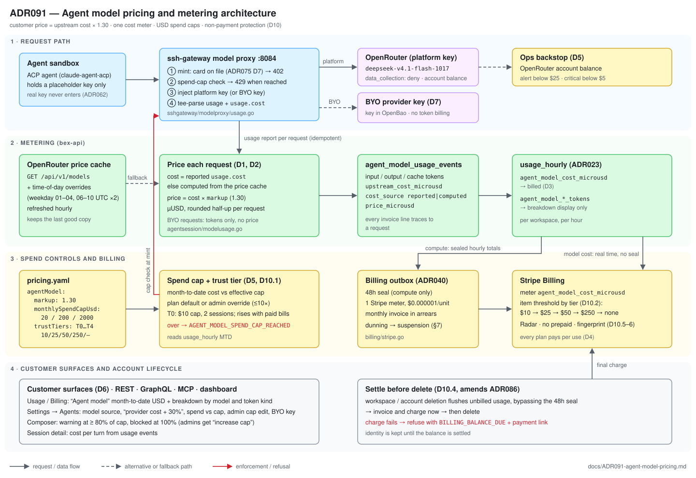

# ADR091 — Agent model pricing: provider cost × 1.3, spend caps, and non-payment protection

**Status:** Accepted, 2026-10-30; D8a added 2026-11-14 (Muse Code on Meta's API, ADR108); D10 amended 2026-10-31 (risk analysis, failed-charge stop, card checks, terms, prepaid trigger) and 2026-11-02 (trust tiers drive the charge threshold, cap and concurrency; real-time cost meter with Stripe item thresholds); D3 amended 2026-11-05 (the cost meter exports its hourly row right after the hour, not per request); D5, D8, D9 and D10.5/D10.7 amended 2026-11-12 (the OpenRouter account balance is the global cap, terms published at `/legal/agent-models`, Radar rules not a rollout gate); D10 amended 2026-11-13 (reaching a charge threshold charges the card and the workspace keeps working; nothing stops at the threshold unless the charge fails — user decision). Implementation is tracked in `w10/m14`. This ADR defines the pricing and spend controls that [ADR090](ADR090-agent-owned-delivery.md)'s 2026-10-23 platform model route left as follow-ups. It supersedes the per-model token-meter billing mechanism shipped in `952b9e8fa`; the token meters stay for display. It amends [ADR030](ADR030-pricing.md): the "Render price × 0.70" rule does not cover agent model tokens, because Render has no equivalent SKU.

**Source:** user decisions 2026-10-30 (`/plan`):

- the price is about **1.3× the OpenRouter model's raw price**, taken from the **actual per-request cost**;
- **Hobby also pays per use**;
- the user asked how the industry handles customers who run up usage and delete their account before the invoice.

## Context

- **Where it runs today.** Agent sessions run on a bex-owned OpenRouter key through the platform model route, currently only in allowlisted workspaces (ADR090). Widening it to every workspace is `w10/m14` t007, due 2026-11-13 (moved from 2026-11-06 on 2026-11-05).
- **What is metered.** bex already meters `agent_model_{input,output,cache_read,cache_write}_tokens` per request: the gateway tee-parses the provider usage, and bex-api stores idempotent `agent_model_usage_events` (ADR023). Nothing is priced or capped yet.
- **No BYO path.** Customers cannot set their own model key: there is no write path for `ModelKeySecretPath` (`w10/009`). So the platform model is the only way a customer can use agent sessions at all.
- **Time-of-day prices.** OpenRouter prices `deepseek/deepseek-v4.1-flash-1017` by time of day: $0.15/M prompt, $0.60/M completion and $0.003/M cache read. Prices double on weekdays 01:00–04:00 and 06:00–10:00 UTC. A fixed per-token price either loses money at peak or overcharges off-peak.
- **Card on file.** Every workspace, Hobby included, already needs a bound card before any usage: [ADR075](ADR075-user-onboarding.md) D7, `BEX_REQUIRE_PAYMENT_METHOD=all`, live.
- **Billing in arrears.** Metered usage is invoiced monthly in arrears through Stripe Billing ([ADR040](ADR040-billing-metronome.md)). Usage reaches Stripe only after a 48h seal horizon. [ADR086](ADR086-account-deletion.md) account deletion keeps Stripe records, but nothing settles unbilled usage before the account disappears.

## Decision

### D1 — Price formula

The customer price of each platform-route request is **upstream cost (USD) × `markup`**, with `markup = 1.30`. It is a single value in `pricing.yaml` (`agentModel.markup`) that applies to every platform-route model. There are no per-model price rows.

Gross margin is 30% on every request. That holds automatically across time-of-day prices, model changes and OpenRouter price changes, with no catalog to maintain.

### D2 — Cost source

1. **Reported cost (primary).** OpenRouter's own per-request cost. The gateway model proxy already tee-parses usage (`sshgateway/modelproxy/usage.go`); it also reads `usage.cost`, and asks for usage accounting in the request if the Anthropic-format `/api/v1/messages` endpoint needs it. The first implementation task confirms this with one live probe.
2. **Computed cost (fallback).** When no cost is reported, bex-api computes it from the OpenRouter `/api/v1/models` price table. It applies the `overrides` (UTC day/hour windows) in effect when the request started. The table is refreshed hourly, and the last good copy is kept.
3. **Recording.** Each usage event records the raw cost, its source (`reported` | `computed`) and the resulting customer price, so an invoice line can be traced back to a request.

### D3 — Metering unit

- **New meter.** One new meter, `agent_model_cost_microusd`, carries the customer price per request in micro-USD, rounded half-up per request and summed in `usage_hourly`.
- **Stripe.** It maps to **one model-agnostic Stripe meter** priced at $0.000001 per unit through the ADR040 outbox. `scripts/stripe-billing-setup.py` creates that one meter and price.
- **Near real time, no seal (2026-11-02, amended 2026-11-05).** The 48h seal exists because `usage_hourly` rows can still change during rollup catch-up. The cost meter's hourly row cannot: it is written only at record time, while its hour is open, and the rollup never rewrites it. So this meter skips the seal: the billing outbox exports a cost row 5 to 10 minutes after its hour closes (sealed at `window_start` + 65 minutes, exported by a pass that runs every 5 minutes) instead of after 48h. It keeps the outbox's existing deterministic row identifier, so a resend is deduplicated within Stripe's 24h window. This is what lets D10 charge at a threshold within about an hour rather than days.
- **Superseded.** The per-model token Stripe meters from `952b9e8fa` are no longer used for billing. The token meters remain the usage breakdown by model and token kind.

### D4 — Who pays

- **Every plan.** Hobby, Pro and Scale all pay per use, with no included allowance (user decision).
- **Admission.** The ADR075 D7 card requirement already gates every workspace. Agent-session admission keeps its synchronous 402 `PAYMENT_REQUIRED`.
- **BYO workspaces.** A workspace using its own model key (D7) is never billed for tokens; it pays only for sandbox compute.

### D5 — Spend caps

These replace the token quota mechanism, which shipped disabled in `952b9e8fa`.

- **The cap.** Each workspace has a monthly spend cap in USD. Plan defaults live in `pricing.yaml` (`agentModel.monthlySpendCapUsd[]`): **Hobby $20, Pro $200, Scale $2,000** as initial values.
- **Admin control.** Workspace admins can lower or raise the cap in Settings → Agents, up to 10× the plan default.
- **Enforcement.** The model mint compares month-to-date `agent_model_cost_microusd` with the effective cap (the D10.1 trust tier can lower it). Over the cap, it refuses with the typed code `AGENT_MODEL_SPEND_CAP_REACHED`. This reuses the shipped refusal path: HTTP 429 at the mint, an Anthropic-shaped 429 to the agent, and a readable session failure with `failureReasonCode`.
- **Overshoot bound.** A request is priced after it completes. So the cap can be exceeded by at most the requests already in flight, one per session.
- **Global backstop (amended 2026-11-12, user decision).** The platform OpenRouter key has no credit limit of its own: the OpenRouter account balance is the cap ("所有的额度都是它的"), and at $0 OpenRouter refuses every platform-model request. bex-api reads the account's `total_credits` and `total_usage` from `GET /api/v1/credits` every 10 minutes with the platform key (never logged) and exports `bex_agent_platform_model_credit_balance_usd` (credits − usage) and `bex_agent_platform_model_credit_last_success_timestamp_seconds`, both only after the first successful read (never a fake 0), plus `bex_agent_platform_model_credit_monitor_configured` from start. `PlatformModelCreditLow` (warning) fires when the balance stays below $25 for 10 minutes and `PlatformModelCreditCritical` (critical, inhibits the warning) below $5; both say to top up the OpenRouter account. `PlatformModelCreditStale` (warning) fires when the newest successful read is over 30 minutes old, or the monitor is configured and has never read the balance, for 10 minutes. This replaces the 80%-of-key-limit alert, which could never fire on a key with `limit: null`.
- **Implementation.** Caps are held in micro-USD, the meter's unit; an override above the plan's 10× bound (left by a plan downgrade) is clamped to it. The mint reads the workspace's spend position in one query and caches it per workspace for 20 seconds, which adds at most 20 seconds of spend to the overshoot bound. The override is `agentModelMonthlySpendCapUsd` on the workspace agent environment (REST `PATCH /v1/agent-environment`, GraphQL `updateAgentEnvironment`, MCP `update_agent_environment`; admin-only; above 10× refused with `AGENT_ENVIRONMENT_SPEND_CAP_INVALID`; null or `resetAgentModelMonthlySpendCap: true` returns to the plan default). Enterprise takes the Scale default. The trust tier's session limit counts the workspace's live platform-route sessions and refuses with 409 `AGENT_SESSION_TRUST_LIMIT`; a create takes the count and the insert under one per-workspace lock. The refusal and the spend-cap failure reason name the cause: the new-workspace limit, a failed or disputed payment ("settle the outstanding payment"), or the monthly cap. bex-api reads the key's limit and usage from OpenRouter's `GET /api/v1/key` every 10 minutes (`bex_agent_platform_model_credit_{limit,usage}_usd`); the alert is `PlatformModelCreditHigh`.

### D6 — What the customer sees

- **Usage and Billing.**
  - An "Agent model" line with month-to-date USD.
  - An expandable breakdown by model and token kind (input, output, cache).
  - REST, GraphQL and MCP usage reads expose the same data.
- **Settings → Agents.**
  - The model source: bex-provided, or your own key (D7).
  - The statement "billed at the model provider's cost + 30%".
  - Month-to-date spend against the cap, editable by admins.
- **Composer.**
  - At 80% of the cap, a warning banner.
  - At 100%, the session is blocked with the typed error, and admins see an "increase cap" action.
- **Session detail.** The cost of each turn, from the usage events.
- **Implementation (2026-11-05, w10/m14 t013).**
  - _Usage reads._ REST `GET /v1/usage`, GraphQL `usage` and MCP `get_usage` carry `agentModel { monthToDateUsd, models[] { model, costUsd, inputTokens, outputTokens, cacheReadTokens, cacheWriteTokens } }`, priced from the usage estimate's agent-session cost meter lines (one per model, each the sum of the requests' prices rounded once to the cent by `pricing.FormatUSD`; models highest cost first), so the line always equals the estimate and the sum of the requests' prices to the cent per model. The Billing page shows it as the "Agent model" card with a collapsed per-model breakdown.
  - _Session cost._ REST `GET /v1/agent-sessions/{id}/model-cost`, GraphQL `agentSessionModelCost(id)` and MCP `get_agent_session_model_cost` (session read access) return the session's `modelSource` (`platform`/`byo`, from the session's stored model endpoint; billed requests always read `platform`), `costUsd` (a cents string in the usage read's format), `requests` and `turns[]`. A request belongs to the turn that was the session's latest when the request **started** (the gateway's `StartedAt`, persisted as `started_at` and clamped like the pricing path; `recorded_at` for older rows), since turns run one at a time and a streamed request is reported after it ends, possibly after the next turn began. Turn 0 holds requests started before the first turn. The session header shows the total with a per-turn popover and re-reads it when a turn starts or the session finishes (no polling); a BYO session reads "Billed by your provider".
  - _Retention._ `CompactUsage` no longer deletes `agent_model_usage_events` with the hourly rows; it deletes them 13 months past the compaction boundary (ADR023 § Retention).
  - _Settings and composer._ The agent environment read adds `trustTierLocked`, `agentModelSpendCapTierLimited` and `billingBalanceDue`. Settings → Agents shows spend against the effective cap, the pricing statement, the trust tier with its next charge point (and the T0 or payment-hold explanation) and the admin cap field with Reset; non-admins see it disabled. The composer of a platform-route workspace warns at 80%, blocks at 100% (admins get "Increase cap" only when the workspace's own cap binds and is still below the maximum an admin may set; otherwise the copy says the cap is at its maximum, without an action) and blocks with a Billing link while a balance is due; `AGENT_SESSION_TRUST_LIMIT` reads as a sentence naming the cause. The trust tier is shown in Settings → Agents, not on the Billing page. Since 2026-11-13 (w6/m362 t007) the read also carries `agentModelSpendCapReached`, the mint's own verdict. It is false while the next request would charge the card at the tier's threshold (D10.2a). The composer blocks on that verdict instead of on month-to-date ≥ cap. It also carries `agentModelChargesAtThreshold`: reaching the next threshold charges the card. It is false where bex cannot charge, on the workspace's own key, or under a hold. When the cap is a T0 charge point bex can charge, the composer's 80% warning says the card is charged there and sessions keep running.

### D7 — Model source and BYO key

This absorbs `w10/009`.

- **Precedence.** A workspace with a BYO key uses it, and bex bills only sandbox compute. Otherwise it uses the platform model, billed per D1.
- **Write path.** A write-only BYO key mutation on REST, GraphQL and MCP, admin-only, stores the key at `ModelKeySecretPath`. The key is never readable back; reads only report whether one is set. Settings → Agents gets the field.
- **Composer copy.** The copy that sends users to a non-existent settings field is fixed.
- **Implementation (2026-11-05, w10/m14 t012).** The write path is the agent environment update (REST `PATCH /v1/agent-environment`, GraphQL `updateAgentEnvironment`, MCP `update_agent_environment`; admin-only): `modelApiKey` sets or rotates the key (trimmed; non-empty, at most 4 KB, no spaces or control characters, else `AGENT_ENVIRONMENT_MODEL_KEY_INVALID`, which never echoes it), and `clearModelApiKey: true` removes it. Reads expose only `modelKeySet` and `modelSource` (`byo`, `platform` or `none`; GraphQL enum `AgentModelSource`). The audit row carries the target `model-key`, never the value. The OpenBao write and `agent_environments.model_key_set_at` happen in one transaction that holds the environment row lock, so concurrent admin writes serialize and the flag commits only after OpenBao succeeded. If the flag write fails after a first-time set, the new key is deleted. A failed rotation cannot restore the old key, so the new key stays active and the update returns an error. Every route decision reads that flag, not OpenBao: create, dispatch, the default-model pin, Capabilities readiness, the trust-tier session count, and the per-request mint. The mint reads the flag together with the spend position, in the same 20-second cache, and only for a workspace the platform route covers. A key write drops that replica's cache entry; other replicas follow within 20 seconds. A BYO workspace's claude sessions therefore go to the provider's release endpoint with no pinned model. The gateway then neither meters nor spend-caps them, and they do not count toward the T0 concurrency limit. On the next steer, a session created on the platform route swaps the pinned OpenRouter model for the workspace default model, or the agent profile default if none is set. Clearing the key swaps it back. A key put into OpenBao by hand before this change gets its flag from a one-shot reconcile at bex-api startup.

### D8 — Data and terms

- **Routing policy.** Platform-route requests keep OpenRouter provider routing `data_collection: "deny"` (shipped in `952b9e8fa`; see ADR090), and a client cannot override it.
- **Disclosure.** Prompts and code are sent to third-party model providers through OpenRouter, under a routing policy that excludes providers that store or train on them.
- **Terms published (2026-11-12).** The user delegated the wording to the agent. The public page **Agent model usage terms** (`/legal/agent-models`, en + zh, readable without signing in, effective 2026-11-12) states the scope (bex-provided model, not a BYO key), the data routing above, the price (provider cost + 30%, metered per request), the D5 caps and T0 limits, the D10 threshold-charge and failed-charge terms, settle-before-delete and charging after deletion, the D10.5/D10.6 card refusals, 13-month usage records as dispute evidence, and that the effective date marks the current version. Settings → Agents (spend section) and Billing → Agent model link it as "Terms". It is bex-native: Render has no agent model, so there is no render.com counterpart page ([ADR018](ADR018-render-parity.md#bex-ahead-of-render)).

### D8a — Muse Code on Meta's API (amended 2026-11-14, w7/m391)

User decisions 2026-11-13: the `muse` profile ([ADR108](ADR108-muse-code-agent.md)) uses Meta's official API, not OpenRouter, and only `muse-spark-1.3-contributor`. That changes three rules above for that one route:

- **D1/D2, cost source.** Meta reports no per-request cost and OpenRouter's table does not price Meta's own API, so the upstream cost is computed from a list price in `pricing.yaml` (`agentModel.upstreamPrices`): $0.10 input, $0.002 cached input and $0.20 output per million tokens ([Meta's pricing page](https://dev.meta.ai/docs/pricing-rate-limits), 2026-11-13). The customer price is still that cost × `markup`, recorded with source `computed`. This is the one exception to "no per-model price rows"; a Meta price change is a reviewed edit to that row.
- **D5, global backstop.** Meta bills the bex account in arrears against a card, so there is no account balance to act as the backstop. The per-workspace caps, charge thresholds and session ceilings apply to Muse exactly as to the OpenRouter route. A platform-wide cap on live Muse sessions (`BEX_AGENT_META_ROUTE_MAX_SESSIONS`, default 8) keeps the one key inside Meta's 150 requests per minute and bounds the spend in flight.
- **D8, data.** The contributor tier is priced in exchange for Meta's permission to train on what it receives: "the prompts, code, files, and context you send, plus the model responses". Muse sessions are therefore the stated exception to the routing policy above. The terms page says so (effective 2026-11-14), and Muse stays off in a workspace until an admin turns it on and acknowledges the data use (w7/m392).

### D9 — Rollout

1. Implement D1–D7 and D10.
2. Create the Stripe meter on test Stripe, then live Stripe.
3. ~~Set the OpenRouter credit limit.~~ Dropped 2026-11-12 (user decision): the account balance is the cap, watched by `PlatformModelCreditLow`/`PlatformModelCreditCritical` (D5). Top up the account before widening.
4. Widen `BEX_AGENT_PLATFORM_MODEL_WORKSPACES` to every workspace (`w10/m14` t007), by 2026-11-13 (moved from 2026-11-06 on 2026-11-05 so all of D1–D7 and D10 ship first).

### D10 — Non-payment and delete-before-invoice protection

**The risk.** Usage is invoiced monthly in arrears and reaches Stripe only after the 48h seal. Account deletion does not settle unbilled usage. So a workspace can burn model spend and delete itself before the period invoice.

**What actually loses money (amended 2026-10-31).** Deleting an account does not cancel a debt. ADR086 keeps the Stripe customer and its payment method, so bex can still charge off-session after deletion, as AWS and GCP do when they bill a closed account's final usage. Money is lost when the charge cannot be collected:

- a one-time virtual or prepaid card that is exhausted or cancelled;
- a stolen card, later disputed (the chargeback also costs a dispute fee);
- insufficient funds, with an owner who never answers dunning;
- many throwaway accounts that each use up a new-account allowance.

Agent model spend needs tighter control than compute. Compute runs on bex-owned Hetzner capacity, so unpaid use is mostly opportunity cost. Model tokens are cash paid to OpenRouter on every request, and one unattended session can spend tens of dollars overnight.

**How the industry handles it** (strongest first):

| Practice | Examples | Exposure | Cost |
| --- | --- | --- | --- |
| Prepaid credits | OpenAI, Anthropic and OpenRouter APIs: usage draws down a balance and stops at zero | ≈ 0 | Most friction; needs a balance ledger and auto top-up |
| Deposit or authorization hold | VPS hosts take a small prepayment or hold from new accounts; DigitalOcean lets a prepayment jump trust tiers | The deposit | Lower sign-up conversion |
| Threshold billing | Stripe `billing_thresholds`; Vercel Pro partial invoices at an unpublished internal threshold or on anomalous usage, with deployments paused after several unpaid ones | One threshold | Several small charges per month |
| Trust tiers | DigitalOcean: mid-month auto-charge at $25 for an account with no payment history, rising through $50 / $250 / $1,000 / $4,000 as successful non-zero invoices accrue, and a failed auto-charge can suspend the account at once. OpenAI (prepaid): monthly limits of $500 / $5,000 / $200,000 after $5 / $100 / $500 of cumulative credit purchases. Stripe's threshold guide suggests a temporary threshold for new customers | The low tier's limit | Good customers start limited |
| Hard spend caps | GitHub Actions spending limits, cloud budget caps | The cap | Needs a good "cap reached" experience |
| Settle on close | AWS bills final usage on a closed account; Heroku and Vercel invoice at deletion | Zero at deletion | Deletion can be held up |
| Card and identity checks | 3DS, a $1 authorization, Stripe Radar, refusing prepaid/virtual cards, card-fingerprint dedupe, phone or disposable-email checks, KYC at the extreme (Hetzner sometimes asks for ID) | Fewer bad actors | False positives |
| Dunning, suspension, collections | Every provider | After the fact | Low recovery rate |

Mature platforms combine several. API products, where every request has a real cash cost, almost all use prepaid credits. Cloud platforms, whose cost is mostly owned infrastructure, use post-paid billing with trust tiers and thresholds. bex has both kinds of cost: compute is the second kind, and agent model tokens are closer to the first.

**bex's decision** (the amounts are initial values in `pricing.yaml`):

1. **Trust tiers (amended 2026-11-02).** One tier per workspace sets three limits together: the agent-model charge threshold, a ceiling on the spend cap, and concurrent platform-model sessions. This is DigitalOcean's auto-charge ladder combined with OpenAI's tiered limits.

   | Tier | Reached when (successful payments only) | Charge threshold | Spend cap | Concurrent sessions |
   | --- | --- | --- | --- | --- |
   | T0 new | no successful payment yet | $10 | $10, lifted at once when the charge at $10 succeeds (D10.2a) | 2 |
   | T1 | lifetime paid ≥ $10 | $25 | plan (D5) | plan |
   | T2 | lifetime paid ≥ $100 and ≥ 1 paid cycle invoice | $50 | plan | plan |
   | T3 | lifetime paid ≥ $500 and ≥ 3 paid cycle invoices | $250 | plan | plan |
   | T4 | lifetime paid ≥ $2,000 and ≥ 6 paid cycle invoices | none (month-end only) | plan | plan |

   - **What counts.** Lifetime paid is the sum of `amount_paid` over every paid, non-zero bex invoice for the workspace, compute included, so a customer who has paid compute bills is trusted for model spend. Credits and unpaid usage do not count.
   - **Only failure lowers a tier.** A failed charge or a dispute drops the workspace to T0. Nothing else lowers a tier.
     - _A failed invoice payment_ (`invoice.payment_failed`) holds T0 until **that invoice** is paid, then for 30 days after its `paid_at`. Paying a different invoice never lifts the hold, a payment older than the failure never lifts it, and a failure event for an invoice already recorded as paid is ignored (late redelivery).
     - _A dispute_ (`charge.dispute.created`) holds T0 on its own, independently of payments, until `charge.dispute.closed` arrives for that dispute with status `won`. A lost (or otherwise closed) dispute keeps the hold; ops lifts it by hand once the account is settled (the statement is in migration 0194).
     - Amended 2026-11-05 (review of the first implementation): the earlier "30 days after the balance is settled" read as "after any later payment", which let an unrelated or out-of-order payment lift the hold.
   - **The effective cap** is min(plan default or admin override, tier cap). Since 2026-11-13 T0's cap is its $10 threshold, and the charge bex makes at that moment lifts the workspace to T1, which has no cap of its own (D10.2a). On Hobby the plan cap ($20) is below the T1 threshold, so after T0 a Hobby workspace's exposure is bounded by its cap and it is charged at month end.
   - **State.** A durable `billing_trust` record (lifetime paid, paid cycle invoices, lock-until with the failed invoice, the open dispute) is updated from the `invoice.paid`, `invoice.payment_failed`, `charge.dispute.created` and `charge.dispute.closed` webhooks. The tier is a pure function of those counters and the `pricing.yaml` table. `stripe_billing_events` cannot serve, because it stores no amounts and is purged after 90 days.
   - **Visible.** Settings → Billing shows the current tier, the next charge point and what reaches the next tier. The fee cost of small charges falls only on T0: Stripe's per-charge fee is about 6% of a $10 charge, 4% of $25 and 3.5% of $50.
   - **Prepay to jump a tier** (DigitalOcean's model) comes later, with [ADR071](ADR071-tenant-billing-credits.md) credit grants.

2. **Threshold billing mechanism.** Stripe charges the threshold, not bex.

   - The subscription's agent-model item carries `billing_thresholds.usage_gte` set to the tier threshold in meter units ($10 = 10,000,000 µUSD). An item-level threshold means only model spend triggers it, never compute.
   - bex updates the value whenever the tier changes, and removes it at T4.
   - With the near-real-time meter (D3), Stripe invoices and charges the card within about an hour of the crossing. The end-of-cycle invoice then carries only the remainder, so nothing is billed twice.
   - The bex spend cap (D5), checked at every mint, covers the time between the crossing and Stripe's charge.
   - **Verified 2026-11-05 (t014 probe, test mode, pinned `2026-08-26.dahlia`).** `usage_gte` works on a meter-backed item, both at item creation and on update, and an empty `billing_thresholds` removes it. 15 to 28 minutes after the meter crossed $10, Stripe created one `subscription_threshold` invoice for exactly the metered usage up to that point. Like a cycle invoice, it is a draft that auto-finalized and charged the default card one hour after creation. The next-cycle preview billed only the usage after the threshold invoice. A replayed meter-event identifier was rejected, so nothing is billed twice. Left alone, the crossing would be charged about 2.5 hours after the spend: up to ~65 minutes of D3 export, 15 to 28 minutes of Stripe evaluation, and an hour of draft. bex-api removes the hour of draft: on `invoice.created` it finalizes a draft `subscription_threshold` invoice with `auto_advance`, so Stripe collects it at once. The D5 cap, checked at every mint, covers the rest of that window. Fallback not needed.
   - **Fallback.** If it does not work, bex issues the threshold invoice itself (`InvoiceItems` + `Invoices.New` + pay, idempotency key `bex-threshold-{workspace}-{seq}`) and stops reporting that already-invoiced amount to the meter. 2a. **Charge to continue (amended 2026-11-13, user decision).** Reaching a charge threshold charges the card, and the workspace keeps working. A successful charge is a payment: it raises lifetime paid at once, so the workspace climbs the ladder (T0 → T1 → …) and the next, higher threshold applies. Nothing is refused at a threshold unless its charge fails.
   - **Why.** Until now T0's spend cap equalled its charge threshold ($10), and Stripe's threshold invoice is created 15 to 28 minutes after the crossing and charged an hour after that. Every new workspace was therefore stopped for one to one and a half hours at its first $10, with the charge that would have lifted the stop still pending. On 2026-11-13 the bex workspace showed it worse: its threshold was never set on Stripe, so no charge came at all, and its routines failed with `AGENT_MODEL_SPEND_CAP_REACHED` until the month's reset.
   - **Mechanism (user decision, 2026-11-13: "执行到 [上限] 然后扣钱，扣成功了就不阻断，否则打断").** bex charges the card in the request that reaches the threshold, and that request waits for the result. The mint begins a charge in `agent_model_threshold_charges` (one pending row per workspace, so concurrent requests on every replica join one charge), creates a standalone `charge_automatically` invoice on the customer for the unbilled agent-model amount (never on the subscription, so the billing anchor, proration and hosting dunning are untouched), finalizes it and pays it off-session, with idempotency keys `bex-threshold-{workspace}-{month}-{seq}-{step}`. The first implementation (an interim of the same day) reused Stripe's item threshold, whose invoice comes an hourly meter export plus 15 to 28 minutes after the crossing, behind a $5 allowance; a slow invoice could still stop a workspace whose card was fine, which this rule excludes. Stripe item thresholds are retired.
   - **No in-flight allowance.** T0's cap is its $10 threshold again: the charge at $10 lifts the workspace to T1 at once. Without a configured charger (billing off), or for a workspace bex does not charge (excluded, comped, or without a subscription), a T0 workspace stops at $10 as before.
   - **Netting with hosting's monthly invoice.** A paid charge adds a negative pending invoice item for the same amount on the workspace's subscription, so the next cycle invoice bills only agent-model usage not already charged. It issues no value and is not the ADR071 credit system. A declined charge is not netted: its usage stays on the meter, so the next subscription invoice that bills the meter (a cycle invoice, or a deletion's settle invoice) bills it. bex then voids that charge's open invoice (w6/125, 2026-11-13). Trust does it on that invoice's `invoice.created` and `invoice.paid`, and the settle step does it before the workspace is deleted. The voided invoice closes the charge's balance due, and a failed subscription invoice raises its own. Open: Stripe refuses negative items on invoices with automatic tax, which production does not enable today (no tax code is configured).
   - **The charge window (2026-11-13, w6/m362 t016; amended t017).** A charge collects only agent-model spend that no subscription invoice has billed. The window opens at `billing_provider_mappings.agent_model_billed_until`, even when that is in the previous month, and at the calendar month's start before any invoice has billed the meter. It never opens before the previous month's start, the oldest hours compaction keeps for certain. That column holds the latest `period_end` of a bex subscription invoice that billed the meter: a `subscription_cycle`, `subscription_threshold` or `subscription_update` invoice, never a charge invoice. Before any such invoice, the charger records the Subscription's start. It moves only forward. Until t017 the window also reset at the calendar month's start. It no longer does, so one window matches the usage one invoice bills, and the credits that invoice applies are counted once.
     - **Where the boundary comes from.** It is set from `invoice.created` and `invoice.paid`. The charger also reads the Subscription's latest invoices before every charge. When that read moves the boundary, the request charges nothing and re-reads its window. So a late webhook cannot make a charge collect usage again.
     - **What counts as unbilled.** Unbilled is the spend in the hours that start inside the window, minus the billing credits that will pay it and the paid charges made inside it. A charge made before the boundary was netted out of that invoice.
     - **Billing credits pay first (2026-11-13, user decision: "应该先扣 credits 如果credits 不够了才扣钱"; w6/m362 t017).** The charge is a standalone invoice, and Stripe applies Billing Credit Grants only to a subscription's metered lines, never to a one-off invoice. Without this rule a workspace holding credits was charged on its card at each threshold. The cycle invoice then still spent its credits on the metered usage, so the net item pushed that invoice below zero and the card's money waited as customer balance. Now the charger reads the available metered credit balance before it charges, in the same Stripe read as the boundary. That is the credit balance summary scoped to metered prices, ADR071's grant scope. Credits a draft invoice already holds are not available. The read leaves out grants that expire by the Subscription's current period end, because an invoice applies a grant only when its period ends before the grant expires. The balance is recorded in `billing_provider_mappings.agent_model_credit_microusd` and `agent_model_credit_read_at` (migration 0253). The spend read takes it off the unbilled spend while the read is inside the window. Moving the boundary clears it, since that invoice consumed credits.
       - **When the balance changes.** If the charger reads a balance other than the one the request's spend read counted, it charges nothing and the request re-reads. A workspace whose credits cover the spend keeps working and is not charged. Past them, the card pays only what the credits leave, at the tier's threshold.
       - **A failed credit read.** For example, a restricted key without the billing-credit permission. The recorded balance stands and the charge goes ahead.
       - **Credits cover all metered usage, compute included.** They are all counted against agent-model spend here. That never bills an invoice below zero: if the credits do not cover the compute, the card pays the rest on the cycle invoice.
       - **Not ADR071's issuance system.** bex only reads grants that a Stripe admin issued (`.pm/DO_NOT_DO.md`).
     - **The T0 ceiling.** It bounds the same unbilled amount, so a cycle invoice that billed part of the month never makes a T0 workspace stop at $10 without a charge. The workspace's own monthly cap still counts the calendar month.
     - **Why.** With a month-keyed window, a billing anchor that is not the 1st let the next charge in the same month collect the usage between the last charge and the cycle invoice a second time. Its net item then returned that amount only as customer balance on the following invoice. On 2026-11-13 the bex workspace showed it: a `subscription_threshold` invoice from the retired item threshold billed its meter at 08:39. At 09:50 bex charged the card $10.50 for the same usage. The −$10.29 that leaves on the 2026-11-16 cycle invoice becomes customer balance.
   - **Outcomes.** A successful charge is recorded at once (the `invoice.paid` webhook stays the idempotent source of truth), and the mint re-reads the workspace's status, now one tier higher. A charge Stripe leaves undecided stays pending, refuses this request, and is retried by a sweep. A failed charge is D10.3 unchanged: model spend stops at once with `BILLING_BALANCE_DUE`, and the workspace holds T0. A charge that needs the customer's authentication (3-D Secure, Stripe `authentication_required`) stops the same way, and Settings → Billing and an email give the hosted payment link.
   - **Exposure is unchanged.** A workspace that cannot pay stops at its first failed charge: at most the T0 threshold plus the requests in flight, about $10 to $15 of customer price.
   - **What still caps spend.** The workspace's own monthly cap (D5: the plan default, or an admin override up to `maxCapMultiplier` × it) stays a hard limit at every tier. Charging to continue never lets a workspace spend past the cap it chose.
   - **Found with it (2026-11-13), owed before D9.4 widens the platform model.** (1) The threshold sweep syncs only workspaces whose trust record changed, so a workspace that never paid has no record and its subscription never received a threshold. (2) `billing_trust` (migration 0194, 2026-11-05) was never backfilled from the invoices paid before it, so workspaces that had paid still read T0. Production had no `billing_trust` row on 2026-11-13, with 31 `invoice.paid` events recorded since 2026-09-16.

3. **Failed threshold charge stops model spend at once.** When a threshold charge fails, the mint refuses new platform-model requests for that workspace (`BILLING_BALANCE_DUE`) until a charge succeeds, and the workspace drops to T0. The ADR040 §7 grace period still applies to compute, but not to model spend, which is cash out. The refusal holds while any of the workspace's failed invoices is open, or while any of its invoices is written off and still unpaid. A failed invoice is closed only by its own payment, or by voiding it. An invoice marked uncollectible stays open, because it is still owed. So when two charges fail, paying the newer one does not lift the refusal. The T0 lock still follows the newest failure (D10.1). The mint's 20-second spend cache can delay the refusal, and its lift, by up to that TTL.
4. **Settle before delete.** Workspace and account deletion (ADR086) first flushes all unbilled usage for that workspace, bypassing the seal horizon, then invoices and charges it. If the charge fails, deletion is refused with typed code `BILLING_BALANCE_DUE` and a payment link, and the identity is kept until the balance is settled.
   - **Implementation (2026-11-05, w10/m14 t015).** `billing.Settler` runs first in the workspace teardown, before membership revocation and every purger, and in `DELETE /v1/users` / `deleteAccount` for each `delete` workspace before the intent commits. With no live contract (no Customer, a Customer retired with `bex_deleted_at`, or no live Subscription) it is a no-op, and the Stripe purger runs last, so a retry after partial teardown settles nothing. Otherwise it exports the workspace's pending rows (every closed hour, plus the open hour of the cost meter; floor, held meters and withholding unchanged). An existing open or uncollectible invoice of the contract is paid as it is. Without one, bex waits (with backoff, up to 20 s in an API request and never past its deadline, up to 150 s in the account-deletion worker; amended 2026-11-12 after a Stripe test-mode probe measured 55–62 s of summary lag) until Stripe's per-Customer meter event summaries cover what it exported for the period, refusing with the retryable 503 `BILLING_SETTLING` and leaving the Subscription untouched if they do not; previews the upcoming invoice; and only when it is above zero resets the billing cycle anchor to now with `proration_behavior=always_invoice` and `payment_behavior=default_incomplete`, so Stripe invoices the shortened period without attempting payment. bex pays each invoice exactly once, off-session. A decline returns 409 `BILLING_BALANCE_DUE` with `hostedInvoiceUrl`, `amountDueCents`, `currency`, `invoiceId` and `workspaceId`. The workspace is untouched and its Subscription live, and the open invoice keeps the D10.3 refusal. A declined settle moves the customer's billing date (one reset per attempt with an amount due); retries pay the open invoice instead of resetting again. The dashboard's workspace and account deletion flows retry `BILLING_SETTLING` every 15 s for up to 3 minutes, showing "Finalizing final usage…". The anchor reset leaves the Subscription `past_due` until bex pays; the settle first stamps `billing_lifecycles.settling_until` (10 minutes), and a `subscription_past_due` observed before it opens no grace period, while `invoice.payment_failed` still does. In the account-deletion worker a refusal stores only the code and emails the hosted invoice link to the account once. Residuals: usage the rollup has not yet written (up to about two hours of compute, a sandbox's open hour) is not settled and falls to the purger's asynchronous `invoice_now` invoice. Details in [ADR086 § Settle before delete](ADR086-account-deletion.md#settle-before-delete).
5. **Card checks at binding.** Stripe Radar rules are on for payment-method binding, and prepaid cards (Stripe `card.funding = prepaid`) are refused. Virtual cards are not refused yet; revisit with abuse data.
   - **Implementation (2026-11-05, t015).** The card is read where it becomes the workspace's card: `checkout.session.completed` and workspace-creation finalize. A prepaid card is detached from the Customer, `payment_method_bound_at` is not stamped, and `billing_provider_mappings.payment_method_rejection` records `prepaid_card`. Billing readiness exposes it as `paymentMethodRejection` (REST/MCP `prepaid_card`/`unpaid_balance`; GraphQL enum `PaymentMethodRejection`: `PREPAID_CARD`/`UNPAID_BALANCE`), and the dashboard shows "Prepaid cards aren't accepted; add a credit or debit card" on the payment wall and both payment cards. Workspace creation refuses with 400 `PAYMENT_METHOD_REJECTED` (`reason`), shown in the user's language. A redelivered event finds the card detached and is acknowledged. The next successful binding clears the reason. Radar rules are a Stripe Dashboard step ([runbook](runbooks/stripe-billing-setup.md#radar-rules-for-card-binding-adr091-d105)). **Not a rollout gate (user decision 2026-11-12):** the prepaid refusal and the D10.6 fingerprint dedupe are enforced in bex code, and Stripe's default Radar risk blocking already applies to every charge, so custom Radar rules are an optional follow-up. Not covered yet: a card made default in the Stripe Billing Portal is audited but not screened.
6. **Card fingerprint deduplication.** Binding a card whose Stripe fingerprint belongs to a workspace with unpaid, written-off agent-model debt is refused.
   - **Implementation (2026-11-05, t015).** `invoice.marked_uncollectible` stores the fingerprint of the card whose charge of the invoice failed (from the invoice's payments: the PaymentIntent's latest charge, else its last payment error's method; the Customer's default card only when the invoice has no card charge) on its `billing_agent_model_writeoffs` row (nullable, indexed, never logged). At binding, a card whose fingerprint matches any write-off row, in any workspace and including a deleted one, is refused like a prepaid card with reason `unpaid_balance` ("This card is linked to an unpaid balance"). Paying the invoice deletes the row and frees the card.
7. **Terms.** The terms authorize threshold charges, state that thresholds rise with payment history, authorize charging unpaid usage after deletion, and state that usage records are evidence in a dispute. `agent_model_usage_events` traces every charge to a request, which is the dispute evidence. Published 2026-11-12 at `/legal/agent-models` (D8).
8. **Unchanged.** The card requirement for every workspace (ADR075 D7) and dunning with suspension (ADR040 §7).

**Exposure.** An abusive account never leaves T0, so the most it can cost bex is the T0 cap plus the requests in flight when it is reached: about **$10 + 2 sessions × the cost of one request**, on the order of $10–15 of customer price. A trusted workspace that later stops paying can cost at most one threshold of its tier (or its cap, if lower) before the failed charge stops model spend.

**When to switch to prepaid credits.** Move Hobby to prepaid credits (for example a $10 initial top-up, built on [ADR071](ADR071-tenant-billing-credits.md) Stripe Credit Grants) if either holds:

- agent-model bad debt exceeds **2%** of agent-model revenue in a calendar month. Both sides count the month the usage was billed for. Bad debt is the agent-model share of each written-off invoice, after discounts, prorated by the part left unpaid. Revenue is the month's metered `agent_model_cost_microusd`, snapshotted so a deleted workspace still counts. (Amended 2026-11-05, t014 review.)
- a batch of throwaway workspaces is found abusing tier T0.

Pro and Scale stay post-paid with tiered thresholds. Until then, threshold billing is preferred because it keeps sign-up friction at "bind a card", which bex already requires.

## Alternatives considered

| Option | Why not |
| --- | --- |
| Off-peak list price × 1.3, fixed | Loses money at peak, where revenue is 0.65× cost. |
| Peak list price × 1.3, fixed | Off-peak it is 2.6× cost, which is uncompetitive. |
| Per-model token meters with list prices (the `952b9e8fa` mechanism) | Cannot express time-of-day prices, and every model change needs new Stripe meters and a new price table. |
| A free Hobby allowance | The user chose pay-per-use for every plan. |
| Prepaid credits for every plan | The strongest protection against unpaid usage, but it adds the most friction and needs a balance ledger. D10 sets the trigger for moving Hobby to prepaid credits. |

## Consequences

- Invoices are cost-plus and cannot be predicted per token. They are made transparent instead: "provider cost + 30%", with a breakdown by model and token kind.
- Billing depends on OpenRouter cost reporting, with a computed fallback from its price table, and each event records which source was used.
- The rollout needs one new Stripe meter and price on test and live Stripe, plus a funded OpenRouter account (its balance is the global cap, D5).
- New customers see one or two small charges ($10, then $25) before their charges settle at month end; the tier and next charge point are shown in Settings → Billing.
- Account deletion gains a payment step that can refuse deletion while a balance is due. ADR086 is amended accordingly in implementation.
- There is no render.com equivalent, so this is a bex-native surface. [ADR018](ADR018-render-parity.md) records it as such, not as parity drift.
