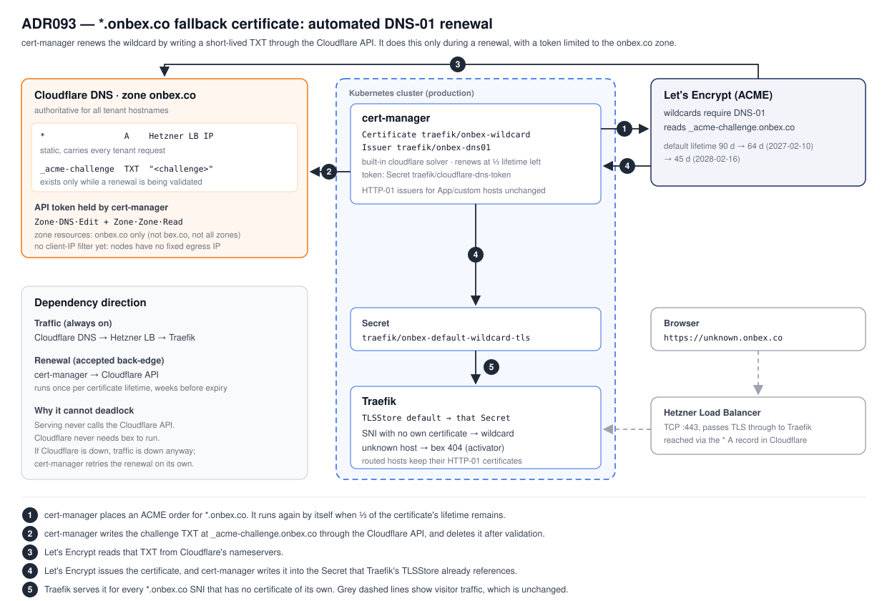

# ADR093 — The `*.onbex.co` fallback certificate renews itself: cert-manager DNS-01 through Cloudflare

**Status:** Accepted, 2026-10-30 (user decision). Implemented 2026-10-31 (w4/441): `deploy/gitops/charts/onbex-default-tls/{issuer,certificate}.yaml`, `scripts/onbex-dns01-token-secret.sh`, the `deploy.yml` token steps and the `scripts/gitops-validate.sh` contract. Triggered by w4/441, where every production deploy failed because the hand-issued certificate entered its 30-day window.

**Related decisions:** [ADR005](ADR005-custom-domain.md) owns per-host certificates (HTTP-01, unchanged here). [ADR019](ADR019-infra-credentials.md) is the credential inventory this ADR adds to and removes from. The fallback itself was built in w2/m85 (`.pm/w2/done/m85`), and D3 amends that milestone's certificate-ownership decision.

## Context

Traefik's default `TLSStore` serves a `*.onbex.co` wildcard for every SNI that has no certificate of its own. An unknown host therefore completes a trusted handshake and gets bex's 404, not `TRAEFIK DEFAULT CERT`. This matches Render: `https://<anything>.onrender.com/` returns 404 under a `DNS:*.onrender.com` certificate (checked 2026-10-31).

Today that wildcard is issued by hand outside bex and handled like a password:

- A person issues a Let's Encrypt certificate with a DNS-01 challenge against the Cloudflare-hosted `onbex.co` zone. A stale `_acme-challenge.onbex.co` TXT from the last issuance is still published.
- They point `BEX_ONBEX_TLS_CERT_FILE` / `BEX_ONBEX_TLS_KEY_FILE` in `.env` at the PEMs, and `scripts/gh-secrets.sh` pushes them to the production environment.
- `deploy.yml` validates them (`scripts/onbex-default-tls-secret.sh --validate-only`), refuses anything with fewer than 30 days left, then installs the Secret `traefik/onbex-default-wildcard-tls`.

Nothing renews the certificate and nothing warns before the deploy guard trips. `CertificateExpiringSoon` only reads cert-manager metrics, and this Secret is not a cert-manager `Certificate`. The first notice was a red deploy (w4/441).

This gets worse on a fixed schedule. Let's Encrypt's default lifetime drops from 90 days to 64 days on 2027-02-10 and to 45 days on 2028-02-16 ([announcement](https://letsencrypt.org/2025/12/02/from-90-to-45)). Under a 30-day guard, a hand-issued certificate would last about 34 days of deploys from 2027 and about 15 from 2028.

Constraints:

1. **Wildcards need DNS-01.** Let's Encrypt issues a wildcard only after a TXT record at `_acme-challenge.onbex.co` proves control of the zone ([challenge types](https://letsencrypt.org/docs/challenge-types/)). The value changes on every order, so something must write it at renewal time.
2. **Cloudflare is the only DNS provider** (user decision 2026-10-30). `onbex.co` stays on Cloudflare, and no other DNS service is introduced, even for a validation-only zone.
3. **Cloudflare API tokens are scoped by zone, not by record.** A token that can write `_acme-challenge.onbex.co` can also edit every other record in `onbex.co`.
4. **The cluster has no fixed egress IP.** Each CAPH node egresses from its own public IPv4, which changes when the node is replaced.

## Decision

### D1 — cert-manager issues and renews the wildcard over DNS-01

A namespaced `Issuer traefik/onbex-dns01` (Let's Encrypt production) has one solver, cert-manager's built-in `cloudflare` DNS-01 solver, with `selector.dnsZones: ["onbex.co"]`. It has its own ACME account key. Being namespaced, only Certificates in `traefik` can spend the token; a ClusterIssuer would offer it to every namespace. No webhook or extra chart is needed. The existing HTTP-01 `letsencrypt-{staging,prod}` issuers and every App and custom-domain certificate are untouched.

One `Certificate` in `traefik`:

- `dnsNames: ["*.onbex.co"]`. The apex keeps its separate Cloudflare-served certificate.
- `secretName: onbex-default-wildcard-tls`, the Secret the `TLSStore` already references, so Traefik needs no change.
- `privateKey.rotationPolicy: Always`.
- `renewBefore` left at cert-manager's default of one third of the lifetime. That is about 30 days today, about 21 days on 64-day certificates and 15 days on 45-day ones, so it follows Let's Encrypt's schedule without further edits.

### D2 — One Cloudflare token, limited to the `onbex.co` zone

- **Permissions:** `Zone → DNS → Edit` and `Zone → Zone → Read`, the two that [cert-manager's Cloudflare guide](https://cert-manager.io/docs/configuration/acme/dns01/cloudflare/) requires.
- **Zone resources:** only `onbex.co` ("Specified Domains"). The guide shows `All zones`, which in this account would grant 11 zones including `bex.co`. Widening the token beyond `onbex.co` needs a new decision.
- **Created 2026-10-31** as the account API token `bex-cert-manager-dns01-onbex` (owned by the Cloudflare account, not a person). Verified the same day: the token is active, lists only `onbex.co` (`bex.co` is invisible to it), and created then deleted a probe TXT `_bex-token-probe.onbex.co`. So the single-zone scope is enough for cert-manager's write/delete.
- **Storage:** `BEX_CLOUDFLARE_DNS_TOKEN` in `.env.example`, `gh-secrets.sh`/`production-secrets.txt` and the `production-deploy` environment. The deploy checks its shape before GitOps write-back and installs it by stdin as `traefik/cloudflare-dns-token` (`scripts/onbex-dns01-token-secret.sh`), following the existing pattern for out-of-band Secrets. Tenant namespaces have no RBAC on `traefik`, and `gitops-validate.sh` fails any reference to the Secret outside this renewal path.
- **No client-IP filter for now.** Cloudflare can restrict a token to source IPs, but constraint 4 means a node roll would lock cert-manager out. The filter becomes worth enabling once there is a fixed egress (see Follow-ups).

The token does not expire, so unlike the certificate it cannot turn main red on a schedule.

### D3 — bex calls Cloudflare, only to renew

Today traffic depends on Cloudflare (DNS sends tenants to the Hetzner LB), and bex never calls Cloudflare. This ADR adds one call in the other direction: cert-manager writes and deletes the challenge TXT through the Cloudflare API once per certificate lifetime. m85's "bex does not call Cloudflare to issue or renew" is amended to this narrower rule: **serving never depends on the Cloudflare API; only certificate renewal may call it.**

This back-edge cannot deadlock or take traffic down:

- Serving does not touch the Cloudflare API, so a Cloudflare API outage leaves running traffic unchanged.
- Cloudflare does not need bex to run.
- If Cloudflare is down, tenant traffic is already down. The renewal fails and cert-manager retries with weeks of slack before expiry, which D5's alerts watch.

### D4 — The deploy stops carrying certificate material

These go away in the same change that lands the production `Certificate`. Otherwise the deploy installer and cert-manager would overwrite each other's Secret.

- The `validate onbex.co fallback TLS certificate` and `install onbex.co fallback TLS certificate` steps in `deploy.yml`, and `scripts/onbex-default-tls-secret.sh` with its test, its `gitops.yml` path filters and any `lib/` helpers nothing else uses.
- `BEX_ONBEX_TLS_CERT` / `BEX_ONBEX_TLS_KEY` from the `gh-secrets.sh` `REQUIRED` list and the secrets table, `BEX_ONBEX_TLS_{CERT,KEY}_FILE` from `.env.example`, and the GitHub environment secrets once the cutover is verified.

The `apply and verify onbex.co fallback TLS store` step stays. It applies the Issuer, Certificate and `TLSStore`, waits up to five minutes for the Certificate and only reports (a warning plus the Certificate, Order and Challenge state) if it is not Ready, then runs `scripts/onbex-default-tls-verify.sh notfound.onbex.co` against the live edge. A deploy then fails only if the served certificate is actually untrusted, not because a renewal is due.

The public probe's validity floor drops from 30 to 14 days (`scripts/lib/onbex-default-tls.sh`), matching `CertificateExpiringSoon`. cert-manager starts renewing at about 30 days left, so a 30-day floor would fire during every normal renewal.

### D5 — If renewal fails, the existing certificate alerts catch it

The `Certificate` emits cert-manager metrics, so `CertificateNotReady` and `CertificateExpiringSoon` (< 14 days, not in the `tea-.*` exclusion) cover it with no rule change. A promtool case in `alerts_test.yml` pins that a stuck `traefik/onbex-wildcard` fires `CertificateExpiringSoon`; `CertificateNotReady` has no namespace exclusion that could skip `traefik`. With renewal starting at one third of the lifetime, the 14-day alert means renewal has been failing for at least a day on 45-day certificates and for over two weeks today.

## Rollout

1. **User:** create the D2 token in Cloudflare and set `BEX_CLOUDFLARE_DNS_TOKEN` in `.env` (done 2026-10-31), then push it to `production-deploy`.
2. **Worker:** in one commit, add the Issuer and Certificate straight against Let's Encrypt production with `secretName: onbex-default-wildcard-tls`, add the token steps and remove the D4 steps and names. No staging pass: cert-manager writes the existing Secret only after a new certificate is issued, so a failed first issuance leaves the edge on the current certificate (which still had 30 days left) and surfaces in the deploy's warning and `CertificateNotReady`. The token's single-zone write/delete was already proven against the live zone (D2).
3. **After the first issuance is verified at the edge:** delete the two old GitHub environment secrets, the old PEM files and the stale `_acme-challenge.onbex.co` TXT.

No manual renewal is needed for w4/441. The commit replaces the deploy's certificate preflight with the token preflight, so deploys unblock as soon as it lands, and the first deploy issues the new certificate.

## Alternatives rejected

- **Keep renewing by hand and add a reminder.** It keeps a person on the deploy path, and the cadence shrinks to about monthly in 2027 and about fortnightly in 2028. That is the w4/441 failure on a schedule.
- **A separate validation zone on Cloudflare,** with `_acme-challenge.onbex.co` CNAMEd to it and the token scoped to that zone only. A leaked token could then not touch `onbex.co`. The user rejected it as not worth the extra domain: anyone able to read cert-manager's Secret already holds the cluster, including the wildcard's private key. The residual it would have closed (editing `onbex.co` from outside the cluster) is recorded under Consequences.
- **Self-hosted authoritative DNS for the challenge (acme-dns), delegated by a static NS record in Cloudflare.** bex would never call Cloudflare, but it would run a public DNS server: UDP 53 on fixed Primary IPs, because the Hetzner LB is TCP-only. The user chose the simpler D3 back-edge instead.
- **Any other DNS provider** (Hetzner Cloud DNS, Route53, Cloud DNS) for a validation zone. This is excluded by constraint 2.
- **On-demand per-host HTTP-01 at handshake time.** Unknown hostnames would spend the shared `onbex.co` rate limit and starve real Apps. The usual guard, an allowlist check before issuing, refuses exactly the unknown hosts the fallback exists for. Traefik and cert-manager also cannot issue during a handshake.
- **Dropping the fallback.** This regresses m85 and Render parity.

## Consequences

- **Residual risk:** a leaked token can edit any `onbex.co` record from anywhere, including the `*` A record that carries all tenant traffic. Mitigations: zone-only scope, storage limited to the protected production environment and one cluster namespace, and Cloudflare's audit log. The token is revocable in seconds without affecting serving.
- One credential is added and two are removed from the ADR019 inventory, and none of the remaining ones expires on a schedule.

## Follow-ups (not required for this decision)

- **Fixed egress, then IP filtering.** Give cert-manager a fixed egress, for example a Cilium Egress Gateway on a Hetzner Primary IP, then turn on the token's client-IP filter so a leaked token is useless outside the cluster.
- **CAA pinning.** A `CAA` record with RFC 8657 `accounturi`/`validationmethods` on `onbex.co` would stop any other ACME account from issuing for the zone. It must also list the CA behind Cloudflare's apex certificate (Google Trust Services) and the HTTP-01 account, so it needs its own design.
- **Edge canary.** Add the fallback's remaining lifetime to the edge canary's TLS report (w1/131) as a second, out-of-cluster signal.
