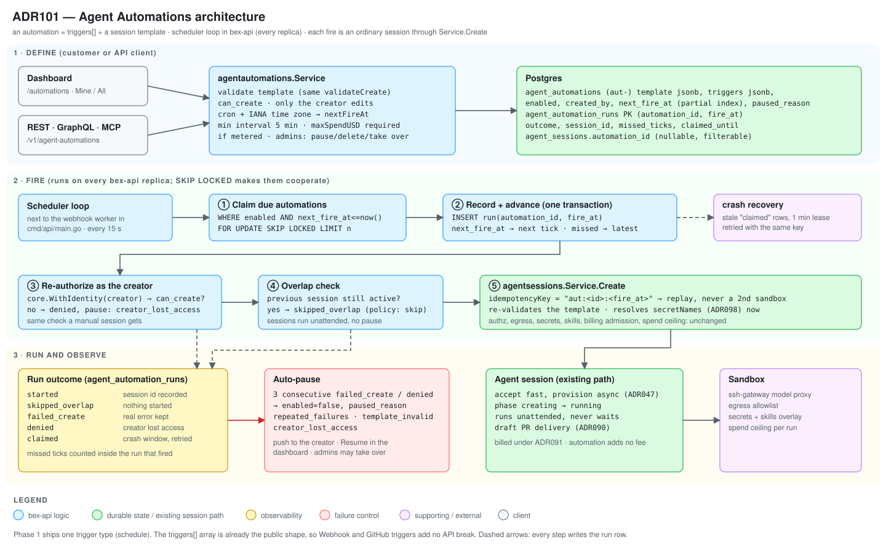

# ADR101 — Agent Automations: scheduled cloud-agent sessions (Devin parity)

**Status:** proposed (design) · **Date:** 2026-11-07 · **Extends:** [ADR047](ADR047-cloud-coding-agent-sessions.md) (sessions), [ADR094](ADR094-coding-agent-mcp.md) D4 (idempotent create), [ADR098](ADR098-agent-session-secrets.md) (secrets), [ADR099](ADR099-agent-skills.md) (skills) · **Parity:** Devin Automations (no Render equivalent; see [Parity](#parity)).



## Context

Every bex agent session starts because a person pressed a button or called the API. Customers who want "triage new errors every morning", "update dependencies every Monday" or "run a nightly check" must build their own scheduler that calls `create_agent_session`, and that scheduler needs a long-lived API key, its own retry logic and its own idempotency.

**What Devin does (verified live in the Devin dashboard, 2026-11-06; docs: [advanced capabilities](https://docs.devin.ai/work-with-devin/advanced-capabilities)):**

- The feature is named **Automations**, with its own sidebar entry. An automation is **triggers + an agent definition**. One automation can hold several triggers, and any one of them starts a run.
- Trigger types: GitHub, **Schedule**, Webhook, Security scan, Snapshot build.
- Schedule options: every hour, every day, every week, run once, custom schedule. A daily schedule has an hour and minute, a **time zone** (defaults to the viewer's) and an **ends on** date (default Never).
- An optional **preflight check** (an LLM or a script) filters matched events before a session starts.
- The agent definition has an **agent type** (start a new session, message an existing session, auto-triage, code scan), instructions, agent mode, **Run as** (default "Default System User"), MCP connectors, completion notifications, network policy and a virtual environment.
- An **Advanced** switch "Allow auto-start of child sessions" is on by default.
- The list has **Mine / All** tabs. Creation can be manual, from a template, "with Devin", or by asking Devin for suggestions.
- Automations can keep a scratchpad across runs ("persistent memory").

**Naming across the industry** (secondary sources, 2026, to be re-checked against vendor docs before quoting details): Cursor and Codex also say "automations"; only Claude Code says "routines"; Warp says "scheduled agents"; Render says "cron jobs" for a scheduled _service_ and "workflows" for multi-step tasks. Customers arriving from Render already have a meaning for "cron job" (a container on a schedule, which bex ships as a service type), so the new feature must not reuse that word.

**What bex has to build on.** `agentsessions.Service.Create` already does authorization (`can_create`), input validation, egress, secrets, skills, billing admission, spend ceilings and idempotency (`idempotencyKey`, ADR094 D4). The webhook worker (`internal/webhooks/worker.go`) already shows the multi-replica pattern: durable rows, `FOR UPDATE SKIP LOCKED` claims, at-least-once delivery. `robfig/cron/v3` is already a dependency of `internal/apps`.

## Decision

### D1 — Name and model: an Automation is `triggers[]` + a session template

The customer-facing name is **Automations** (dashboard `/automations`, Chinese "自动化"). The word follows the reference product and the most common industry usage, does not collide with Render's "Cron Jobs" or "Workflows", and does not become wrong when more trigger types arrive.

An automation belongs to a workspace and holds:

- `name`, `enabled`;
- `triggers`: an array. **Phase 1 accepts exactly one trigger, of type `schedule`.** The array shape is the public contract from day one, so adding Webhook or GitHub triggers later is additive and needs no API break;
- `template`: the session to start (D5);
- `overlapPolicy`: `skip` in phase 1 (D6);
- read-only: `createdBy`, `nextFireAt`, `lastRun`, `pausedReason`, `createdAt`, `updatedAt`.

Ids are `aut-<20 chars>`, minted with `id.New` in `internal/id` (bex-native; Render has no such resource). The prefix is to be confirmed free against [ADR020](ADR020-identifiers.md) when the Kind is added.

### D2 — The schedule trigger

```json
{
  "type": "schedule",
  "schedule": {
    "frequency": "day",
    "at": "09:00",
    "timezone": "Europe/Berlin",
    "endsAt": null
  }
}
```

| `frequency` | Fields               | Stored as                         |
| ----------- | -------------------- | --------------------------------- |
| `hour`      | `minute`             | cron `M * * * *`                  |
| `day`       | `at`                 | cron `M H * * *`                  |
| `week`      | `at`, `weekdays[]`   | cron `M H * * D,D`                |
| `once`      | `runAt` (RFC 3339)   | `run_at`; disabled after it fires |
| `custom`    | `cron` (five fields) | validated, stored as given        |

- `timezone` is an IANA name and is required. The dashboard defaults it to the browser's zone, and the API never guesses.
- `endsAt` is optional. After it passes, the automation stops firing and shows as `ended`.
- **Minimum interval is 5 minutes.** A cron expression whose next two fires are closer is refused `400 AGENT_AUTOMATION_SCHEDULE_TOO_FREQUENT`. This is a bex limit (cost control), not a Devin one; see [Open decisions](#open-decisions).
- **Daylight saving time.** A local time that does not exist (spring forward) fires once at the next valid instant. A local time that occurs twice (fall back) fires once, at the first occurrence. Tests pin both.
- `nextFireAt` is computed on create, update and resume, and after every fire. It is the only value the scheduler queries.

### D3 — Mechanism: a loop inside bex-api, durable in Postgres

No new service, no Kubernetes `CronJob`, no in-process timers. A scheduler loop starts next to the webhook worker in `cmd/api/main.go` and runs on **every** bex-api replica:

1. **Claim.** Every 15 s: `SELECT … FROM agent_automations WHERE enabled AND next_fire_at <= now() ORDER BY next_fire_at FOR UPDATE SKIP LOCKED LIMIT n`. A partial index on `next_fire_at WHERE enabled` keeps this cheap.
2. **Record and advance, in the same transaction.** Insert `agent_automation_runs(automation_id, fire_at, outcome)`, whose primary key is `(automation_id, fire_at)`, then move `next_fire_at` to the next future tick. If several ticks were missed (bex-api was down), only the **latest** is run and the run row records `missedTicks = k`. A restart after an outage does not start sixty sessions.
3. **Fire, outside the transaction.** Re-authorize (D4), check overlap (D6), then call `agentsessions.Service.Create` with `idempotencyKey = "aut:<id>:<fire_at unix>"`. If the process dies after step 2 and the run is retried, Create replays the first result instead of starting a second sandbox.
4. **Settle.** Update the run row with the outcome and the `ags-` id.

**Crash recovery.** A crash between 2 and 3 leaves a run row in `claimed`. A recovery pass retries `claimed` rows older than one minute with the same idempotency key. It claims them the same way the main loop does: `SELECT … FROM agent_automation_runs WHERE outcome = 'claimed' AND claimed_until < now() FOR UPDATE SKIP LOCKED`, then extends `claimed_until` (a lease of one minute) in the same transaction. Two replicas therefore never retry the same run at once. The worst case is a late fire, never a double fire and never a lost one.

**Why a fire cannot be duplicated across replicas.** Four independent layers, each enough on its own for the case it covers:

1. **Row lock.** `FOR UPDATE SKIP LOCKED` makes a replica skip a row another replica is holding while its transaction is open.
2. **Advance in the same transaction.** Once the first replica commits, `next_fire_at` is already in the future, so a second replica's `next_fire_at <= now()` no longer matches. This closes the window after commit that `SKIP LOCKED` alone does not cover. It relies on the default READ COMMITTED isolation: the claim query must not run inside a stricter transaction, and a test pins that.
3. **Run-row primary key.** `(automation_id, fire_at)` is unique, so a second insert for the same fire is rejected by the database, not by application logic.
4. **Idempotent create.** `agent_sessions` has a partial unique index on `(workspace_id, idempotency_key)` (migration 0180), and the insert maps the violation to `ErrAgentSessionIdempotencyKey`, which `Create` turns into a replay. Two replicas that reach `Create` together still produce one session.

**Replay semantics.** The idempotency key guarantees at most one session per fire, not a retry of a failed one. If the session row was written and its asynchronous provisioning then fails, a retry returns that same (failed) session and starts nothing new. If `Create` failed before writing the row (for example, GitHub was briefly unreachable), the retry creates it normally. The run row records which of the two happened.

**Test.** Against real Postgres, N concurrent loops claim the same due set for a thousand rounds, and each fire must yield exactly one run row and one session. A second test kills the loop between steps 2 and 3 and asserts that recovery starts exactly one session, including when two recovery passes race.

Why not the alternatives:

- **Kubernetes `CronJob` per automation.** The operator is DB-free by design and owns `App` CRs; sessions, billing and authorization live in the backend. A `CronJob` would need its own credentials to call back into bex-api and would split the audit trail.
- **In-process timers (`cron.Start`).** They are not durable across restarts and would fire once per replica.
- **A workflow engine.** New infrastructure for a single loop, and Workflows are a recorded non-goal in ADR018.

### D4 — Identity: runs as the creator, re-checked on every fire

`Create` authorizes the caller. The scheduler has no caller, so it builds the **creator's** identity with `core.WithIdentity` and goes through exactly the same `can_create` check a manual session would.

- Every fire re-checks. If the creator has left the workspace or lost `can_create`, the run is `denied`, the automation is paused with `pausedReason = creator_lost_access`, and nothing is started. A departed member's schedule cannot keep spending the workspace's money.
- **Only the creator can change what runs.** Editing the template or trigger of someone else's automation would change what executes under their identity, so it is refused. Workspace admins (`can_manage`) can pause, resume and delete any automation, and can **take over** one: `POST …/take-over` sets `createdBy` to the admin and re-validates the template under the admin's authority.
- Devin's default is "Default System User". bex runs as a real, accountable member instead, which is a recorded difference (see [Parity](#parity)). Service-account runs are a follow-up.
- Authorization stays on workspace relations plus a creator comparison in application code. A first-class OpenFGA object type is not needed in phase 1 and is the first thing to add if per-automation sharing is ever requested.

### D5 — The session template

`template` reuses the create-session request, so an automation is "what you would have typed into `/agents`":

| Field | Notes |
| --- | --- |
| `task`, `repo`, `branch` | `branch` omitted means a new `bex-agent/<ags-id>` per run (ADR094 D3) |
| `agentConfig` | agent, model, template |
| `maxSpendUSD` | **required** when the model is platform-metered (D7) |
| `secretNames` | names only (ADR098). Values are resolved from the workspace at fire time |
| `skills` | `[{name, arguments}]` (ADR099 D4) |
| `outputSchema` | as ADR094 |
| `egressAllowlist` | as on create |

Not allowed in a template: `resumeSessionId`, attachments (a one-off upload does not belong in a recurring definition) and `idempotencyKey` (the scheduler sets it).

The template is validated on save with the same `validateCreate` a manual create uses, so a bad repo or model fails when the customer saves, not at 03:00. It is validated again at fire time, because the repo grant or a secret may be gone by then. A failure there is `failed_create` with the real error recorded.

The session row gains a nullable `automation_id`. The session list takes an `automationId` filter, and the session page shows "Started by automation X" with a link back.

### D6 — Overlap: skip

If the previous run's session is still active, the new fire is recorded as `skipped_overlap` and nothing starts. A session is active until it is `succeeded`, `failed` or `canceled`. Cloud sessions run unattended and never pause for a person (`.pm/DO_NOT_DO.md` #APPROVAL-MODE), so an overlap lasts only as long as the run itself and the next fire is skipped rather than piling up. `queue` and `allow` are follow-ups.

### D7 — Cost and failure controls

- Each run is an ordinary session, billed under [ADR091](ADR091-agent-model-pricing.md) (price = upstream cost × 1.30). Automations add no fee of their own.
- A platform-metered template **must** carry `maxSpendUSD`. A recurring run with no ceiling is the one way to turn a typo into a large bill. The workspace's existing live-session limit and trust-tier ceiling (ADR091 D10) apply to each run unchanged.
- **Auto-pause.** Three consecutive `failed_create` or `denied` runs pause the automation with `pausedReason` (`repeated_failures`, `creator_lost_access`, `template_invalid`). The creator gets the existing push notification, and the dashboard shows the reason and a Resume button. `skipped_overlap` does not count as a failure.
- Run outcomes: `claimed`, `started`, `skipped_overlap`, `skipped_missed` (counted inside the run that did fire), `failed_create`, `denied`.
- Create, update, pause, resume, take-over, delete and run-now write the audit log with the actor.

### D8 — API: one core, three thin adapters

| Operation | REST | GraphQL | MCP (`/mcp/cloud-agents`) |
| --- | --- | --- | --- |
| list | `GET /v1/agent-automations?ownerId=&mine=` | `agentAutomations(ownerId, mine)` | `list_agent_automations` |
| get | `GET /v1/agent-automations/{id}` | `agentAutomation` | `get_agent_automation` |
| create | `POST /v1/agent-automations` | `createAgentAutomation` | `create_agent_automation` |
| update | `PATCH /v1/agent-automations/{id}` | `updateAgentAutomation` | `update_agent_automation` |
| delete | `DELETE /v1/agent-automations/{id}` | `deleteAgentAutomation` | `delete_agent_automation` |
| pause | `POST …/{id}/pause` | `pauseAgentAutomation` | `pause_agent_automation` |
| resume | `POST …/{id}/resume` | `resumeAgentAutomation` | `resume_agent_automation` |
| run now | `POST …/{id}/run` | `runAgentAutomation` | `run_agent_automation` |
| take over | `POST …/{id}/take-over` | `takeOverAgentAutomation` | `take_over_agent_automation` |
| list runs | `GET …/{id}/runs` | `agentAutomationRuns` | `list_agent_automation_runs` |

- Lists use the cursor/limit envelope and `StablePage` like every other bex list. `mine=true` is Devin's **Mine** tab.
- `run` is an immediate, idempotent fire for testing. It is a normal run recorded with `fire_at = now()` and obeys D4–D7.
- MCP annotations are set per tool: `list`, `get` and `list_runs` are read-only; `delete` is destructive; `run` is not idempotent.
- Read tools sit in the `bex.cloud_agents` scope. Write tools need the same scope as `create_agent_session`, since they start sessions.

### D9 — Dashboard

A new **Automations** entry in the agents nav section (`agent-sessions-nav-section.tsx` already reserves `/automations`):

- **List** with **Mine / All** tabs and, per row, the trigger in words ("Every day at 09:00 Europe/Berlin"), next run, last result and a pause switch.
- **Create and edit** form: name, schedule (frequency, time, time zone, ends on), then the same task, repository, model, spend limit, secrets and skills controls as `/agents`, sharing components with it.
- **Detail** with run history (fire time, outcome, session link, missed ticks) and Run now / Pause / Take over.
- Preloading skeletons match the ready layout at desktop and narrow-mobile widths (AGENTS.md rule). Copy is in the en and zh locale files.

## Consequences

- Recurring agent work needs no customer-side scheduler or long-lived API key. Because runs go through `Create`, they inherit every later change to sessions (secrets, skills, cost) for free.
- bex-api gains a loop and two tables. The hot query is one indexed range scan per replica every 15 s.
- The worst failure modes are bounded: a double fire is prevented by the idempotency key, a lost fire by the recovery pass, a runaway bill by the required ceiling, the live-session limit and auto-pause.
- Runs execute under a member's authority. A departing member silently stops their automations, and admins can take over. The cost is that an automation made by someone who later loses access pauses and needs a human to adopt it.
- Clock behavior (DST, month ends, a bex-api outage) is the main source of subtle bugs, so it is the main thing the tests pin (D2, D3).

## Parity

There is no Render surface for this, and the Render "Cron Jobs" service type is a different feature that stays as it is. The reference is Devin Automations. [ADR018](ADR018-render-parity.md) gets a new row (agents, Devin parity) that links here.

| Devin behavior | bex |
| --- | --- |
| Named Automations, triggers + agent definition | Same model, `triggers[]` array |
| Schedule: hour, day, week, once, custom | Same, with required time zone and `endsAt` |
| Mine / All tabs, list, detail, templates | Mine / All and detail in phase 1. Templates and "create with Devin" are follow-ups |
| Run as "Default System User" | **Difference:** runs as the creator (D4) |
| Minimum interval not found in its docs | **bex limit:** 5 minutes (D2) |
| Preflight checks, persistent memory | Not in phase 1 |
| Webhook, GitHub, Security scan, Snapshot triggers | Not in phase 1; the array shape reserves them |
| Agent type "message existing session" | Not in phase 1 |
| Network policy, MCP selection, notifications | Egress allowlist as on create; MCP and notification choices are follow-ups |

## Open decisions

These need the user's sign-off before the milestone's first task starts; each has a default so work is not blocked.

1. **Run as the creator, not a system user** (D4). Default: creator. A system-user or service-account option is a follow-up.
2. **Missed ticks run once, the latest** (D3). Default: latest only.
3. **Minimum interval 5 minutes** (D2). One secondary source says Claude Code routines allow no more often than hourly during preview. Default: 5 minutes, adjustable by a constant, with the required `maxSpendUSD` as the real spending guard.
4. **`maxSpendUSD` required on platform-metered templates** (D7). Default: required.

## Alternatives rejected

- **Name it "Routines".** One vendor uses it, and it does not say what is running or what starts it.
- **Name it "Scheduled agents".** Accurate for phase 1, wrong as soon as a second trigger type ships.
- **Name it "Cron Jobs".** It is Render's word for a scheduled service, which bex already ships, so customers would confuse the two.
- **Add a `schedule` field to the session create API.** It would make a session a template and a run at once. The automation, its runs and its sessions are three different things with three lifetimes.
- **Kubernetes `CronJob`, in-process timers, a workflow engine** (D3).
- **A system user as the default runner.** It hides who is spending the workspace's money and who lost access.

## Follow-ups, not gates

- Webhook and GitHub triggers, and multiple triggers per automation.
- Preflight checks and a per-automation scratchpad (persistent memory).
- `queue` and `allow` overlap policies; "message an existing session" as an agent type.
- Service-account runs; automation templates; "create an automation with the agent".
- Outbound webhook events for runs (needs a decision on bex-native event names next to the Render vocabulary).
- Per-automation sharing as an OpenFGA object.
