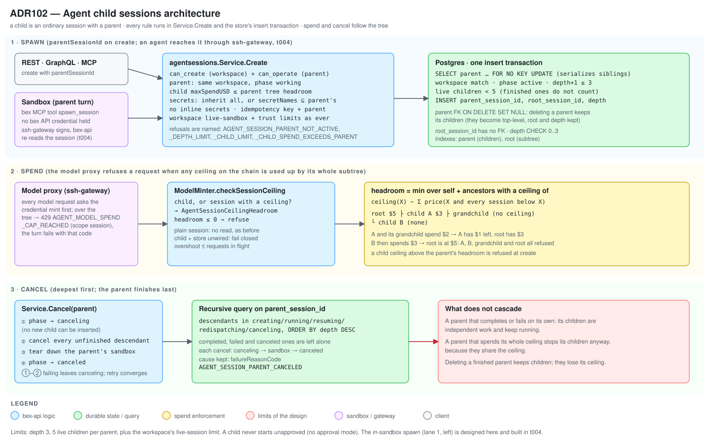

# ADR102 — Agent child sessions: an agent can spawn and track child sessions (Devin parity)

**Status:** accepted (w21/m279 t001, 2026-11-08; the two decisions marked "adopted by the worker, user may override" stand until the user says otherwise) · **Date:** 2026-11-08 · **Extends:** [ADR047](ADR047-cloud-coding-agent-sessions.md) (sessions), [ADR094](ADR094-coding-agent-mcp.md) (D4 idempotent create, D8 spend ceilings; closes its "Parent and child sessions" deferral), [ADR098](ADR098-agent-session-secrets.md) (secrets), [ADR091](ADR091-agent-model-pricing.md) (spend and ceilings) · **Parity:** Devin child sessions (no Render equivalent; see [Parity](#parity)).

## Context

A cloud coding agent works on one task in one sandbox. A large task, such as "migrate these five services" or "write tests for each package", is easier to split across sessions, but today only a person or an API client can start a session, so the split happens outside the agent and nobody sees the whole.

[ADR094](ADR094-coding-agent-mcp.md) deferred this: "bex agents cannot yet spawn agents; an in-sandbox `bex` tool for that, together with lineage on the session record, is a separate decision." Structured results (ADR094 phase 3), spend ceilings (ADR094 D8) and secrets ([ADR098](ADR098-agent-session-secrets.md)) have all shipped since, so the pieces a child needs exist.

**What Devin does (verified live in the Devin dashboard, 2026-11-06; docs: [advanced capabilities](https://docs.devin.ai/work-with-devin/advanced-capabilities)):**

- A parent session can start child sessions, each with its own prompt, tags and spend limit, and can message running children. The API records `parent_session_id`.
- The parent's chat shows a **"Created a Devin session"** card for each child.
- A right-hand **Agents** panel groups the children by status (for example "Done 1") with a **View session** link per child.
- The sidebar **nests children under their parent**.
- Devin's automation form has an "Allow auto-start of child sessions" switch, on by default. bex has no approval mode ([`.pm/DO_NOT_DO.md` #APPROVAL-MODE](../.pm/DO_NOT_DO.md)), so a bex child always starts unattended. That is the existing anti-goal, not a divergence to sign off.

**What bex has to build on.** `agentsessions.Service.Create` already does authorization, validation, egress, secrets, skills, billing admission, the workspace live-session limit, spend ceilings and idempotency. `submit_result` (ADR094 D5) is the precedent for an in-sandbox verb: the sandbox posts to the ssh-gateway, which forwards a MAC-signed envelope to a bex-api internal verb that re-checks the session. The model proxy asks bex-api's credential mint before every model request, and that mint already enforces the per-session ceiling.

## Decision

### D1 — Lineage: three columns on `agent_sessions`

A child is an ordinary session with a parent. `agent_sessions` (migration 0211) gains:

| Column | Type | Meaning |
| --- | --- | --- |
| `parent_session_id` | `text NULL`, foreign key to `agent_sessions(id)` | The session that spawned this one. NULL for a top-level session. |
| `root_session_id` | `text NULL`, no foreign key | The top of the tree. NULL for a root; a child's root is its parent's root, or the parent itself. |
| `depth` | `integer NOT NULL DEFAULT 0 CHECK (depth BETWEEN 0 AND 3)` | Distance from the root. 0 for a root. |

- **Deleting a parent never deletes a child.** The foreign key is `ON DELETE SET NULL`: a parent can only be deleted once finished (ADR065 D4), and its children are independent work. They become top-level rows in the list and keep `root_session_id` and `depth`, so the subtree query by root still returns the tree minus the deleted session. `root_session_id` has no foreign key for the same reason: deleting a root must not touch the tree.
- **The lineage is never client input to the row.** The store derives `root_session_id` and `depth` from the locked parent row (D2). A forged value in the request is ignored.
- Indexes: `(parent_session_id, created_at, id)` for the children list, the live-children count and the cancel walk; `(root_session_id, depth, created_at, id)` for a tree. Both are partial (`WHERE … IS NOT NULL`), so top-level sessions pay nothing.
- The session view gains `parentSessionId`, `rootSessionId` and `depth`, each omitted for a top-level session. The session list gains a parent filter.

### D2 — Limits, enforced in the insert transaction

- **Depth: at most 3.** Root is depth 0; its great-grandchild is depth 3 and cannot spawn. Refused `409 AGENT_SESSION_DEPTH_LIMIT`.
- **Fan-out: at most 5 live children per parent.** "Live" means the active phases (`creating`, `running`, `resuming`, `redispatching`), the same set the workspace counts use. A finished child frees its slot. Refused `409 AGENT_SESSION_CHILD_LIMIT`.
- **The existing per-workspace limits still apply** to every child, because a child goes through the same `admitDispatch`, live-sandbox cap and trust-tier admission as any session. The tree limits do not replace them.
- **Atomicity.** The store inserts the child in one transaction that first runs `SELECT … FROM agent_sessions WHERE id = <parent> AND workspace_id = <workspace> FOR NO KEY UPDATE`. That lock conflicts with itself, so two concurrent children of one parent run one after the other and the second sees the first's row: two inserts at the limit minus one admit exactly one (a real-Postgres test runs that race five times). It does not conflict with the foreign-key share lock the insert itself takes. The same transaction checks the parent's phase and workspace, and derives the child's root and depth, so no read-then-insert window exists. The depth `CHECK` is the schema-level backstop.
- **A parent in another workspace is "not found"** (`404 AGENT_SESSION_PARENT_NOT_FOUND`), the same answer as an unknown id.
- **The parent must be working** (`creating`, `running`, `resuming` or `redispatching`): `409 AGENT_SESSION_PARENT_NOT_ACTIVE` otherwise, including for `canceling`, `canceled`, `failed` and `completed`. A completed parent is steered back into a working phase first. Because Cancel moves the parent to `canceling` before it cancels descendants (D6) and the insert locks the parent, no child can be started under a parent that is being canceled.

### D3 — Spend: a child's spend counts against the parent's ceiling

_Adopted by the worker, user may override (2026-11-08)._ The user did not answer; this is the recommended default.

Each session may have a `maxSpendUSD` ceiling (ADR094 D8). A child's spend **counts against every ceiling above it.** Define, for a session `S`, its **headroom**:

> headroom(S) = the minimum, over `S` and each ancestor `X` that has a ceiling, of `ceiling(X) − Σ recorded platform-route price of X and every session below X`.

There is no headroom (the session is unbounded by ceilings) when nothing on the chain has a ceiling.

- **At creation**, a child's `maxSpendUSD` may not exceed the **parent's** headroom: `400 AGENT_SESSION_CHILD_SPEND_EXCEEDS_PARENT`, with the remaining amount in the details. A child of a parent whose headroom is zero or negative is refused `409 AGENT_SESSION_CHILD_SPEND_EXHAUSTED`. A child created without a ceiling is fine: the run-time rule below bounds it.
- **While running**, the model proxy's existing refusal point is the enforcement. Before each model request the gateway asks bex-api's credential mint (`ModelMinter.Mint`), which already calls `checkSessionCeiling` for the per-session ceiling and answers `ErrModelSessionSpendCapReached` (429, `AGENT_MODEL_SPEND_CAP_REACHED`, scope `session`, and the turn fails with that code). That check changes for two kinds of session: **a child**, and **a session that has a ceiling** (its children's spend counts against it). They call one store query, `AgentSessionCeilingHeadroom`, which walks the ancestor chain with a recursive query and compares each capped ancestor's ceiling with the summed price of its subtree; the mint refuses when the result is at or below zero. A session with no parent and no ceiling reads nothing, as before.
- **Consequences, all intended.** A child's spend appears in the parent's total. A sibling with no ceiling can be refused because another sibling spent the parent's allowance. When the parent's ceiling is used up, the parent and all its descendants stop, so a runaway tree is bounded by one number. The workspace's monthly cap (ADR091 D5) still binds above all of it, and the lower of the two wins.
- **Limits of the design.** The recorded price lands when the gateway reports an exchange, so a tree can overshoot its ceiling by the exchanges in flight (ADR094 D8 has the same bound for a single session); with several live children the overshoot is up to one in-flight exchange each. The creation check reads the headroom before the insert and is not atomic with it; the run-time check is what holds the line. Only the platform model route records a price, so a session on the workspace's own model key cannot have a ceiling (`AGENT_SESSION_SPEND_LIMIT_UNAVAILABLE`, ADR094 D8), and the workspace is on one route or the other. Deleting a finished parent removes its ceiling from its orphaned children's chain.
- **The refusal reuses the existing code.** A child refused because an ancestor's ceiling is used up sees `AGENT_MODEL_SPEND_CAP_REACHED` with scope `session`, the same as a session at its own ceiling. A distinct reason string for the tree case is a follow-up, not a gate.

### D4 — Secrets: inherit, may narrow, never add

_Adopted by the worker, user may override (2026-11-08)._

A child inherits its parent's session secrets (ADR098) and may use a subset:

- **`secretNames` omitted:** the child gets all of its parent's secrets.
- **`secretNames` given:** the child gets exactly those, and each must be one of its parent's secrets. A name the parent lacks is refused `400 AGENT_SESSION_CHILD_SECRET_NOT_INHERITED` with the name in the details. An explicit empty list means none.
- **Inline `secrets` are refused** on a child with the same code: an inline value would add a secret the parent lacks. (A child of a parent that has an inline secret still receives it; see below.)
- A workspace secret the parent holds is attached to the child by reference, as any workspace secret is, and resolved at the child's dispatch. A secret the parent holds **inline** has its value in the parent's per-session OpenBao document; the child's create **copies** that value into the child's own inline document, so deleting the parent never breaks the child, and the value never appears in a response or the transcript (ADR098).
- A child cannot widen what the workspace gave the parent: the secret limits (20 names, total size) apply to the child's resulting set.

### D5 — Authorization

Creating a child needs **both**:

- `can_create` on the workspace, exactly as for any new session (SECURITY note in `Service.Create`: a new session runs attacker-chosen tasks), and
- `can_operate` on the **parent** `agent_session` object.

The parent check runs **before** the idempotent replay and before the parent's row is read, so an unauthorized caller learns nothing about it. The parent must be in the same workspace and working (D2). A caller who can start sessions but cannot operate the parent is refused with the ordinary forbidden error. A child inherits nothing else from the parent: its repository, task, model and egress allowlist come from its own request.

There is no approval step. The child starts unattended like every cloud session.

### D6 — Cancel cascade

Cancelling a parent cancels its **unfinished descendants**, children and their children, deepest first:

1. The parent moves to `canceling`. From that moment no child can be inserted under it (D2).
2. The store lists every descendant (a recursive query on `parent_session_id`) in an active phase **or `canceling`**, ordered by depth descending. Each is moved to `canceling`, its sandbox is torn down, and it is terminalized `canceled`, the same steps as a direct cancel.
3. Each cascaded session records why: `failureReason` "canceled because its parent session `ags-…` was canceled" and `failureReasonCode` `AGENT_SESSION_PARENT_CANCELED`. A user's own cancel records no cause.
4. The parent's sandbox is torn down and it becomes `canceled`.

If a sandbox teardown fails, every other descendant is still attempted, then Cancel returns the error and the parent stays `canceling`; a retry converges because the walk includes `canceling` descendants. The public cancel remains idempotent once the parent is `canceled`.

**Finished descendants** (`completed`, `failed`, `canceled`) are left alone. Authorization is checked once, on the session the caller named: descendants live in the same workspace and the caller can operate the root of the cancel.

**What does not cascade.** A parent that completes or fails on its own does not cancel its children: they are independent, unattended work, and the parent's final turn may have been written to wait for them or not. This is a bex decision; if a customer wants the parent's end to stop them, the parent's agent or an orchestrator cancels them, and the shared ceiling (D3) already stops the whole tree when the parent's allowance is spent. An automatic cascade on parent failure is a follow-up.

### D7 — Idempotency

A child create takes `idempotencyKey` like any create (ADR094 D4). The parent id is part of the normalized request digest, and so is whether the child inherits all of its parent's secrets (no `secretNames`), so the same key with a different parent, or a different secret choice, is `409 AGENT_SESSION_IDEMPOTENCY_KEY_REUSED`. A replay returns the first child with `created: false` **even if the parent has since been cancelled**: the parent authorization still runs, but the parent's state is only checked on a real create. A retry therefore never starts a second child. A replay does not recount against the fan-out limit.

### D8 — API, MCP and dashboard surfaces (built in later tasks)

All three transports stay thin adapters over `agentsessions.Service` ([ADR006](ADR006-bex-api.md) one-core rule).

- **REST / GraphQL / MCP (m279 t005).** `create_agent_session` gains `parentSessionId` (the MCP schema description states the limits and the inheritance rules); the session view carries `parentSessionId`, `rootSessionId` and `depth` (the children are read through the parent filter and the tree read, not a count on every view); list gains a parent filter; a tree read returns a root's subtree with each session's `state`, so an orchestrator sees the whole tree in one call. `wait_agent_sessions` already accepts several ids, so an orchestrator can wait for its children.
- **Dashboard (m279 t006).** In the parent's chat, each child shows a card ("Started a session", with title, state and a View session link); an **Agents** panel lists the children grouped by state with counts; the sidebar nests children under their parent. Loading skeletons match those layouts ([AGENTS.md](../AGENTS.md) dashboard rule).
- **Not built:** messaging a running child from the parent is already `send_agent_session_message` on the child's id (it needs `can_operate`, which the owner has); Devin's dedicated tool for it is not a separate verb here.

### D9 — The in-sandbox spawn path (built in m279 t004)

An agent reaches D1–D8 through the sandbox's `bex` MCP server, the same one that carries `submit_result` (ADR094 D5). t004 built it with these refinements of the design below.

- **A new tool, `spawn_session`,** takes the child's task, optional repository, branch, title, tags, `maxSpendUSD`, `secretNames` and an idempotency key. It holds **no bex API credential**: it posts to the gateway's agent listener on a session-label-only route, the same Pod-identity rule the share and result routes use.
- **The gateway** verifies the caller pod's identity, wraps the request in a kind-tagged `spawn-session` envelope with its own MAC domain, and forwards it to a new internal verb on bex-api. The sandbox's request can name only a child; the **parent is the calling session**, taken from the verified pod identity, never from the body, so a sandbox cannot spawn under, or with the token of, another session.
- **bex-api re-reads the parent** and applies the current-sandbox rule (the caller pod must be the session's current sandbox, in a working phase), then calls the same create path as D2–D7 with `ParentSessionID` set. The remaining rules (limits, spend, secrets) apply unchanged; they are the guarantees, not extra checks of the transport. The in-sandbox caller is not a person, so the OpenFGA subject checks of D5 are replaced by the pod-identity check: the workspace delegated authority to the parent when it was started, and the parent can do no more than a person who can operate it.
- **Idempotency.** The gateway derives the key as `spawn:<parent>:<turn>:<tool call key>` so an agent retrying a tool call never starts two children.
- **Result.** The tool returns the child's id and state. A parent that wants a child's result uses `get_agent_session` and `outcome.result` through the same read verbs; the sandbox has no read credential, so a read verb for children from inside the sandbox is a t004 decision (the lean: `get_child_session` through the same signed route, limited to the caller's own children).
- **Network.** The spawn route is on the agent listener, which the sandbox's egress policy already reaches; nothing is added to the egress allowlist.

**As built (m279 t004).**

- **Routes.** `POST /agent-children/<b64 ns>/<b64 session>` starts one child; `GET /agent-children/<b64 ns>/<b64 session>/<child id>` reads one descendant. Both are Pod-identity routes on the agent listener (session-label rule, like `/agent-results/`) and forward one signed `spawn-session` envelope (`op` `create` or `read`) to the new internal `POST /v1/agent-session-children` (`BEX_AGENT_SPAWN_API_URL` on the gateway). The sandbox's body is decoded strictly: an unknown field, `parentSessionId` included, is refused at the gateway and again at bex-api.
- **Authority is the parent's creator.** Sessions now record `created_by` (migration 0212). `Service.SpawnChild(ctx, parentSessionID, SpawnRequest)` runs `Service.Create` as that subject, so `can_create` on the workspace and `can_operate` on the parent are re-checked on every spawn, and a person who lost access stops their sessions from spawning (`403 AGENT_SESSION_SPAWN_CREATOR_FORBIDDEN`). A session older than the column records no creator and cannot spawn (`403 AGENT_SESSION_SPAWN_NO_CREATOR`). Limits, spend, secrets, idempotency and persistence are `Create`'s own: nothing is copied.
- **The child inherits** the parent's agent, model, template and workspace environment, and works in the parent's repository: a `repo` that is not the parent's is refused `400 AGENT_SESSION_CHILD_REPO_MISMATCH`, so a prompt-injected parent cannot reach a repository it could not itself. Widening this is a separate decision. A parent's custom `egressAllowlist` is not stored on the row, so the child takes the workspace environment's allowlist.
- **Idempotency.** The create key is `spawn:<parent>:<caller key>` (the caller key is optional, at most 64 printable ASCII); without one there is no dedupe.
- **Read.** The tool is `get_child_session`. A read of any session that is not a strict descendant of the caller (a sibling, an ancestor, itself, another tree) is `not_found`. It returns `state` and `outcome` (summary, structured result, pull request, cost).
- **Tools.** `spawn_session` and `get_child_session` are listed by the driver's `bex` MCP server only when `BEX_AGENT_SPAWN_URL` is set; bex-api sets it for every session below the depth limit. The URL is an opaque path naming the session: no credential of any kind is added to the sandbox environment (tested).

## Consequences

- **New durable state:** three columns and two partial indexes on `agent_sessions`; no new table.
- **One enforcement point per rule.** The limits live in one store transaction, the spend rule in the existing model-proxy mint, the secrets and authorization rules in `Service.Create`. The adapters add none of them.
- **A run-time cost for children and ceiling-bearing sessions only.** Every model request of such a session now runs one recursive query (an ancestor walk of at most four rows plus a subtree sum over indexed usage events) instead of one indexed sum. Sessions with neither a parent nor a ceiling do no read at all, as before.
- **The cascade is best-effort across sandboxes.** A teardown failure leaves the parent `canceling` until a retry, which is the existing cancel behaviour extended down the tree.
- **A shared ceiling can surprise.** One greedy child can use the allowance its siblings expected. That is the point of one number per tree, and a per-child ceiling is how a parent reserves a share.
- **Deleting a parent loosens its children's ceilings.** After the parent is deleted its children are top-level sessions bounded only by their own ceiling. Delete requires a finished parent, so this is bounded to children still running after their parent finished (D6); the workspace's monthly cap still applies.
- **`failureReason` on a canceled session** is now sometimes set (the cascade cause), where it was always empty. Clients that treat a non-empty `failureReason` as failure must key on `state`, which they already should (ADR094 D7).

## Parity

**Reference product: Devin, verified live 2026-11-06.** Devin lets a parent start children with their own prompt, tags and spend limit, message running children, see "Created a Devin session" cards, an Agents panel grouped by status, and nested sidebar rows. Render has no agent sessions, so [ADR018](ADR018-render-parity.md) has no rule to apply.

| Devin | bex |
| --- | --- |
| `parent_session_id` on the session | `parentSessionId`, plus `rootSessionId` and `depth` (D1) |
| Child with its own prompt, tags, spend limit | Same fields on create; the child's limit is capped by the parent's remaining ceiling (D3) |
| Message a running child | `send_agent_session_message` on the child's id |
| "Created a Devin session" card, Agents panel, nested sidebar | Dashboard child cards, status-grouped Agents panel, nested sidebar (D8, t006) |
| "Allow auto-start of child sessions" switch | None: children always start unattended ([`DO_NOT_DO.md` #APPROVAL-MODE](../.pm/DO_NOT_DO.md)); not a divergence to sign off |
| (not documented) | bex adds hard limits (depth 3, five live children), a shared ceiling and secret narrowing, which are safety controls, not removed behaviour |

No divergence from Devin's visible behaviour needs sign-off. The limits are bex additions that Devin's public docs do not state; if Devin documents different limits, change the numbers, not the design.

## Decisions

Both were open when the ADR was written, and the user did not answer. The worker adopted the recommended defaults on **2026-11-08**; **the user may override either.** Overriding changes D3 or D4 and their tests, not the lineage or limits.

1. **Does a child's spend count against its parent's ceiling?** Adopted: **yes** (D3).
2. **Does a child inherit its parent's secrets?** Adopted: **yes, may narrow, never add** (D4).

## Alternatives rejected

- **A separate `agent_session_children` join table.** Rejected. A session has exactly one parent, so a column is the natural shape; a join table adds a join to every tree read and cannot express the single-parent rule without a constraint.
- **A foreign key on `root_session_id`, or `ON DELETE CASCADE` on the parent.** Rejected. Deleting a finished parent must not delete live children, and a root's deletion must not rewrite or block its tree.
- **No foreign key on `parent_session_id` (a dangling id).** Rejected. The FK costs nothing, guards against a bogus parent even if a caller path skips the store check, and `SET NULL` gives the UI a clean top-level row instead of a dangling reference to render.
- **Counting fan-out with a plain `SELECT count(*)` before the insert.** Rejected. Two concurrent children at the limit would both pass. The row lock on the parent serializes them.
- **An advisory lock instead of a row lock on the parent.** Considered. The row lock also makes the parent's phase check and a concurrent cancel agree (the cancel's UPDATE waits for the insert or is seen by it) without a second mechanism.
- **Per-child budgets that do not roll up.** Rejected as the default. The whole point of a ceiling is one number a customer can trust; unrolled child ceilings multiply the exposure by the fan-out. A parent can still give each child a smaller ceiling.
- **Rolling child spend up by writing it into the parent's usage rows.** Rejected. It would double-count in billing. The roll-up is a read-time sum over the same events, so the ledger stays the single source.
- **Letting a child take new inline secrets.** Rejected. It would let an agent add credentials its owner never attached to that task. A customer who wants a different secret set for a child attaches the secret to the workspace and the parent first.
- **Cascading cancel on parent failure or completion.** Deferred, not rejected (D6): it changes what "done" means for a parent that was designed to hand work off.
- **A dedicated "child" resource or API.** Rejected. A child is a session: it has the same lifecycle, transcript, outcome and ceiling, and every existing client already reads it.
