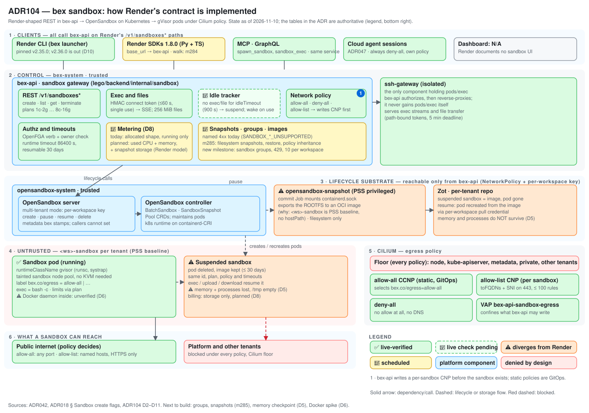

# ADR104 — Sandbox Render parity: the contract bex matches, and every gap with an owner

**Status:** proposed (2026-11-08; refreshed against the repo, and D8 decided, 2026-11-10) · **Extends:** [ADR008 § Render parity first](ADR008-vision.md#render-parity-first), [ADR018](ADR018-render-parity.md) (§ Sandbox create flags), [ADR042](ADR042-sandbox-cluster-substrate.md) (substrate and network policies), [ADR014](ADR014-sandboxes.md) · **Amends when accepted:** ADR018 (sandbox rows), ADR023, ADR030, [cli-compatibility-checklist.md](cli-compatibility-checklist.md) · **Board:** w2/m278 (suspend, blocked), w32/m283 (network policy, done), w32/m284 (SDK walk, blocked), w32/m285 (snapshots, blocked), w32/m297–m299 (env, execution history, SDK gaps; done)

## Context

Render Sandboxes entered **public beta on 2026-11-04**. Until now bex tracked them piecemeal: ADR042 chose the substrate and the `ea sandbox` wire shapes, ADR018 graded individual create flags, and three milestones (m278, m283, m285) each re-read one slice of Render's docs. No single document says what "sandbox parity" is, which rows are green, and which gaps are open. This ADR is that document.

It is built from a sourced research pass on 2026-11-08 (fan-out search, 19 sources fetched, 25 claims put to a three-vote check by model reviewers, 23 confirmed, 2 refuted). **Every confirmed claim comes from render.com's own pages** (`/sandboxes`, `/docs/sandboxes*`, the TypeScript and Python SDK docs); none was corroborated independently, and the product was four days old when researched, so each limit below can change. Re-check the sources in § Sources when you act on a row.

**Refreshed 2026-11-10.** The repo moved after the first draft. w32/m283 (network policy), m297 (`env`), m298 (execution history) and m299 (SDK path and mint gaps) are done and verified on production, and w5/m287 serves sandbox `name`. ADR018's sandbox rows moved, so this ADR cites them by name, not by line number. m278 (suspend), m284 (SDK walk) and m285 (snapshots) are **blocked**: m278 on the D5 sign-off and a production walk, m284 on QA credentials, m285 on m278. The first draft was numbered ADR102; it is ADR104 because another ADR102 (agent child sessions) landed first and w3/m304 t003 claimed ADR103 at filing.

**Not established by the research, and therefore not decided here:** the exact `/v1/sandboxes` and `/sandbox-groups` REST schemas for groups, images and snapshots; the `render sandboxes` and `sandbox-groups` flag set beyond what the pinned CLI v2.35 already exercises (the repo's own pin and OpenAPI copy are the authority for those); and **pricing, including whether a suspended sandbox bills and what snapshots cost**. The research's two pricing claims were each rejected by all three reviewers, which is a gap in evidence, not evidence of the opposite. Follow-up reads of Render's launch post (2026-11-08) and its comparison article (2026-11-06) answer both the billing model and the rates; see D8, which decides to adopt them. Remaining unknowns are tracked as open questions.

## Implementation at a glance

Every client reaches bex-api on Render's `/v1/sandboxes*` paths. bex-api authorizes, tracks idle time, mints the exec and file connect tokens, and is the **only** caller of the OpenSandbox lifecycle API; the ssh-gateway is the only holder of `pods/exec`. Sandboxes run as gVisor pods in a per-tenant namespace, and Cilium decides what they can reach. Solid green is shipped and verified live, dashed green is shipped with the live check pending, yellow is scheduled, orange diverges (memory and processes on suspend, D5; Docker in a sandbox, D6). Source of the picture: ADR042's architecture and network-policy sections, plus ADR018's sandbox rows.

## Decision

### D1 — The parity target is Render's documented contract, graded row by row

The rows below are the **contract**: what Render does and what bex must do. A row is **✅** when shipped **and** verified live, **🚧** when shipped but not yet verified live, or scheduled on a named milestone, **⚠️** when it diverges. A divergence stands only if ADR018 records it with the user's sign-off (AGENTS.md rule); a ⚠️ here without that is a defect to close, not a decision.

**Authority.** The state ledgers are [ADR018](ADR018-render-parity.md) (§ Sandbox create flags and the sandbox rows) and [cli-compatibility-checklist.md](cli-compatibility-checklist.md); this ADR owns the contract and the decisions. The State columns below are a dated snapshot (2026-11-10), not a second ledger. Landing this ADR requires amending the ADR018 rows it contradicts (gap 11), so the two cannot disagree.

**Surfaces.** Every row applies to REST, GraphQL and MCP (the dashboard is N/A for sandboxes except groups: Render's docs show a Dashboard "+ New > Sandbox Group" menu, with an optional project environment, read 2026-11-10; w22/m311 t012). A row is not ✅ until all three answer the same way.

### D2 — Lifecycle, timeouts and suspension

| Render behavior (render.com/docs/sandboxes-limits, SDK docs) | bex | State |
| --- | --- | --- |
| Statuses `creating`, `running`, `suspending`, `suspended`, `resuming`, `errored`, `terminated` | Every status occurs in code since w2/m278; not yet seen live | 🚧 m278 t009 |
| Runtime timeout: default 86400 s; `0` disables; otherwise 60–2592000 s | Shipped (w2/m263 D3=A) | ✅ |
| Runtime timeout restarts on resume and restore | Shipped for resume (w2/m278 t010), live check pending; restore is m285 | 🚧 m278 t009, m285 |
| Hobby plan timeout cap | bex caps Hobby at 86400 s and holds `0` to it (ADR018, w2/m263 D3). Render's CLI v2.36.0 (2026-11-06) **removed** the Hobby 24 h wording from `--timeout` help, so Render may have lifted it. Not recorded as a signed divergence | ⚠️ gap 9 |
| Idle timeout: default 900 s; `0` disables; otherwise 300–86400 s; idle sandboxes suspend automatically | Shipped in code (w2/m263 D2=A, w2/m278); live check pending | 🚧 m278 t009 |
| A suspended sandbox stays resumable for 30 days, subject to group capacity; exec, upload and download each resume it | Shipped in code (w2/m278 t010); live check pending | 🚧 m278 t009 |
| Terminate is idempotent and permanently deletes the filesystem | Shipped | ✅ |
| Exec runs the command under `bash -c` in a new shell in the sandbox's home directory (Render SDK 1.8.0 `SandboxClient.exec`: "command is passed to `bash -c` in the sandbox"; render.com/docs/sandboxes-executing, read 2026-11-12: "Each command starts in a new shell in your sandbox's home directory"), streams `output` events then `exit`; a nonzero exit code is data, not an error; list is newest first, excludes `terminated` unless filtered in, and caps `limit` at 100 | **w32/m348 (2026-11-12), production walk pending:** the base image is the Docker Official `bash` image (Alpine 3.24 plus bash 5.3, `/bin/bash` linked at start), and every caller-facing exec runs `cd "$HOME"` then `bash -c` with the command as one untouched argument, falling back to `/bin/sh -c` on a root filesystem without bash (a sandbox suspended before the change). Pinned by `TestExecRunsTheCommandUnderBashInTheHomeDirectory` and its neighbours in `exec_shell_test.go`. Exec, SSE and the status filter shipped and live-verified (m147, m263); the list `limit` cap is pinned (w22/001), and the list is newest first since w32/015 (`TestListIsNewestFirstAndPagesInThatOrder`; it had returned OpenSandbox's oldest-first order) | 🚧 w32/m348 t005 |
| Execution history: `GET /sandboxes/{id}/execs` | Shipped (w32/m298), verified on production 2026-11-10 | ✅ |
| Suspend keeps files, memory and running processes (runtime snapshot by default) | Files only: the rootfs is committed and the pod recreated, so memory and processes are lost and `/tmp` is empty (ADR042 D5) | ⚠️ D5 |
| Create inputs `env`, `name`, `group` | `env` is served (w32/m297: 100 variables, 256 KB, write-only) and so is `name` (w5/m287). `group` is served by w22/m311: a sandbox is created in the named group or the workspace's default one, which is created on first use; the code is in, the production walk is w22/m311 t007 | ✅ `env`, `name`; 🚧 `group`, m311 t007 |
| Billing: running sandboxes bill used CPU plus allocated memory; suspended bill snapshot storage only | **Storage half shipped by w22/m313, held until its Stripe Price exists** (a suspended sandbox's retained image bills at $0.056 per GB-month, ADR023 § Sandbox snapshot storage, ADR030 §15); memory is recorded as a shadow meter; CPU billed on use is w22/m314, so a running sandbox still bills the weighted allocated-shape charge | 🚧 D8 (CPU) |

**How exec runs a command (w32/m348, 2026-11-12).** w22/001 had read render.com/docs/sandboxes-executing's advice "Use `sh -c` to interpret operators such as `&&`, pipes, and redirection" as the server's shell. That sentence is advice to CLI users, whose argv the CLI shell-quotes into one command string. The server-side contract is the SDK's: `render==1.8.0` `render/experimental/sandbox/client.py:357-358` (wheel sha256 `80800015…906c1`) says "command is passed to `bash -c` in the sandbox", and the same docs page says "Each command starts in a new shell in your sandbox's home directory". bex now matches both:

- **Wrapper.** Every caller-facing exec (REST `exec`, the connect-token run path the CLI uses, and MCP `sandbox_exec`; GraphQL has no exec mutation) runs `/bin/sh -c '<wrapper>' bex-exec <command>`: the wrapper changes to `$HOME` (or `/` if that fails) and `exec`s `bash -c "$1"`, or `/bin/sh -c "$1"` when the root filesystem has no bash. pods/exec has no working-directory field, so the argv carries it. The command is one positional argument, never wrapper source, and `exec` keeps its exit code, signals and output its own. The execution record stores the caller's command, not the wrapper.
- **Image.** The `base` template moves from `alpine:3` to the Docker Official `bash` image (`bash:5.3`, Alpine 3.24 plus bash 5.3 at `/usr/local/bin/bash`, digest-pinned in `cmd/api/config.go`), and its entrypoint links `/bin/bash` to it before `sleep infinity`, so `#!/bin/bash` scripts run. Keeping Alpine keeps everything that depends on it: busybox `wget`, `httpd` and `apk`, the musl resolver analysis behind D3's `ndots:1`, the isolation matrix's in-sandbox probes and the file gateway's scripts, which ran unchanged in the new image. A Debian base was rejected for this milestone because it drops `wget` and busybox, which the isolation matrix and users relied on; whether Render's image carries more tools (python, git, curl) is undocumented and stays open question 5.
- **Home.** Render's SDK says relative paths "resolve under `/home/render`". **Since w32/019 (2026-11-12)** the `base` template sets `HOME=/home/render` (a template environment under the caller's own, so a caller's `HOME` still wins) and its entrypoint creates the directory, so a command starts there, relative uploads land there and `~` is there. The user stays root: Render documents only the path. A sandbox created earlier keeps `/root` until it is recreated.
- **Agent sessions.** An exec into an agent-session sandbox also runs under bash (the agent image is Debian with bash) but keeps the image's working directory, the session's checkout `/workspace`, as a Devin shell starts in its repository ([ADR047](ADR047-cloud-coding-agent-sessions.md)). The Completer's internal status and transcript reads (`sessionExec`), the file gateway and the SSH gateway paths pass their own `/bin/sh` argv and are unchanged.
- **Older sandboxes.** A sandbox created before the change keeps its BatchSandbox (Alpine image, `sleep infinity`) across suspend and resume, so its commands run through the `/bin/sh` fallback in `$HOME` until it is recreated.

### D3 — Network policy

Matches Render and is shipped by w32/m283: `allow-all` is the default, `deny-all` reaches nothing, and `allow-list` takes 1–100 `{domain, protocol: "https"}` rules, lowercase, no scheme, port or path, with `*.example.com` covering subdomains but not the apex and an exact name not covering subdomains. Rules must be omitted for the other two types. Traffic matching no rule is blocked. The platform floor (nodes, Kubernetes API, metadata, private ranges, other tenants) stays closed under every policy; that is bex's isolation invariant, not a Render row, and Render does not document it as customer-visible.

One rule is easy to miss: **a restored sandbox inherits the source's policy, including allow-list rules, and the policy can be overridden at restore.** `allow-all` as the default applies to a plain create only. m285 must implement inheritance; m283 does not cover it. These rows are ✅: w32/m283 is done and enforcement was verified on production (2026-11-08; ADR018's `networkPolicy` row is ✅). The inheritance rule above is still open.

A listed domain is reachable **by name** from ordinary programs (w8/m152, 2026-11-11). Until then the Alpine base image's resolver gave up on the cluster's search-list candidates, which the DNS filter refuses, so `wget https://<listed>` and `apk add` failed with `bad address` although the policy was correct. Sandbox Pods now ask a dotted name as an absolute name first (`ndots:1`); see [ADR042 § Sandbox network policies](ADR042-sandbox-cluster-substrate.md#sandbox-network-policies-w32m283). A sandbox created before the fix keeps the old resolver setting until it is recreated.

### D4 — Snapshots

m285 is the vehicle. It is blocked behind w2/m278 (its production walk and the D5 decision), so gap 2 and the D5 sign-off sit on its critical path. The contract it must match:

- **Kinds:** `runtime` (default; filesystem plus memory and CPU, restorable only on the identical plan, else `SnapshotPlanMismatchError` in the Python SDK) and `filesystem` (writable filesystem only, restorable on any plan). The source keeps running during capture.
- **Statuses:** `creating`, `available`, `failed`; only `available` restores; deleting a `creating` snapshot is refused; `failed` carries an `error` field.
- **Expiry and names:** 30 days from the capture request by default; a custom `expiresAt` must be in the future (SDK-documented only); restore does not extend it; an expired snapshot cannot be fetched or restored and is omitted from lists, but sandboxes already restored from it are unaffected. Names are 1–64 characters, case-sensitive, scoped to the group, reusable, must not begin `snp-`, and resolve to the most recent `available` snapshot of that name.
- **Restore:** creates a new sandbox and keeps the snapshot; takes `snapshotId` or `snapshotName`, never both; works only inside the snapshot's own group; the filesystem is always preserved; processes survive only for runtime snapshots, keep their original environment, and environment variables are not inherited; plan, network policy, runtime timeout and idle timeout default to the source's values, including a disabled timeout, and can be overridden.

**Security of the capture path.** Today's suspend path runs a commit Job in `opensandbox-snapshot`, a PSS-privileged namespace that mounts the node's `containerd.sock` (ADR042 D5), which is node-root equivalent. m285 lets a user trigger it on demand, so m285 t001 must fix, before t002 ships: that the Job spec contains nothing a caller chooses (image, mounts, arguments), a per-sandbox and per-workspace rate limit, a size and time bound on a capture, and that a failed capture cannot leave a privileged Pod behind. This makes a privileged path user-triggerable, so route it through the security review lineage.

`runtime` is Render's default kind and bex cannot capture memory today. That is the same gap as D5 and is resolved with it: until a memory checkpoint exists, `--kind runtime` answers a named 400, and ADR018 carries it as a divergence awaiting sign-off (as m285 t001 already plans).

**Billing hook for m285 (w22/m313).** A snapshot is billed storage (D8), and the meter already exists: `store.StartSandboxStorage(workspace, snapshotID, StorageKindSnapshot, "", at)` when the capture succeeds, `SetSandboxStorageBytes(workspace, snapshotID, startedAt, bytes)` once its size is known (m285 reads it from the registry; `RegistrySizer` in `internal/sandbox` does it for a manifest), and `EndSandboxStorage` when it is deleted or expires. All three are idempotent and safe to replay, and an unsized snapshot is never billed as zero silently ([ADR023 § Sandbox snapshot storage](ADR023-usage-metering.md#sandbox-snapshot-storage-w22m313-adr104-d8)). m285 must call them rather than add a second meter.

### D5 — The main substrate divergence: memory and processes

Render's microVM snapshots memory, so suspend and runtime snapshots keep running processes. bex's gVisor/OpenSandbox substrate commits the root filesystem only. This is the largest divergence in what a customer's code observes (the others are D6 and the Hobby cap), and it appears twice (suspend, runtime snapshot). It is already recorded in ADR018 as awaiting sign-off; this ADR does not settle it. It lists the two honest ways to close it so the decision is not an open-ended wait:

1. **Build the checkpoint** (`runsc checkpoint`/CRIU under gVisor; the ADR042 D5 watch item). Full parity; large, with an unproven restore path.
2. **Accept filesystem-only** and document `--idle-timeout 0` as the workaround, with the divergence signed off in ADR018.

Per the parity rule, the board does not wait on this choice: filesystem snapshots and the rest of m285 ship now, and option 1 is filed as a separate follow-up.

### D6 — Isolation runtime and Docker in a sandbox

Render documents "its own Firecracker microVM" with **Docker and Docker Compose supported**. The isolation technology itself (Firecracker vs gVisor) is not a customer-visible parity row. Docker in a sandbox is, and the research did not establish how far Render's "supported" goes (whether `docker build` works, whether published ports work, how Compose networking behaves).

**Correction (2026-11-08):** an earlier draft of this ADR said gVisor cannot run a Docker daemon. That was unverified and wrong. gVisor documents running `dockerd` inside a `runsc` sandbox ([Docker in gVisor](https://gvisor.dev/docs/tutorials/docker-in-gvisor/)). What it takes, and what it costs:

- **Node-level `runsc` flags.** `--net-raw` for every supported Docker version, plus `--allow-packet-socket-write` for Docker v28 and later. gVisor's own warning: the second flag "allows sandboxed code to craft arbitrary network packets". These are runtime-wide settings in the node's containerd `runsc` configuration, not per sandbox, so they apply to every pod on the node pool unless sandboxes get a second runtime class.
- **In-sandbox capabilities.** The tutorial uses `sys_admin`, `net_admin`, `net_raw` and `setuid` (it starts with `--cap-add all`). They are perceived by the sandboxed application only; gVisor never runs with host capabilities. They may conflict with bex's baseline Pod Security Standard on `<ws>-sandbox` namespaces; this has not been checked against the sandbox Pod template.
- **Storage.** gVisor needs `tmpfs` as the upper layer of `overlayfs`, so Docker v29 needs a `tmpfs` at `/var/lib/docker` (or `--feature containerd-snapshotter=false`).
- **Networking.** `dockerd` must run with `--iptables=false --ip6tables=false`. With iptables off, `docker run -p` and `--expose` do not publish ports (use `--network=host`), and gVisor's FAQ notes that DNS on user-defined bridge networks does not resolve. **Compose service discovery and port publishing may therefore differ from Render. Unverified.**

So Docker in a sandbox is feasible on bex's substrate, not impossible, with real trade-offs: a looser node-level network posture that has to be reconciled with the Cilium allow-list and tenant isolation (ADR042, ADR043), Pod-security exceptions, and a networking subset. It is **unverified on bex's nodes** (runsc version, kernel, node image).

**Decision:** Docker in a sandbox is a parity row, not a non-goal. It stays ⚠️ until a spike answers the questions below, and then the user signs off on whatever remains. The spike (a task for the sandbox board): start a pod on the gVisor class with the flags above and run `docker run hello-world`, a `docker build` of a small image, and a two-service Compose file with an internal call between services and a published port; record what fails; check that the Cilium allow-list and the platform floor (D3) still hold with `--net-raw` on, including with `--allow-packet-socket-write`: attempt source-IP and ARP/NDP spoofing, reach a denied destination by raw packets, and bypass the FQDN/SNI allow-list through the nested Docker's own DNS resolver. Any success rules out options (2) and (1)'s shared pool and leaves a separate pool or a signed divergence. Options after the spike: (1) a second RuntimeClass and node pool for sandboxes that opt in to Docker, keeping the default pool's flags tight; (2) enable it pool-wide if the floor holds; (3) a Kata/Firecracker pool for sandboxes, which reopens ADR042 D3 and needs `/dev/kvm`; (4) record a signed divergence in ADR018.

#### D6 spike results: measured on a local colima VM, not a bex node, 2026-11-10 (w22/m312)

**Scope.** This is the part of w22/m312 that could be done without a cluster. It ran on a throwaway local colima VM (profile `gvisor-spike`, deleted afterwards), never on a bex node and never on the production sandbox pool. It measures how gVisor and Docker behave together; it says nothing about bex's nodes, Cilium or the allow-list, so D6's "unverified on bex's nodes" still holds for everything below. **Not done:** the isolation tests (t005: source-IP, ARP and NDP spoofing, raw packets to a denied destination, the FQDN/SNI bypass, the platform floor), the second RuntimeClass on Kubernetes, admitting a Docker pod into a `<ws>-sandbox`-shaped namespace, and the final recommendation (t007). All of those need a throwaway Kubernetes node with Cilium and bex's allow-list policy; this run had no cluster and was not allowed one.

**What it ran on.** An Apple Virtualization VM, aarch64 (bex's sandbox nodes are Hetzner Cloud `cpx32`, x86, ADR042 D3), Ubuntu 24.04.4 LTS, kernel `6.8.0-117-generic`, outer Docker 29.5.2. runsc `release-20261102.0` (spec 1.2.1, default `systrap` platform) from gVisor's release bucket with its sha512 verified; gVisor reports its guest kernel as `4.19.0-gvisor`. Runtimes were registered in that VM's Docker `daemon.json`, not in a containerd `runsc.toml`, so bex's node-bootstrap path was not exercised. The sandbox is the stock `docker:<v>-dind` image: Docker 29.9.3 (Compose v5.7.0), 28.5.2 (v2.40.3) and 27.5.1 (v2.33.0), started with Docker's default capability set plus `sys_admin` and `net_admin`, and bootstrapped like the tutorial's `start-dockerd.sh` (tmpfs at `/var/lib/docker`, SNAT, `--iptables=false --ip6tables=false`). Re-run it with `scripts/sandbox-docker-spike.sh`, which refuses a `bex.co/pool=sandbox` node.

**Functional matrix** with runsc `--net-raw --allow-packet-socket-write`, 13 checks per Docker version. Every check passed on every version:

| Check | 27.5.1 | 28.5.2 | 29.9.3 |
| --- | --- | --- | --- |
| `dockerd` starts, `docker info` answers | pass | pass | pass |
| `docker run hello-world` (pull from Docker Hub) | pass | pass | pass |
| `docker build` of a 3-layer image (`RUN`, `COPY`, `RUN`), then run it | pass | pass | pass |
| Compose, two services, `client` calls `web` by service name on the default Compose network | pass | pass | pass |
| Compose `ports: 8081:8080`, answered on 127.0.0.1 inside the sandbox | pass | pass | pass |
| the same port answered from a container outside the sandbox, at the sandbox's `eth0` address | pass | pass | pass |
| Compose `network_mode: host` | pass | pass | pass |
| user-defined bridge, a container resolves another by name (embedded DNS, `nameserver 127.0.0.11`) | pass | pass | pass |
| `docker run -p 8082:8080` | pass | pass | pass |
| `docker run -P` of an image with `EXPOSE` | pass | pass | pass |
| default bridge with `--link` | pass | pass | pass |
| HTTPS fetch (1.5 MB) from a nested container on the bridge | pass, 9-30 s | pass, 14-19 s | pass, 17-23 s |
| the same fetch with `--network host` | pass, 0-3 s | pass, 2-3 s | pass, 1-3 s |

Compose `network_mode: bridge` with `links` also passed on 29.9.3. Pulls came from Docker Hub with unrestricted egress; how pulls behave under bex's HTTPS-only FQDN allow-list was not tested.

**What the runsc flags and capabilities did** (same checks, each variation re-run):

| Variation | Result |
| --- | --- |
| plain `runsc`, no flags (D6 takes this to be the production pool's shape; that was not checked) | `dockerd` never starts on 27, 28 or 29: `iptables: Failed to initialize nft: Protocol not supported` from the dind entrypoint, and the tutorial's SNAT step fails with `can't initialize iptables table 'nat': Table does not exist`. Any raw socket in the sandbox fails with `PermissionError: [Errno 1] Operation not permitted`, even with `--cap-add NET_RAW` |
| `--net-raw` only | Docker 27.5.1 and 29.9.3: 13/13 pass; 29 logs `Failed to send unsolicited ARP ... error="operation not supported"` as a warning. Docker 28.5.2: `dockerd` starts and `--network host` works, but every container on a bridge fails with `failed to set up container networking: failed to add interface veth21782e2 to sandbox: failed to advertise addresses: operation not supported` (10 of 13 checks fail) |
| `--net-raw --allow-packet-socket-write` | 13/13 on 27, 28 and 29 |
| the same plus `--overlay2=none` (what ADR042 says bex's sandbox nodes run) | 13/13 on 28 and 29 with the tmpfs at `/var/lib/docker`; 13/13 on 29 without it (`overlay2` storage driver, no `containerd-snapshotter`) |
| `--cap-add all` (the tutorial command) | not needed: the default set plus `sys_admin` and `net_admin` is enough |
| `--cap-drop all` plus only `sys_admin`, `net_admin`, `net_raw`, `setuid` | `dockerd` fails: `chown /var/run/docker.sock: operation not permitted`, then `bind: permission denied`. Dropping any single capability of Docker's default 14 breaks either `dockerd` (`chown`, `dac_override`, `net_raw`) or nested containers (the other 11); `sys_admin` and `net_admin` are also required |

**What this changes in D6's picture.** (a) The Networking bullet above does not hold for a nested `dockerd`: published ports work with `--iptables=false` (the userland `docker-proxy` serves them, inside the sandbox and from outside it) and DNS on user-defined bridge networks resolves, because the embedded DNS server runs inside the same sandbox as the containers; the FAQ limitation is about a container started by the host's Docker. Compose service discovery and port publishing therefore matched what Render documents in this setup. (b) The real cost is elsewhere: bridge networking inside the sandbox was roughly 5 to 20 times slower than the host network for the same fetch, and `--allow-packet-socket-write` is needed for Docker 28 (and for the gratuitous ARP and neighbor advertisements Docker 29 tries to send). A customer chooses the Docker version, so the node-level flag set has to be both flags. (c) The in-sandbox capabilities Docker needs are `sys_admin` and `net_admin` beyond the runtime default set, which is what the Pod Security check below turns on.

**Capability facts for the isolation question** (measured on a plain Docker bridge with no Cilium, so these say what the sandbox can emit, not what bex's network lets through): with `--net-raw` alone, sandbox code can send a raw IP packet with a forged source address, and it left the VM's `eth0` unchanged; `--allow-packet-socket-write` adds forged layer-2 frames (an ARP reply claiming another IP and an IPv6 Neighbor Advertisement were both seen on the bridge). Without that flag an `AF_PACKET` write fails with `Errno 95 Not supported`. The tutorial's SNAT rule in the sandbox's own netstack swallowed locally originated raw IP packets until it was deleted; the sandbox holds `NET_ADMIN`, so that is not a barrier. Whether Cilium drops forged sources and frames, and whether the allow-list, FQDN/SNI rule and platform floor hold with these flags on, is exactly what t005 must measure and has not.

**Pod Security and admission (read from the files, nothing admitted anywhere).** Rules that would reject or strip what Docker-in-gVisor needs:

| Control | Where | Effect on a Docker pod |
| --- | --- | --- |
| PSS `enforce=baseline` on every `<ws>-sandbox` namespace | `lego/backend/internal/store/namespaces.go:432-433` | Baseline's Capabilities row allows adding only `AUDIT_WRITE`, `CHOWN`, `DAC_OVERRIDE`, `FOWNER`, `FSETID`, `KILL`, `MKNOD`, `NET_BIND_SERVICE`, `SETFCAP`, `SETGID`, `SETPCAP`, `SETUID`, `SYS_CHROOT` (kubernetes.io Pod Security Standards, read 2026-11-10). `capabilities.add` of `SYS_ADMIN`, `NET_ADMIN` or `NET_RAW` is rejected at pod create, as is `privileged: true`; `SETUID` is allowed. An `emptyDir` with `medium: Memory` for the tmpfs is not restricted (baseline forbids only `hostPath` volumes), but a `mount -t tmpfs` inside the sandbox needs `SYS_ADMIN` |
| PSS `warn` and `audit` = `restricted` | `lego/backend/internal/store/namespaces.go:434-437` | restricted would object to any added capability too, but only warns and audits |
| Namespace admission pins the labels | `deploy/gitops/base/bex-api-namespace-admission.yaml:35-47` | bex-api may create or change a sandbox-regime namespace only with `enforce=baseline`, `warn=restricted`, `audit=restricted` and the name `<ws>-sandbox`; a Docker-capable regime needs this policy amended, so "relax PSS for one namespace" is a policy change, not a label edit |
| Sandbox-pod admission | `deploy/gitops/base/sandbox-pod-admission.yaml:26-34` | requires `runtimeClassName == 'gvisor'` (line 28), so a pod on a second RuntimeClass is denied; requires `nodeSelector['bex.co/pool'] == 'sandbox'` (lines 30-31), so a dedicated Docker pool must still carry that label and be told apart by another one, or the policy changes; also the regime label (27), `automountServiceAccountToken: false` (29) and no `nodeName` on create (32). It does not inspect capabilities, `privileged`, volumes or `securityContext`: it neither strips nor allows them |
| RuntimeClass | `deploy/opensandbox/gvisor-runtimeclass.yaml:23-32` | one class, `gvisor`, handler `runsc`, node selector `bex.co/pool: sandbox`. The runsc flags are not in this manifest: they belong to the containerd runsc configuration installed at node bootstrap (lines 15-19), so a second class means a second runtime handler on those nodes, and its node selector is merged with the pod's, where a conflicting value rejects the pod |
| Pod template | `deploy/opensandbox/batchsandbox-template.yaml:21-30` | pins `runtimeClassName: gvisor` (21); declares no `securityContext`, capabilities or volumes, so it neither grants nor strips capabilities and mounts no tmpfs at `/var/lib/docker`. What the OpenSandbox server adds when it merges the template (lines 1-2) is upstream code outside this repo: check a live sandbox pod's `securityContext` before designing |
| OpenSandbox server config | `deploy/opensandbox/sandbox-cluster.toml:32-34` | `[secure_runtime] k8s_runtime_class = "gvisor"` for every sandbox; choosing a second class per sandbox needs server support this repo does not show. The `drop_capabilities` list that names `NET_ADMIN`, `NET_RAW` and `SYS_ADMIN` (`sandbox.toml:34`) belongs to the legacy local-dev Docker runtime (`sandbox.toml:1-3`), not the cluster |
| Precedent | [ADR042](ADR042-sandbox-cluster-substrate.md) D5 (sandbox pause) | relaxing the sandbox namespace's PSS was already rejected once (a `hostPath` for the snapshot commit Job would "dissolve the isolation floor"); the Job moved to a separate privileged namespace instead |

**Provisional recommendation, conditional on t005 and not final.** The measurements remove the functional objection: Docker, `docker build` and Compose work under gVisor on Docker 27 to 29, so "gVisor cannot do it" is not a reason for a divergence. What remains is the control cost. (i) If every t005 attempt is blocked with both flags on, option (1), a second RuntimeClass with a dedicated node pool, is the lowest-risk route to parity, because it keeps the default pool's flags tight (plain runsc refuses every raw socket, measured above); option (2) becomes eligible but would widen every sandbox's raw-packet capability for good. This ADR records no Render opt-in for Docker, so option (1) also needs a way to land a sandbox on the Docker class without a customer-visible flag, or that flag is itself a divergence for ADR018. (ii) If any t005 attempt succeeds, options (2) and a shared-pool (1) are out, leaving a Docker pool with its own policy, option (3) or option (4). (iii) Under either outcome, giving the sandbox `SYS_ADMIN` and `NET_ADMIN` needs the admission changes in the table (a second RuntimeClass name and pool label in the pod policy, and a namespace regime whose PSS admits those capabilities), which no document designs yet. **Sign-off:** none requested yet; the choice flips on t005, so the user is asked after it runs.

### D7 — Groups, plans, limits and regions

- **Plans:** `1c-2g` (default), `2c-4g`, `4c-8g`, `8c-16g`, each with a **40 GB** writable filesystem. The plans ship (w2/m263), and since w8/247 (2026-11-11) a create without a plan is `1c-2g` in name, size (1 CPU, 2 GiB) and meter weight; before that it was the deprecated `starter` at 0.5 CPU and 512 MiB. Sandboxes created earlier keep the plan they were created with, and an agent session's sandbox keeps its own size and its `starter` label (ADR047, ADR091). The 40 GB figure is not enforced anywhere: a 2026-11-10 read of the pod template, `gvisor-runtimeclass.yaml`, the create request (`resourceLimits` carries only `cpu` and `memory`) and the sandbox code finds no `ephemeral-storage` limit, so a sandbox can write until the node's disk fills (the per-workspace storage cap of D11 bounds only suspended images). Adding one is a platform change that needs a live gVisor node (kubelet's accounting of a runsc rootfs is unverified): w22/008. 🚧
- **Groups:** a workspace may have 10 sandbox groups; each carries a `concurrencyLimit` (default 1,000 concurrent sandboxes, lowerable per group, capped at 1,000 even if a higher value is sent); suspended sandboxes do not count; create and resume answer **429** at the limit; snapshots belong to the source sandbox's group. Render runs sandboxes in `oregon` only, and the group sets the region (bex reports its own platform region for both, w32/016). **Shipped by w22/m311** ([ADR042 § Sandbox groups](ADR042-sandbox-cluster-substrate.md#sandbox-groups-w22m311)): the default group is created on first use, so every workspace has exactly one without a hook or a backfill; the limit is counted under a per-workspace lock with a slot lease, so parallel creates and resumes cannot exceed it; every resume path (explicit, exec, and the run and file token mints) is held to it; the status rule (creating, running, suspending and resuming count) is bex's reading of Render's silence; and Render's own `sandbox_group_limit_reached` (a 400, from the pinned `errorCode` vocabulary) answers the 11th group. The three numbers are configurable (`BEX_SANDBOX_MAX_GROUPS_PER_WORKSPACE`, `BEX_SANDBOX_MAX_GROUP_CONCURRENCY`, `BEX_SANDBOX_MAX_ACTIVE_PER_WORKSPACE`). The groups were the largest unscheduled parity gap and a prerequisite of snapshots (D4); m285 t002 now has its default group. Live verification is w22/m311 t007.
- **Numbers are targets, not capacity.** 10 groups, 1,000 concurrent sandboxes per group and 40 GB are Render's beta figures. bex implements them as configurable constants with its own quotas (D11); a 1,000-sandbox group on a Hetzner pool is a capacity and cost decision this ADR does not make.
- **Region:** the Python SDK accepts `region` as a compatibility parameter that does not affect placement. bex ignores it the same way. **Since w32/016 (2026-11-12)** a sandbox and its group always read the same region, as Render's "Every sandbox belongs to a sandbox group, which scopes it to a region" requires. bex reports the region it actually runs in (`frankfurt` on production, as services report it), not Render's `oregon`, so a reader never sees a US region for EU-hosted sandboxes; `oregon` stays accepted on a group create ([ADR042 § Sandbox groups](ADR042-sandbox-cluster-substrate.md#sandbox-groups-w22m311)). The dashboard's new-group dialog no longer shows a fixed "Oregon"; its confirmation shows the region bex-api reports.

### D8 — Pricing and billing

**Decision (2026-11-10, proposed): adopt Render's billing model. Do not record it as a divergence.** The user asked for a recommendation on whether to keep bex's own model; the parity rule says a divergence needs a reason and sign-off, and the one real reason (gVisor CPU accounting) is a spike away from being settled either way.

**What Render publishes.** The launch post ([render.com/blog/introducing-render-sandboxes](https://render.com/blog/introducing-render-sandboxes)) gives the model, and Render's own comparison article ([render.com/articles/render-sandboxes-vs-vercel-sandboxes](https://render.com/articles/render-sandboxes-vs-vercel-sandboxes), published 2026-11-06) gives the rates. `render.com/pricing` and `/docs/sandboxes*` still carry no sandbox figures.

| Item | Render |
| --- | --- |
| CPU | $0.12 per **active** CPU-hour (used, not provisioned; waiting on a model or a person adds none) |
| Memory | about $0.019 per GB-hour ($0.038/h per 2 GB), **allocated**, while running |
| Suspended | no CPU or memory charge; snapshot storage only |
| Snapshot storage | $0.08 per GB-month |

The article says APIs, defaults and limits might change before general availability. It says nothing about prices. Re-read it when ADR104 is accepted.

**What bex does today** (ADR023, ADR030): one `sandbox_compute_seconds` meter, CPU millicores plus memory folded into a weighted unit, from the **allocated shape**, running only, referenced to AgentCore ($0.0895 per CPU-hour, $0.00945 per GB-hour). There is no storage meter. Three differences follow:

| Render rule | bex today | Decision |
| --- | --- | --- |
| CPU billed on use | Allocated shape, so an idle sandbox costs what a busy one does | Adopt, after the spike below |
| Suspended pays snapshot storage only | Suspended is free; bex absorbs the rootfs image for up to 30 days | Adopt now |
| Snapshots are billed storage | No meter; m285 would add 30-day objects of up to 40 GB at no cost to the creator | Adopt now |

**Design.**

- Three meters replace the single weighted one for new usage:
  - `sandbox_cpu_seconds`: used CPU from Prometheus (`increase(container_cpu_usage_seconds_total)`), per running interval.
  - `sandbox_memory_gb_seconds`: allocated GiB × running seconds. The data is already in the phase cursor.
  - `sandbox_snapshot_gb_seconds`: bytes × retention seconds for a suspended sandbox's rootfs image and for each snapshot. It is event-driven: it starts when the commit succeeds and ends when the image is deleted (D11's GC rule: terminate, 30-day expiry, snapshot delete or expiry).
- `sandbox_compute_seconds` stays for history and for the agent-session cost in `outcome.cost` (w9/m178), so that cost does not change basis. Nothing is re-priced retroactively.
- **Rates** follow the existing `pricing.yaml` convention of Render × 0.70: $0.084 per active CPU-hour, $0.0133 per GB-hour, $0.056 per GB-month of snapshot storage. They live in `pricing.yaml`, not in code. The convention is ADR030's to change.
- **Identity.** cAdvisor series carry the pod name, and a resume recreates the pod. Record the pod name on each running interval and attribute by interval. Do not add pod labels to kube-state-metrics: its allowlist is nodes-only today, and tenant pod labels would add cardinality for no gain.
- **Coverage.** The `kubernetes-cadvisor` job lists every node, so the tainted sandbox pool is scraped. If Prometheus is unreachable, defer the window and mark it `partial`; never bill zero.
- **Surfaces.** `GET /v1/usage`, GraphQL and MCP return the new kinds together, and the Stripe line items follow ADR040.

**Spike (gates only the CPU meter).** Run `stress-ng` at one core for 60 s in a gVisor sandbox and read the cAdvisor series. Pass: within ±5% of one CPU-minute. Also measure an idle sandbox's baseline and a syscall-heavy load against the same load under runc. gVisor's sentry spends host CPU emulating syscalls, so that load reads high, and Render's Firecracker has no such cost.

- **Policy for the overhead: bill the measured cgroup CPU, with no subtraction.** It is the figure a customer can reproduce, and the 0.70 factor absorbs some of it. A variant that subtracts the sentry overhead is a separate follow-up.
- **Escalate to the user** if a syscall-heavy load reads more than 2× its runc figure, or an idle baseline exceeds 2% of one core. **Thresholds fixed 2026-11-10, before any measurement (w22/m314 t001):** pass is 60 CPU-seconds ±5% for one core over 60 s; escalate above 12 CPU-seconds idle over 10 minutes or above 2× the runc figure for a fixed syscall-heavy load; fail outside ±5%. The pod to read is `<sandbox id>-0` in `<ws>-sandbox` (the pinned controller's naming); whether a resume keeps that name is unverified. Either would make the bill visibly worse than Render's for the same work. These are starting thresholds; the spike task fixes them before the run.
- **If the spike fails**, keep the allocated-shape CPU charge as a time-boxed divergence recorded in ADR018, with the user's sign-off and a dated task to remove it. The storage and memory meters ship regardless.

**Not settled.**

- **Settled (w22/m313 t001, 2026-11-10):** the byte source is the OCI manifest in Zot, `config.size + Σ layers[].size`, read by the highest `snap-gen<N>` tag; neither OpenSandbox's `SandboxSnapshot` status nor Zot's search extension (off in bex's config) reports a size. Billing sums each object's own manifest bytes, so layers shared across two sandboxes' images are counted in each, and a sandbox's older retained tags are bex's retention overhead, not billed. Measured and written down in [ADR023 § Sandbox snapshot storage](ADR023-usage-metering.md#sandbox-snapshot-storage-w22m313-adr104-d8).
- Whether `resuming` time is billed. Render does not say. Keep it free.
- **Settled (w22/m313 t001):** a resumed, running sandbox pays compute and no storage; the object closes when the phase cursor leaves `suspended`. The old image stays in Zot until retention reaps it, which is bex's overhead under D11.
- Whether Hobby workspaces pay for sandbox usage. `pricing.yaml` keeps Hobby plans free, ADR091 charges Hobby per use for agent models, and Render's pages do not say. Decide it in ADR030 when the meters land; D11's caps apply either way.
- The Hobby timeout cap (D2).

### D9 — The SDK is part of the contract

Render's SDKs (`@renderinc/sdk` as `new Render().sandboxes`, and Python `Render`/`RenderAsync`) default `baseUrl`/`base_url` to `https://api.render.com`, read `RENDER_API_KEY` (and `RENDER_WORKSPACE_ID` for `owner_id`), and expose create, exec, upload, download, list, get, terminate, snapshots and groups, with **no explicit suspend, resume or stop method** (suspend and resume are implicit). Pointing `base_url` at bex-api is the drop-in hook, so the SDK walk (w32/m284) is the acceptance test for every row above, not an extra. Since the first draft, w32/m299 closed the relative-remote-path and mint-during-resume gaps; the full walk is blocked on QA credentials.

### D10 — What left early access, and the CLI pin

Checked against `render-oss/cli` release notes and `cmd/` on 2026-11-08. Only **sandboxes and sandbox-groups** have left the CLI's `ea` group (v2.32.0, breaking, no alias). `ea blueprints create|plan|approve|update` (public alpha, v2.35.0) and `ea objects` (object storage) are still early access, so bex's `[~]`/`[-]` rows for them (cli-compatibility-checklist, ADR018 row for object storage) stand. Leaving `ea` is not GA: the Sandboxes product is still labeled **Beta**. Release notes older than v2.30.0 were not read, so this is not a claim about earlier pins.

The latest CLI is **v2.36.0 (2026-11-06)**; bex pins v2.35.0. v2.36.0 adds `sandboxes create --name`, errors that explain when a sandbox ended and when, and drops the Hobby 24 h wording from `--timeout` help (the ADR018 row for `timeoutSeconds` says the Hobby cap is 86400 s; recheck it against Render's docs). `main` also shows `sandbox-groups` `delete` and `default set`, `sandboxes snapshots` (create, delete, get, list) on the CLI reference page, and `sandboxcredentials*`. All of these land on gaps this ADR lists (groups, snapshots, credentials), so the pin bump should be filed with them and graded in the checklist.

### D11 — Resource and abuse bounds

Parity widens what a sandbox can do: `allow-all` egress by default, 30-day retention of suspended sandboxes and snapshots, and a Hobby plan. Render's own numbers are not a substitute for bex's cost and abuse controls, so the following are requirements for the milestones that ship these rows, whatever Render does:

- **Storage:** a cap on snapshots per group and on total sandbox storage (suspended rootfs images plus snapshots) per workspace, a garbage-collection rule that deletes images when a sandbox terminates, expires at 30 days, or a snapshot expires, and a gauge for the registry growth the sandbox path causes.
- **Compute and egress:** the 429 concurrency limit (D7) per group and per workspace, egress metering on `allow-all` sandboxes (the egress-meter exists), and an alert on a workspace whose sandboxes egress far above its plan. Free (Hobby) workspaces get the same default; the control is the meter and the cap, not a different default.
- **Privileged capture path:** the constraints in D4.

## Gaps, owners and order

| # | Gap | Owner |
| --- | --- | --- |
| 1 | Prove D2 live on production (D3 is proved: w32/m283 is done) | w2/m278 t009, blocked on the D5 decision and a production walk |
| 2 | Sandbox groups: default group per workspace, `concurrencyLimit`, 429, 10 per workspace | w22/m311 t001–t005, and t006's workspace cap, shipped in code; the production walk with the unmodified CLI and the ledger flip are t007 |
| 3 | Filesystem snapshots and restore, including policy inheritance and D4's capture-path constraints | w32/m285 (blocked behind m278) |
| 4 | Pin `bash -c` in the home directory, list `limit` ≤ 100 and 40 GB storage with tests | **w22/001 (2026-11-10), corrected by w32/m348 (2026-11-12):** exec (`bash -c` in `$HOME`, falling back to `/bin/sh -c`; one untouched argument, nonzero exit as data; w22/001 had pinned `/bin/sh -c` from a misread of the CLI's `sh -c` advice) and the list `limit` clamp (1 to 100; an unpaged list is complete, ADR006's recorded divergence from Render's default of 20) are pinned; the 40 GB filesystem is not enforced, w22/008 |
| 5 | SDK walk grades every method | w32/m284 (blocked on QA credentials) |
| 6 | Memory/process preservation (D5) | user sign-off, then a follow-up |
| 7 | Docker/Compose inside a sandbox (D6): spike on a gVisor node, then pick an option | w22/m312. Functional matrix and the Pod Security/admission read are measured on a local VM, not a bex node (D6 results); the isolation tests (t005) are not run and need a throwaway Cilium node, then user sign-off |
| 8 | Billing (D8), in order: snapshot-storage meter and memory split (no dependency); gVisor CPU spike, then the used-CPU meter; `pricing.yaml` rates, usage surfaces and Stripe lines; amend ADR023 and ADR030 | w22/m313 (storage meter, memory shadow meter, bounds, rate, surfaces and Stripe line: **code shipped, production unverified and the Stripe Price not yet created**), then w22/m314 (CPU); sign-off only if the spike fails |
| 9 | Hobby timeout cap: confirm Render's current rule, then sign off or lift (D2) | **new task**, w2 |
| 10 | Pin is Render CLI v2.35.0; v2.36.0 (2026-11-06) is out (D10) | bump task, w2 CLI train |
| 11 | Amend ADR018's sandbox rows that file groups, images and snapshots as omissions or non-goals (§ _Render sandbox groups and snapshots_, and the `sandboxGroupId`, `buildId`/`buildName` and `snapshotId`/`snapshotName` rows of § Sandbox create flags) and the checklist's matching `[-]` rows (`sandboxes snapshots`, `--group`, `--image`, `sandbox-groups`), which this ADR contradicts (D1). Cite them by name: line numbers have drifted | same change that accepts this ADR |
| 12 | `group` on create and list (D2). `env` (w32/m297) and `name` (w5/m287) are done | w22/m311 t003 shipped in code (REST, GraphQL and MCP); verified live in t007 |
| 13 | Images/builds (`buildId`, `/sandbox-groups/{id}/builds`) refused today | follow-up, after the REST schema is confirmed |
| 14 | Storage, compute and egress bounds (D11) | with gaps 2 and 3. **Compute: done in code** by w22/m311 t004 and t006 (the per-group and per-workspace 429, `BEX_SANDBOX_MAX_ACTIVE_PER_WORKSPACE`). **Egress: open.** The operator's egress meter selects pods by `app.bex.co/app` and `bex.co/app-id`, which a `<ws>-sandbox` pod does not carry, so sandbox egress is not metered and no alert exists (ADR042 § Sandbox groups); the fix is an operator change to the meter's pod selector, then the alert, its promtool test and its Grafana panel. **Storage: done in code** by w22/m313 t004 (the per-workspace cap `BEX_SANDBOX_MAX_STORAGE_GB_PER_WORKSPACE` with 429 `SANDBOX_STORAGE_LIMIT`, deletion of a gone sandbox's images, the registry-growth gauge and four alerts; the delete credential and the production check are open); the per-group snapshot-count cap stays with w32/m285 |
| 15 | Drift watch: re-diff Render's sandbox docs, limits and OpenAPI on every CLI pin bump and at least monthly during the beta, through ADR018's re-baseline rounds; freeze the SDK/OpenAPI shapes as contract fixtures like `lego/cli/testdata` | w2 |

## Out of scope

Render's **scoped API keys for sandbox tasks** and **credential brokering** are labeled _Early access_ on render.com/sandboxes, and **Shared filesystems** is also labeled _Early Access_. They sit outside the parity bar until Render ships them out of early access; ADR062 (sandbox credential vault) covers bex's own design. **Caveat:** the CLI source on `main` already has `sandboxcredentials*` commands (create, get, list, update, delete, versions, write, restore), which the pinned v2.35.0 does not, so credentials may be further along than the product page says. Re-read the label and the commands when the pin moves (D10) and move this row into D7-style parity if it is no longer early access.

## Open questions

1. What are the exact `/v1/sandboxes` and `/sandbox-groups` schemas for groups, images, builds and snapshots, and the error format? Diff the pinned OpenAPI copy (`lego/backend/internal/api/openapi/render-public-api-1.json`) and the render-oss/sdk source against the live spec.
2. Does Hobby keep a 24 h timeout? Render's rates are answered in D8.
3. Does the D6 spike show Docker and Compose working on bex's gVisor nodes, and which option follows (second runtime class, pool-wide, Kata/Firecracker pool, or a signed divergence)? **Partly answered (w22/m312, 2026-11-10, a local colima VM, not a bex node):** Docker 27 to 29, `docker build` and Compose (service names, published ports, bridge DNS) work under gVisor with `--net-raw --allow-packet-socket-write` (D6 results). **Still open:** the isolation tests on a throwaway Kubernetes node with Cilium and bex's allow-list (spoofing, raw packets, DNS/SNI, platform floor), the admission design for `SYS_ADMIN` and `NET_ADMIN`, and so the option and the user's sign-off.
4. Does the user accept filesystem-only suspend and snapshots (D5), or build the checkpoint?
5. What does Render's default sandbox image ship beyond bash (python, git, curl, a `render` user)? Render's sandbox pages (read 2026-11-12) do not say; bex ships Alpine's busybox tools plus bash (w32/m348).

## Consequences

- One place answers "is sandbox Render-parity done?": the D2–D7 rows, with an owner for every non-green one.
- Groups surface as a prerequisite of snapshots, which the m285 plan had not counted.
- No behavior changes in this ADR. It proposes board work (gaps 2, 4, 7, 8, 9, 14 and 15) and user decisions on D5 and, after its spike, D6. D8 is decided in favor of Render's model; the user signs off only if its CPU spike fails. Accepting it amends the ADR018 rows it contradicts (gap 11); the user's sign-off is still what makes any divergence stand.
- The billing model is a larger parity gap than the earlier draft said: bex bills allocated CPU, Render bills used CPU, and neither side of the suspended-storage rule matches. D8 closes it by adopting Render's model.

## Alternatives considered

- **Keep only the ADR018 ledger and the milestones.** Rejected: that is how the slices drifted (m278, m283, m285 each re-reading Render's docs) and how groups and the policy-inheritance rule were missed. The contract needs one place; the ledger keeps the state.
- **Treat Render sandboxes as a CLI-only subset.** Rejected: the SDKs and REST are Render's documented path, and the parity rule applies to every customer-facing behavior.
- **Build the Firecracker/Kata pool now for full microVM parity.** Not chosen: needs `/dev/kvm` (ADR042 D3) and would absorb D5 and D6 at once; kept as option (3) in D6 after the spike.

## Sources

Fetched 2026-11-08: render.com/sandboxes, /docs/sandboxes, /docs/sandboxes-limits, /docs/sandboxes-snapshots, /docs/sandboxes-sdk-typescript.md, /docs/sandboxes-sdk-python, /docs/sandboxes-creating, /docs/sandboxes-executing, /docs/sandboxes-cli-reference, the Render CLI releases (v2.30.0–v2.36.0), `cmd/` on `main` and render-oss/sdk on GitHub, render.com/changelog, and gVisor's Docker-in-gVisor tutorial and FAQ (D6), Render's launch post for D8, and render.com/articles/render-sandboxes-vs-vercel-sandboxes (2026-11-06) for the rates. All single-vendor, model-reviewed and unconfirmed by Render; state the date when citing. Secondary pricing trackers were consulted and only used to locate the first-party article. On 2026-11-10 the D8 article was read in full (published 2026-11-06), render.com/pricing and /docs/sandboxes were re-read and carry no sandbox prices, and the repo state (boards, ADR018, the CLI pin v2.35.0) was re-checked.
