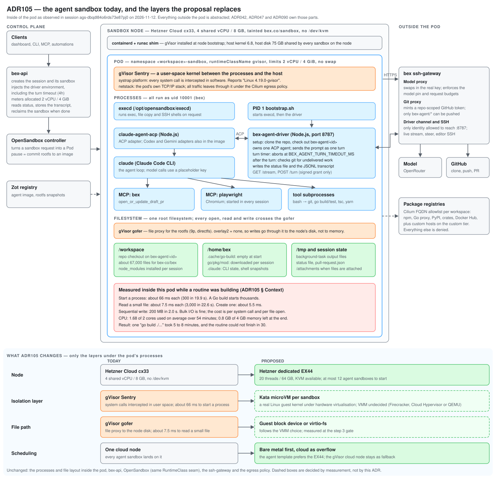

# ADR105 — Agent sandboxes on Hetzner bare metal: unit economics and a first production node

**Status:** proposed (2026-11-11; revised the same day — the first server is a production node, not a one-month spike, and it is an EX44; revised again the same day after a review of what joining the cluster takes, how a sandbox picks its runtime, and what the probe measured) · **Extends:** [ADR042](ADR042-sandbox-cluster-substrate.md) (D3 — gVisor because the cloud nodes have no KVM), [ADR044](ADR044-sandbox-runtime-comparison.md) (watch item 2 — Kata on bare metal), [ADR047](ADR047-cloud-coding-agent-sessions.md), [ADR053](ADR053-node-instance-types.md) · **Amends when accepted:** ADR042 D3, ADR053 (a bare-metal pool), [ADR002](ADR002-architecture.md) § Network (a vSwitch subnet in the `bex` network)

## Context

The upper part of the figure is the sandbox as it runs now. The band at the bottom is the proposal: the node, the isolation layer, the file path and scheduling change; everything else stays.

On 2026-11-11 all eight scheduled `rt-*` routines failed on their first day with `ACP turn exceeded 1800000ms`. Raising the production turn bound to 4h ([ADR047](ADR047-cloud-coding-agent-sessions.md), amended the same day) lets them finish, but it does not make them fast. A probe inside a live agent sandbox (`ags-dbqdl84o6rds73e87pj0`, 2 vCPU / 4 GiB, gVisor `systrap`, rootfs through the gofer) measured why:

| Operation in the sandbox | Measured | Usual order on plain Linux (not measured here) |
| --- | --- | --- |
| Start 300 processes (`/bin/true`) | 19.9 s, about 66 ms each | under 1 s |
| Read 3,000 source files | 22.6 s, about 7.5 ms each | about 0.1 s |
| Create 2,000 small files | 10.9 s | about 0.1 s |
| Sequential write, 200 MB | 2.0 s | similar |

The probe ran while the agent was running two `go test` commands and a `tsc`, so the numbers include CPU contention: the sandbox had averaged 1.68 of its 2 cores over 54 minutes. Sequential I/O is fine. The cost is in system calls and file opens, which is what compilers, test runners and `node_modules` do all day. One `go build ./...` took 5 to 8 minutes; the same routine could not finish in 30.

The probe measured gVisor as bex runs it, not gVisor's floor. Two other costs sit in the same numbers:

- **A shared-vCPU node under load.** The sandbox pool is one `cx33` (`bex-sandbox-cx33`, shared vCPU), and the probe ran beside three builds. Steal time on the node was not read.
- **`overlay2 = "none"`.** The sandbox nodes turn off runsc's memory-backed rootfs overlay so that tenant writes reach the host rw layer the pause commit Job reads ([ADR042](ADR042-sandbox-cluster-substrate.md) D5). Every file open and write therefore crosses the gofer. That is the price bex chose for correct pause and resume. Kata does not have to pay it: the container rootfs is the host overlay snapshot shared into the guest over virtio-fs, so writes land where the commit Job already reads them.

### The probe re-run on today's node (m331 t001, 2026-11-12)

The probe was re-run with `scripts/sandbox-probe.sh` in two benchmark Pods on the production `cx33` sandbox node (`bex-sandbox-cgqq6-p8wcg`). Both used the agent image (`ghcr.io/bex-co/bex-agent-sandbox@sha256:2383…054f`) and the agent shape: 2 vCPU and 4 GiB limits, with requests at a quarter. One Pod ran under `runtimeClassName: gvisor`, with the pool's `overlay2 = "none"`. The other ran under runc, as the native floor on the same node at the same time.

The node was not idle. Session `ags-dbqdl84o6rds73e87pj0`, the source of the original probe, was still running on it and used 1.2 to 1.4 cores. The node ran at 48 to 67% CPU, and steal time read 0.0% over 30 s from the runc Pod's `/proc/stat`. Steal cannot be read any other way: node-exporter does not run on the tainted sandbox node, and gVisor virtualises `/proc/stat`.

The file probes use shell builtins on the rootfs (`/var/tmp`), not `/tmp`, which gVisor keeps in memory. Times are the median of three runs.

| Probe | Original probe, inside the busy session | gVisor, own 2 vCPU | runc, same node |
| --- | --- | --- | --- |
| Start 300 processes | 19.9 s | 5.18 s (17 ms each) | 0.47 s (1.6 ms each) |
| Read 3,000 files | 22.6 s | 1.30 s (0.43 ms each) | 0.15 s |
| Create 2,000 files | 10.9 s | 0.82 s | 0.28 s |
| Sequential write, 200 MB | 2.0 s | 0.38 s | 0.38 s |

The replay ran once per runtime from cold Go, module and yarn caches. The Go half covers the four `lego/` workspace modules; the dashboard half is `yarn install` and `yarn typecheck`.

| Replay step | gVisor | runc | gVisor ÷ runc |
| --- | --- | --- | --- |
| `go mod download`, network-bound | 189 s (436 s in an earlier attempt) | 137 s | — |
| `go build`, four modules | 1,236 s | 767 s | 1.61 |
| `go vet`, four modules | 706 s | 366 s | 1.93 |
| `go test ./...` in `lego/types` | 44 s | 17 s | 2.6 |
| dashboard `yarn install` | 75 s | 45 s | 1.65 |
| dashboard `yarn typecheck` | 187 s | 166 s | 1.13 |
| **Total without the download** | **2,248 s** | **1,361 s** | **1.65** |

What this changes:

- **Contention made most of the original numbers.** In a sandbox of its own, gVisor starts processes 4 times faster and reads files 17 times faster than the original probe recorded.
- **gVisor's own cost is real but narrow.** On the same node it is 9 to 11 times runc for process start and file open, about 3 times for file create, and equal for sequential writes.
- **A cold build is mostly CPU.** The replay is 1.65 times slower under gVisor than runc on the same node. Even under runc, the Go half takes 19 minutes on 2 vCPU of a `cx33`.
  - So the runtime alone does not reach the step 3 gate of twice as fast. The gate compares Kata on the EX44 with gVisor on the `cx33`, so it can pass only with the EX44's faster cores. t006 separates the two with runc and runsc on the EX44.
  - The vCPU count and cold caches cost as much as the runtime. That is why the larger-template and warm-cache alternatives below were re-weighed.
- **Every session also downloads a Go toolchain.** The agent image ships Go 1.26.10, and `lego/go.work` requires 1.27.3 because `lego/cli/go.mod` does. So `go mod download` fetches go1.27.3 before the first build (w6/120).

Render runs each sandbox in its own Firecracker microVM. bex chose Kata first and fell back to gVisor only because Hetzner Cloud nodes expose no `/dev/kvm` (ADR042 D3, verified on `cpx32` on 2026-07-28). ADR042 already says Kata "remains the choice if KVM-capable nodes (Hetzner dedicated/bare-metal) ever join". This ADR prices that step.

## Inputs

**Revenue.** The sandbox meter bills the allocated shape while running, at the AgentCore reference ([ADR030](ADR030-pricing.md), `pricing.yaml`): $0.0895 per vCPU-hour and $0.00945 per GB-hour. An agent sandbox is 2 vCPU / 4 GiB, so it bills **$0.2168 per sandbox-hour**. The session above confirms it: $0.116 of compute for a 32-minute turn.

**Cost.** Hetzner dedicated servers, read from hetzner.com on 2026-11-11, EUR excluding VAT; the price is each model's base configuration. Thread counts and CPU generations are the CPUs' public specifications, not read from Hetzner. USD figures assume 1 EUR = 1.20 USD.

| Server | CPU | Threads | RAM | Disks | Monthly | Setup |
| --- | --- | --- | --- | --- | --- | --- |
| AX41 | Ryzen 5 3600 (Zen 2, 2019) | 12 | 64 GB | 2 × 512 GB | €59 ($70.80) | €0 |
| EX44 | Core i5-13500 (2023), 6 performance + 8 efficiency cores | 20 | 64 GB | 2 × 512 GB | €59 ($70.80) | €0 |
| AX42 | Ryzen 7 PRO 8700GE (Zen 4) | 16 | 64 GB ECC | 2 × 1.92 TB | €79 ($94.80) | €49 |
| EX63 | Core Ultra 7 265, 8 performance + 12 efficiency cores | 20 | 64 GB ECC, up to 192 GB | 2 × 1 TB | €99 ($118.80) | €74 |
| AX102 | Ryzen 9 7950X3D (Zen 4) | 32 | 128 GB ECC | 2 × 1.92 TB | €159 ($190.80) | €129 |
| AX162 | EPYC 9454P | 96 | 128 GB ECC, up to 512 GB | not read | €319 ($382.80) | €304 |

**Capacity model.** One slot is one agent sandbox: 2 vCPU and 4 GiB, plus 0.25 GiB assumed for the guest kernel and VMM. The host keeps 2 threads and 8 GiB.

- **Memory is never overcommitted.** A build inside the sandbox touches the memory it was given, so memory sets the ceiling: 13 slots in 64 GB, 28 in 128 GB.
- **The 0.25 GiB holds only if Kata is configured for it.** Kata sizes each VM as its `default_memory` plus the container's memory limit, and `default_memory` ships at 2048 MiB. Left at the default, an agent sandbox becomes a 6 GiB VM and a 64 GB node holds 9, not 13. The node sets `default_memory` small and declares the measured remainder as the RuntimeClass `overhead`, so the scheduler counts it and the pod cgroup contains it.
- **CPU is overcommitted up to that ceiling.** An agent session spends much of its life waiting on the model. The 84% CPU use measured above came from three parallel builds under gVisor's own overhead, which is the worst case and not the microVM case. The safe ratio is an assumption until measured on the node.

## Unit economics

| Server | Slots without CPU overcommit | Slots at the memory ceiling | CPU overcommit at the ceiling | Cost per slot-hour at full use | Break-even sandbox-hours per month | Break-even use |
| --- | --- | --- | --- | --- | --- | --- |
| AX41 | 5 | 13 | 2.6 : 1 | $0.0075 | 327 | 3.4% |
| **EX44** | 9 | 13 | 1.4 : 1 | $0.0075 | 327 | 3.4% |
| AX42 | 7 | 13 | 1.9 : 1 | $0.0100 | 437 | 4.6% |
| EX63 (64 GB) | 9 | 13 | 1.4 : 1 | $0.0125 | 548 | 5.8% |
| AX102 | 15 | 28 | 1.9 : 1 | $0.0093 | 880 | 4.3% |
| AX162 (128 GB) | 28 | 28 | none needed | $0.0187 | 1,766 | 8.6% |

- **Cost per slot-hour** is the monthly price over 730 hours and the slots at the memory ceiling. Against $0.2168 of revenue the compute margin at full use is 91% to 97%.
- **Break-even** is where paid compute revenue covers the server. It depends only on the monthly price: 327 paid sandbox-hours a month for either €59 server, about 11 a day.
- **EX44 against AX41, same price.** The EX44 has 20 threads to the AX41's 12 and a CPU four years newer, so it reaches the memory ceiling at 1.4 : 1 where the AX41 needs 2.6 : 1. Its efficiency cores are slower than its performance cores, so a sandbox's speed varies with where the host scheduler places it once the node is busy.
- **Two servers for redundancy** double the break-even hours. A single server is a single point of failure for every session on it.
- **Today's pool for comparison:** one `cx33` cloud node at €8.99 a month (ADR053, priced 2026-08-08, may be stale) breaks even at about 50 sandbox-hours a month. A €59 server costs six to seven times more per month, and that fixed cost is the whole downside.

### What the numbers do not show

- **Break-even counts paid hours only.** The steady load today is bex's own eight daily routines: about 240 sandbox-hours a month at one hour each, worth $52 at list price, and not revenue. Platform-wide agent sandbox-hours were not measured for this ADR.
- **A faster sandbox bills fewer seconds.** If a routine drops from 60 minutes to 20, its compute revenue drops from $0.22 to $0.07, and the same 327 hours take about three times as many runs. That is acceptable: the same runs carried $0.30 to $0.67 of model cost per 30-minute turn, and the 30% model margin ([ADR091](ADR091-agent-model-pricing.md)) already exceeds the whole compute line. Compute is the minor revenue line of an agent session.
- **The real loss today is failed runs.** Nine of nine runs on 2026-11-11 billed compute and model usage and delivered nothing. Speed is worth more as completion rate than as margin.
- **Bare metal does not scale to zero.** A dedicated server is paid for the month and needs manual registration in Hetzner Robot before Cluster API can use it.
- **Not costed:** engineering time, the extra IPv4 address, VAT, free allowances and discounts, and the 2026 Hetzner price changes still in flight.

## Decision

The goal is to try bare metal and serve real agent sessions from it, not to run a throwaway benchmark.

1. **Rent one EX44 as the first production sandbox node.** It has no setup fee, so the commitment is €59 a month and it is cancelled if the gate in step 3 fails.
2. **Run Kata Containers on it behind one neutral `sandbox` RuntimeClass whose handler each node maps to its own runtime.** The RuntimeClass names handler `bex-sandbox`. The cloud sandbox node's containerd maps `bex-sandbox` to runsc and the EX44's maps it to Kata, so the node a Pod lands on decides its runtime. OpenSandbox and bex-api do not choose a runtime. They cannot today: the OpenSandbox server takes one runtime class for every sandbox (`[secure_runtime] k8s_runtime_class` in `deploy/opensandbox/sandbox-cluster.toml`) and one BatchSandbox template. Each node carries a `bex.co/sandbox-runtime` label (`gvisor` or `kata`), so it is always visible which runtime a sandbox ran under. The `gvisor` class stays until no Pod uses it.
3. **Gate real traffic on evidence.** Until the gate passes, the EX44 carries a trial taint that no sandbox template tolerates, so no customer session lands on it. Measure the four probe operations and a scripted replay of the `rt-unify-duplicates` routine's build and test commands on every substrate. The replay is the gate measure because it is repeatable: a routine's wall time also moves with the model's choices and latency. Proceed when the replay finishes at least twice as fast and the ADR042 controls listed below hold under Kata. Otherwise keep gVisor, cancel the server, and close this ADR as rejected. One real routine run on the node is the production check after the gate.
4. **Every sandbox prefers the EX44, and the cloud node takes the overflow through the scheduler.** Removing the trial taint opens the node to every workspace at once. There is no per-workspace switch, because nothing in the create path knows the node. Preference comes from scheduling alone. The sandbox template gets a preferred node affinity for the `kata` runtime label, and the cloud sandbox node gets a `PreferNoSchedule` taint. The scheduler scores with `MostAllocated` (`infra/clusterapi/overlays/hetzner-caph/cluster.yaml`), which favours the fuller, smaller cloud node, and `ImageLocality` favours whichever node has the image cached. The default plugin weights are TaintToleration 3 and NodeAffinity 2, against 1 each for those two, so the preference wins. When the EX44 is full, cordoned or down, a new sandbox lands on the cloud node under gVisor with no retry in bex-api. Base sandboxes follow the same template, so they move too. That matches Render, which runs every sandbox in a microVM. Keeping the node for agent sandboxes only would need a per-create scheduling knob. The OpenSandbox create request has none: it carries image, entrypoint, limits, requests, env, metadata and timeout (`lego/backend/internal/sandbox/client.go`). That variant is a follow-up if base sandboxes crowd agent sessions off the node. Rollback is restoring the trial taint: running sandboxes keep running and new ones go to the cloud node.
5. **Size the node conservatively, and let allocatable memory be the cap.**
   - **Memory request equals the limit for every sandbox.** That is a change. bex-api requests a quarter of both limits today (`requestFor`, `lego/backend/internal/sandbox/meter.go`), so an agent sandbox asks for 500m CPU and 1 GiB against limits of 2 vCPU and 4 GiB. At that request the scheduler would place about 40 agent sandboxes on the EX44. Under Kata that is unsafe: the page cache a build fills stays inside the guest, where the host cannot reclaim it, so each VM grows toward its full size. Base sandboxes share the template and can land on the EX44 too, so the rule covers them as well. The cost is density on the cloud node, where a `cx33` then holds one agent sandbox or three base ones by request.
   - **The CPU request stays at a quarter of the limit**, as today. CPU pressure measured at 12 concurrent sandboxes decides whether it rises.
   - **Kata `default_memory` is set small,** with the remainder declared as RuntimeClass `overhead` and `sandbox_cgroup_only` on, so the VMM and virtiofsd are charged to the pod.
   - **Kubelet reservations are set so allocatable memory holds 12 agent sandboxes.** No separate counter exists. Raise the cap only after measuring CPU pressure with real sessions.
6. **Grow by memory before cores.** When sustained use passes half the slots, add a second server for redundancy or move to an EX63, which adds ECC memory, up to 192 GB, and 1 TB disks.

### Known limits of the EX44 as a production node

- **Non-ECC memory.** Bit errors are not corrected. Accepted for ephemeral sandboxes whose work is pushed to git; not acceptable for durable state.
- **Disk.** Mirrored, the two 512 GB disks give about 512 GB, and thirteen sandboxes at Render's 40 GB writable limit do not fit. The node needs a per-sandbox quota or a disk-pressure alert.
- **Uneven cores.** The scheduler prefers performance cores while they are free; under load a sandbox can land on efficiency cores and run slower. Pin by core type only if measured variance justifies it.
- **Stock.** Whether the EX44 is orderable today, or is one of Hetzner's stock-limited `-LTD` models, was not checked.
- **One host cannot be replaced surge-first.** The production rule (user rule 2026-11-04, `infra/clusterapi/overlays/hetzner-caph/README.md`) adds a machine before removing one. A one-server pool has no second machine, so a template change or a remediation reprovisions the EX44 in place. Sandboxes running on it end, and new ones overflow to the cloud node until it is back. The user accepted this exception on 2026-11-11 for the single agent sandbox server. A second server is the way out of it, under step 6.

### What joining the cluster takes

The cloud nodes rely on four things a dedicated server does not have. Each one needs its own step before the node is Ready.

- **The private network.** Every cluster-internal path rides CAPH's `bex` Cloud Network (`10.10.0.0/16`): kubeadm advertises private IPs, Cilium's `devices` and `direct-routing-device` are pinned cluster-wide to `enp7s0`, and the WireGuard and VXLAN tunnels run between private node IPs ([ADR002](ADR002-architecture.md) § Network, `.github/workflows/app-cluster.yml`). A dedicated server reaches it only through a Robot vSwitch coupled to the `bex` network as a vSwitch subnet. The VLAN interface is limited to MTU 1400, where Cloud servers get 1450. Three consequences follow:
  - The node needs a per-node Cilium device setting (`CiliumNodeConfig`).
  - Large packets between the two kinds of node must be tested, and if they drop, Cilium's MTU must come down cluster-wide.
  - The `bex` network is CAPH-owned and treated as immutable. A subnet added outside CAPH must survive CAPH's reconcile.
- **The cloud controller manager.** The installed hcloud CCM has no Robot support. Without it, the node keeps the `node.cloudprovider.kubernetes.io/uninitialized` taint and nothing schedules there. Robot support needs `robot.enabled`, Robot credentials in the CCM secret, and a node the CCM can match by its `hrobot://` provider ID or by a hostname equal to the server's Robot name. The CCM does not report vSwitch IPs. It forwards the kubelet's `--node-ip` as the InternalIP, so the kubelet sets `--node-ip` to the vSwitch address. Hetzner's guide for Robot servers on a private network also sets the chart's `networking.enabled` to false with `HCLOUD_NETWORK` passed directly; bex sets it to true today.
- **The node firewall.** Cloud nodes expose only SSH and ICMP on their public interface through the `bex-app-nodes` Cloud Firewall (`infra/terraform/main.tf`), which notes that VXLAN on `:8472` is unauthenticated. Cloud Firewalls do not apply to dedicated servers. The EX44 drops every other inbound port on its public interface with host nftables from bootstrap, and the Robot firewall is a second layer.
- **The node image.** Cloud nodes boot a baked Cloud snapshot (`infra/packer/`) that carries pinned runc, containerd and kubeadm, the patched kubelet behind `kubectl logs` record framing (w4/m200), and a pinned kernel. A dedicated server cannot boot a Cloud snapshot. Its bootstrap installs the same pinned artifacts against the same digests, and a validator keeps the two in step.

Three smaller items:

- The hcloud-csi node plugin must not run on the node, because Cloud volumes cannot attach to a dedicated server. No sandbox uses a volume today.
- CAPH's CSR controller must approve the kubelet-serving certificate for the vSwitch address. The API server verifies kubelet certificates, and session exec rides that path.
- The edge Load Balancer selects targets by the CAPH Cloud label, so the EX44 is never an ingress target. That stays true only while the CCM owns no `LoadBalancer` Service.

### What the first weeks must also answer

- **Hypervisor backend.** Kata with Firecracker needs the devmapper snapshotter and cannot resize after boot. On devmapper the rootfs is a block device inside the guest, so the kubelet cannot account the sandbox's ephemeral storage, and the pause commit Job may not read a consistent rootfs. Cloud Hypervisor and QEMU share the host overlay over virtio-fs and keep both working. Measure those two first; measure Firecracker only if commit and storage accounting are shown to work on devmapper.
- **ADR042 controls under Kata.** The sandbox admission policy, the per-workspace egress deny, and the rootfs-commit pause and resume were all verified on gVisor and need the same verification on Kata. Pause on one runtime and resume on the other must work in both directions, because overflow can move a resumed sandbox between them.
- **`/tmp` across a pause.** gVisor mounts `/tmp` as an internal tmpfs, so it is lost on pause, and ADR018 records that as a divergence from Render. Under Kata, `/tmp` is part of the rootfs the commit captures. Verify it; if it holds, the divergence narrows for sandboxes on the EX44.
- **Density.** The 0.25 GiB per-VM overhead and the CPU overcommit ratio are assumptions. Measure idle and build-time memory per microVM, and CPU pressure at the 12-sandbox cap.
- **Memory snapshots.** Firecracker can snapshot memory, which is the gap behind ADR104 D5 (`runtime` snapshots). Out of scope here, but record whether the chosen backend keeps that door open.

## Alternatives considered

- **gVisor with the KVM platform on bare metal.** Keeps the runtime and removes most of the system-call interception cost. It needs the same server and leaves the gofer file path in place, so it is worth one extra run at the step 3 gate, not a separate project.
- **AX41 as the first node.** Same price and the same 13-slot memory ceiling, with every core alike, which makes benchmarks cleaner. Rejected because the CPU is two generations behind the AX42 and AX102, it has 12 threads to the EX44's 20, and the node is meant to carry real sessions.
- **AX42 as the first node.** Same generation as the AX102 and ECC memory, so its numbers transfer to a larger AMD fleet. It costs €20 more a month plus €49 setup; choose it instead if ECC is required from day one.
- **A larger agent template on the current pool (4 vCPU / 8 GiB).** Relieves CPU contention for no infrastructure work, and raises revenue per hour. It does not touch the per-syscall cost, and a 4 vCPU sandbox would fill a whole `cx33`. The t001 replay shows a cold build is mostly CPU: 19 minutes for the Go half under runc on 2 vCPU. CPU is therefore at least as large a lever as the runtime. The EX44's 20 threads serve both, and t006 measures how much of its gain each one gives.
- **Build caches on tmpfs or baked into the image.** Cheap, helps cold builds, and is compatible with every option above. Do it regardless of this decision. The t001 replay starts from cold caches, as every session does today, and its build and vet steps are most of its time.
- **Choosing the runtime per sandbox in OpenSandbox.** This means patching the server to take a runtime class per create, or running a second OpenSandbox server with its own store for Kata. Either way, falling back needs bex-api to notice an unschedulable Pod, delete it and create it again under gVisor, which adds the wait to every overflowed session start. The by-id lookups would also have to learn which server holds a sandbox. Rejected for one handler name mapped per node, where overflow is ordinary scheduling.
- **A per-workspace canary before every workspace.** Nothing in the create path knows the node, so a canary needs a mutating admission step or an OpenSandbox change. The trial taint, the replay and the controls check carry the risk instead, and restoring the taint is the rollback.
- **Hetzner Cloud dedicated-vCPU (CCX) nodes.** Third-party reports say Hetzner Cloud offers no nested virtualisation on any line; not verified on a CCX instance. One `ls -l /dev/kvm` on a CCX node would settle it.
- **Another provider with nested virtualisation.** Not priced. It would split the cluster across providers for one node pool.

## Sources

- Hetzner AX and EX price matrices, read 2026-11-11: <https://www.hetzner.com/dedicated-rootserver/matrix-ax/>, <https://www.hetzner.com/dedicated-rootserver/matrix-ex/>
- Render sandbox plans and isolation: <https://render.com/docs/sandboxes-limits>, <https://render.com/blog/introducing-render-sandboxes>
- hcloud CCM Robot support, read 2026-11-11: <https://github.com/hetznercloud/hcloud-cloud-controller-manager/blob/main/docs/explanation/robot-support.md>, <https://github.com/hetznercloud/hcloud-cloud-controller-manager/blob/main/docs/guides/robot/private-networks.md>
- Hetzner vSwitch and its MTU: <https://docs.hetzner.com/robot/dedicated-server/network/vswitch/>
- Cluster wiring that a dedicated server must match: `.github/workflows/app-cluster.yml` (CCM and Cilium flags), `infra/terraform/main.tf` (`bex-app-nodes` firewall), `infra/packer/README.md` (node image), `deploy/opensandbox/sandbox-cluster.toml` (one runtime class), `deploy/gitops/base/sandbox-pod-admission.yaml`
- Sandbox meter rate: `lego/backend/internal/pricing/pricing.yaml` (`sandbox.usdPerWeightedSecond`); agent template size: `lego/backend/cmd/api/main.go`
- Probe data: agent session `ags-dbqdl84o6rds73e87pj0`, turn 3, 2026-11-12 01:20 to 01:30 UTC
