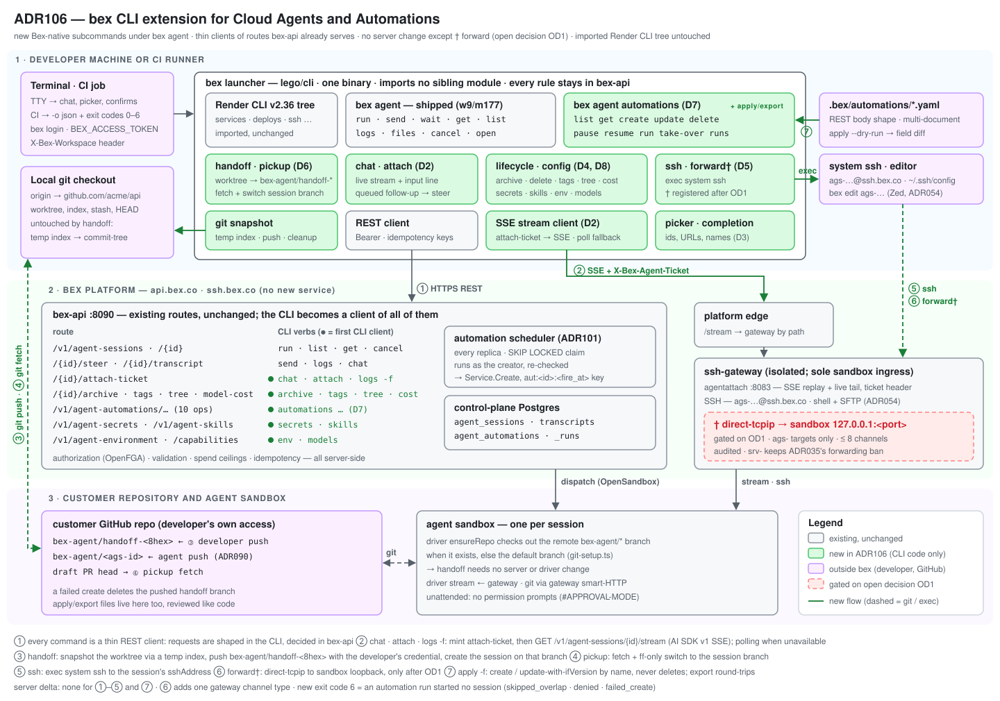

# ADR106 — bex CLI extension for Cloud Agents and their Automations

**Status:** proposed (2026-11-11), implementation in progress (2026-11-12: D7 `bex agent automations` shipped in w1/m338, verified on production) · **Date:** 2026-11-11 · **Extends:** [bex-cli.md § Cloud Agents](bex-cli.md#cloud-agents-bex-agent) (the shipped `bex agent` group), [ADR047](ADR047-cloud-coding-agent-sessions.md) (sessions, attach stream), [ADR094](ADR094-coding-agent-mcp.md) (session contract), [ADR101](ADR101-agent-automations.md) (automations), [ADR054](ADR054-open-in-zed.md) (sandbox SSH), [ADR065](ADR065-agent-session-archive.md), [ADR098](ADR098-agent-session-secrets.md), [ADR099](ADR099-agent-skills.md), [ADR102](ADR102-agent-child-sessions.md) · **Parity:** Devin CLI and Devin Automations (no Render equivalent; see [Parity](#parity)).



## Context

### What a customer can do today

`bex agent` ([bex-cli.md](bex-cli.md#cloud-agents-bex-agent), w9/m177) drives Cloud Agents from scripts and CI with nine verbs: `run`, `send`, `wait`, `get`, `list`, `logs`, `files`, `cancel` and `open`. It is a thin REST client with stable exit codes, `-o json|yaml`, idempotent create and polling with backoff.

Everything else a Cloud Agent user does still needs the dashboard, the API or MCP:

| Capability | API (shipped) | `bex` today |
| --- | --- | --- |
| Watch a session live, type follow-ups | `attach-ticket` + gateway SSE `GET /v1/agent-sessions/{id}/stream` ([ADR047](ADR047-cloud-coding-agent-sessions.md) D9) | `logs --follow` **polls** `/transcript`; no interactive mode |
| Pick a recent session | `GET /v1/agent-sessions?mine=true` | every verb needs a pasted `ags-` id |
| Archive, unarchive, delete | ADR065 | — |
| Replace tags, read the child-session tree, read model cost | `PUT …/tags`, `GET …/tree`, `GET …/model-cost` | — |
| Start a child session | `parentSessionId` on create (ADR102) | — |
| Filter sessions by creator, automation or parent | `mine`, `createdBy`, `automationId`, `parentSessionId`, `phase`, `createdAfter`/`Before` | only `--state`, `--tag`, `--repo`, `--archived` |
| Shell into the sandbox | `sshAddress` on the session; gateway SSH + SFTP (ADR054) | only `bex edit ags-…` (opens Zed) |
| Move local work to the cloud, or cloud work back | — | — |
| **Automations** (ten operations) | `/v1/agent-automations…` (ADR101 D8) | — |
| Workspace agent secrets, skills, environment, model catalog | `/v1/agent-secrets`, `/v1/agent-skills`, `/v1/agent-environment`, `/v1/agent-sessions/capabilities` | — |

### What our Automations do (ADR101, shipped in w21/m278)

- An automation is `triggers[]` plus a session `template`, owned by a workspace. Ids are `aut-…`, and a name is unique per workspace (`[a-z0-9-]`, ≤ 64).
- **Triggers.** Phase 1 accepts exactly one `schedule` trigger:
  - `frequency` is `hour` (`minute`), `day` (`at`), `week` (`at` + `weekdays`), `once` (`runAt`) or `custom` (a five-field `cron`);
  - `timezone` is a required IANA name;
  - `endsAt` is optional and exclusive;
  - the minimum interval is 5 minutes.
- **Template.** The create-session request without attachments, inline secrets, `resumeSessionId` or `idempotencyKey`. `maxSpendUSD` is required on platform-metered models. The template is validated when it is saved and again at every fire.
- **Mechanism.** A scheduler loop runs on every bex-api replica:
  - it claims due rows with `SKIP LOCKED` and records `(automation_id, fire_at)`;
  - it re-authorizes as the creator, then calls `Service.Create` with `aut:<id>:<fire_at>` as the idempotency key;
  - overlapping fires are `skipped_overlap`;
  - three failures auto-pause the automation, with `pausedReason` set to `repeated_failures`, `creator_lost_access` or `template_invalid`.
- **Operations.** `list` (with `mine`), `get`, `create`, `update` (`ifVersion`), `delete`, `pause`, `resume`, `run` (run now, answers 201 with the settled run), `take-over` and `runs`, on REST, GraphQL and MCP.
- **Run outcomes.** `claimed`, `started`, `skipped_overlap`, `failed_create` and `denied`.

The CLI has none of this. A customer who keeps an automation in a repository must hand-write `curl` against `/v1/agent-automations` and handle `ifVersion` conflicts themselves.

### What the Devin CLI does (checked against docs.devin.ai/cli on 2026-11-11)

- **One binary, local and cloud.** `devin` runs a local agent. `devin --cloud` opens an interactive cloud session, and `devin --cloud -p "…"` runs one prompt, prints the answer and exits while the session keeps running.
- **Resuming.** `devin --cloud -r <id|url>` reopens a session. A bare `-r` picks from recent sessions.
- **Handoff, local to cloud.** `/handoff [task]` packages the conversation context, the current branch and the **uncommitted diff** ("Commit or stash anything you don't want sent"). The cloud session clones the repo and checks out that branch.
- **Handoff, cloud to local.** `/handoff` (or `/pickup`) inside a cloud session fetches the session's PR branch, switches the checkout to it and continues locally.
- **SSH.** `devin ssh <session>` wraps the system `ssh` and authenticates with the CLI login, and extra flags pass through. Plain `ssh devin-<id>@ssh.devin.ai` and `scp` also work.
- **Port forwarding.** `devin forward <session> [local:]remote` forwards a port until you press Ctrl-C.
- **Local machine access.** `devin connect <CODE>` lets a web session run commands on your machine, and you approve every tool call.
- **Session commands.** `devin list` (`--format json|csv`), plus the slash commands `/open web|desktop`, `/rename`, `/archive`, `/repo` and `/model`.
- **Automations have no CLI.** They are managed in the web UI, through the v3 `automations` API or with the Terraform provider, and the legacy `/schedules` endpoints have answered 403 since 2026-09-24 for organizations that moved to Automations.

### Constraints this design must honor

- **No new CLI codebase.** `.pm/DO_NOT_DO.md` forbids a first-party CLI written from scratch or a fork of the upstream one. bex ships Render's CLI as the `bex` launcher and adds Bex-native groups beside the imported tree, as `bex agent`, `bex code`, `bex edit` and `bex skills` already do. Everything here is another Bex-native subcommand in `lego/cli/internal/agent`. The imported Render tree is not touched.
- **#APPROVAL-MODE.** Cloud sessions are unattended. There is no permission prompt, no `needs_input`, no `bex agent answer` and no agent→user question channel.
- **Forwarding ban.** ADR035 and DO_NOT_DO ban port forwarding through the SSH gateway. The agent-sandbox carve-out (ADR054) admits SFTP and multiple channels, not forwarding. Port forwarding into a sandbox needs the user's sign-off ([OD1](#open-decision)).
- **Thin client.** The CLI module imports no sibling module (`operator → types ← backend`; `cli` imports none). Every decision (authorization, validation, spend, idempotency, the schedule math) stays in bex-api. The CLI only shapes requests and renders answers.
- **ADR047's frozen stream boundary.** No WebSocket hop and no second bridge. The CLI reads the same AI SDK v1 UI-message SSE stream the dashboard reads.

## Decision

### D1 — One `bex agent` tree, extended in place

Every new command is a subcommand of the shipped `bex agent` group (alias `agents`):

```
bex agent
├── run · send · wait · get · list · logs · files · cancel · open   (shipped; list/run gain flags, logs -f moves to SSE)
├── chat (alias attach)                                             D2  live, interactive
├── archive · unarchive · delete · tags · tree · cost               D4  lifecycle
├── ssh · forward†                                                  D5  sandbox access († gated on OD1)
├── handoff · pickup                                                D6  local ⇄ cloud
├── automations (alias automation, aut)                             D7  ten API operations + apply/export
│   └── list · get · create · update · delete · pause · resume · run · take-over · runs · apply · export
└── secrets · skills · env · models                                 D8  workspace agent configuration
```

- **Automations stay under `bex agent`, with no top-level `bex automations`.** The root command tree belongs to the pinned Render CLI, and a future pin could add a word there. `bex agent automations` cannot collide with it. It also says what an automation starts, as ADR101's naming rationale asked.
- **Conventions shared with the shipped group:**
  - auth through `bex login` or `BEX_ACCESS_TOKEN`;
  - the active workspace in `X-Bex-Workspace`;
  - `-o text|json|yaml` with the API's own answer on stdout;
  - streamed text on stderr while `-o json` is set;
  - the exit-code table in [CLI specification § Exit codes](#exit-codes), extended by one code;
  - telemetry that records only the command path.
- **Server changes.** D1–D4 and D6–D8 call shipped routes only. D5's `forward` needs one gateway change after OD1, and nothing else changes on the server.

### D2 — `bex agent chat`: a live session in the terminal

`chat` is the terminal counterpart of the dashboard's `/agents/ags-…` page and Devin's `devin --cloud`.

- **Transport.** `chat` reads the live session in four steps:

  1. `POST /v1/agent-sessions/{id}/attach-ticket` returns a 90-second, single-use ticket and the stream URL.
  2. `GET <streamUrl>` with `X-Bex-Agent-Ticket` and `Accept: text/event-stream` opens the stream.
  3. The stream replays the durable transcript, then splices the live tail (ADR047 D9). SSE comment heartbeats are ignored.
  4. On a drop, the client mints a fresh ticket and reconnects. It skips replayed parts it has already printed, keyed by `(turn, partIndex)`.

  If the stream is unavailable, `chat` falls back to the shipped `/transcript` polling. That covers a 503 from an unconfigured gateway and `409 AGENT_SESSION_NOT_ATTACHABLE` while the first sandbox is still provisioning, which `chat` retries.

- **Input.** `chat` is a line-mode prompt under the stream, not a full-screen TUI, so output stays in scrollback and works in tmux, in SSH sessions and in pipes to `tee`.
  - The public live-turn path is disabled (`AGENT_SESSION_LIVE_TURN_UNAVAILABLE`, ADR047 D9), so a message typed while a turn runs is **queued in the client** in one slot.
  - The queued message is sent with `steer` when the turn settles. Typing again replaces it, and the prompt shows `queued — sends when this turn ends`.
  - A message typed while no turn runs is sent with `steer` at once.
- **Detach is not cancel.** Ctrl-D, `/quit` or Ctrl-C on an empty line detach and leave the session running. `/cancel` asks for confirmation and then calls the cancel verb. This is ADR047's "client disconnect ≠ cancel" rule.
- **New sessions.** `bex agent chat --repo acme/api [task…]` creates the session with the `run` flags and an idempotency key, then attaches. With no task it asks for the first message.
- **Not for scripts.** With no TTY, `chat` exits 2 and points to `run --follow`. `logs --follow` and `run`/`send --follow` move to the same SSE client with polling as the fallback, so CI sees the agent's output sooner and its exit codes do not change.

### D3 — Session selection: picker, URLs and completion

- **Two ways to name a session.** Wherever a command takes `<session>`, it accepts an `ags-…` id or a dashboard URL (`https://dashboard.bex.co/agents/ags-…`, or the session URL of a custom dashboard origin). Devin's `-r <id|url>` works the same way.
- **Picker.** If `<session>` is omitted on a TTY, a picker lists the caller's 20 most recent sessions (`mine=true`) with their state, title, repo and age. `--all` widens it to the workspace. Without a TTY, an omitted session is a usage error (exit 2). The same picker serves `<automation>`.
- **Shell completion.** Cobra `ValidArgsFunction` completes `ags-`, `aut-` and automation names. Completion has a 2-second budget and stays silent on any error.
- **List filters.** `list` gains the API's existing filters:
  - `--mine`;
  - `--created-by` (repeatable);
  - `--automation <automation>`;
  - `--parent <session>`;
  - `--phase`;
  - `--since` and `--until` (mapped to `createdAfter` and `createdBefore`).
- **Child sessions.** `run --parent <session>` creates a child session (ADR102). Depth, child-count and spend rules stay server-side.

### D4 — Lifecycle verbs

| Command | Route | Notes |
| --- | --- | --- |
| `archive <session>…` / `unarchive <session>…` | `POST …/archive`, `…/unarchive` | several ids per call; each result printed |
| `delete <session>` | `DELETE /v1/agent-sessions/{id}` | confirms on a TTY; `--confirm` otherwise required |
| `tags <session> [TAG…]` / `tags <session> --clear` | `PUT …/tags` | replaces all tags, as the API does; no read-modify-write `--add` (it would race) |
| `tree <session>` | `GET …/tree` | indented tree of descendants with state, title and spend |
| `cost <session>` | `GET …/model-cost` | per-turn and total model cost |

There is no `rename`. The title is fixed at create (ADR094 amendment w7/m296), and this is a recorded difference from Devin's `/rename`.

### D5 — Sandbox access: `ssh` and `forward`

- **`bex agent ssh <session> [-- ssh-args…]`.**
  - Reads the session's `sshAddress` and `exec`s the system `ssh` on it. Arguments after `--` pass through unchanged.
  - Uses the same target, permission (`can_view_sensitive`) and registered key as `bex edit ags-…`.
  - A session with no running sandbox says "send it a message to start one" and exits 1.
  - The gateway keeps deciding which channels it admits. The CLI adds no policy.
- **`bex agent forward <session> [<local>:]<remote>…`** opens `ssh -N -L 127.0.0.1:<local>:127.0.0.1:<remote>` through the same gateway until Ctrl-C. It is **gated on [OD1](#open-decision)**: until the user signs off, the command is not registered, so no command exists that the gateway refuses. The proposed gateway change is scoped this way:
  - `direct-tcpip` is admitted only for `ags-` targets;
  - the destination must be the sandbox's loopback (`127.0.0.1` or `::1`) on ports 1024–65535;
  - at most 8 concurrent channels per connection;
  - every open is written to the audit log;
  - `srv-` App-instance SSH keeps ADR035's full ban.

### D6 — Handoff and pickup

`handoff` moves a developer's local work into a new cloud session. `pickup` brings a session's branch back into the local checkout. Neither needs a server change, because the sandbox driver already starts a session on an existing remote `bex-agent/*` branch. In `ensureRepo`, `lego/agent-image/driver/src/git-setup.ts` checks out `remoteBranchOid || baseOid`.

**`bex agent handoff [run flags] [--notes FILE] [--tracked-only] [<task…>]`**

1. **Locate.** The current directory must be inside a git worktree. `--repo` wins; otherwise the repo is parsed from the `--remote` URL (default `origin`, `github.com/OWNER/REPO` over HTTPS or SSH).
2. **Snapshot without touching anything.**
   - Copy the index to a temporary `GIT_INDEX_FILE`, then run `git add -A` (or `-u` with `--tracked-only`) against it. `.gitignore` is honored.
   - Run `git write-tree` and `git commit-tree <tree> -p HEAD -m "bex handoff: <title>"`.
   - The worktree, the real index, the stash and `HEAD` are unchanged. A clean tree hands off `HEAD` itself.
3. **Confirm.** Print the branch, the base commit, a diffstat and the untracked files that will be sent (the first 20). On a TTY, ask before pushing; without one, `--confirm` is required. This is the moment Devin warns about with "Commit or stash anything you don't want sent".
4. **Push with the developer's own credential.** `git push <remote> <commit>:refs/heads/bex-agent/handoff-<8 hex>`. The developer is pushing to their own repository, which bex never does on their behalf.
5. **Create.** `POST /v1/agent-sessions` with `repo`, `branch` = the handoff branch, the task and every `run` flag (`--model`, `--max-spend`, `--secret`, `--skill`, `--attach`, `--wait`, `--follow`, `--chat`).
   - `--notes FILE` is uploaded as an attachment (ADR095), so the agent finds `/attachments/<name>`.
   - The idempotency key is `handoff:<commit sha>:<sha256(task)[:16]>`, so re-running after a dropped connection resumes the same session.
   - If create fails, the CLI deletes the branch it pushed (`git push <remote> --delete …`) and reports both outcomes.
6. **The PR base.** The PR targets the repository's default branch, which the driver already resolves. If the developer branched off something else, the PR also shows their unpushed commits. A `--base` flag needs a session field and is a follow-up.

**What does not transfer.** A local agent's conversation does not transfer. bex ships no local agent of its own (`bex code` and `bex glm` launch Claude Code, whose history format is private and versioned). Context travels as `--notes` and the task text. This is a recorded difference from Devin, whose local agent and cloud agent share a conversation format.

**`bex agent pickup [<session>] [--remote origin] [--stash] [--wait [--timeout D]]`**

1. Read the session. Its `repo` must match the checkout's remote (case-insensitive `owner/repo`); otherwise the command exits 2.
2. If the turn is still running, `--wait` waits for it to end. Without `--wait`, the command warns that the agent may push more commits and carries on.
3. A dirty worktree is refused (exit 2) unless `--stash` is given, which runs `git stash push -u -m "bex pickup <ags-id>"`.
4. `git fetch <remote> refs/heads/<branch>`, then switch the checkout to it:
   - a branch that does not exist locally is created with `git switch -c <branch> --track <remote>/<branch>`;
   - an existing local branch is fast-forwarded only (`git merge --ff-only`);
   - a local branch that has diverged is refused with a hint.
5. If nothing has been pushed yet, the command exits 1 with "the session has not pushed its branch yet". Otherwise it prints the PR URL. The cloud session is untouched and stays steerable.

### D7 — `bex agent automations`

The command group maps one-to-one onto ADR101 D8 and adds two client-side verbs, `apply` and `export`, for keeping automations in a repository. Devin covers that with Terraform, so bex goes further than Devin here.

- **Flags.**
  - The **template flags** are `run`'s flags. The task is given as positional words or with `-f FILE`.
  - Flags a template cannot carry are refused with exit 2 and a reason: `--attach`, `--secret-from-env`, `--idempotency-key`, `--parent`. `--secret-from-env` points to `bex agent secrets set`.
  - The **schedule flags** build the one `schedule` trigger (see [the spec](#bex-agent-automations)). `--timezone` defaults to the machine's IANA zone, from `TZ` or the `/etc/localtime` link, and the CLI prints the zone it used. This matches the dashboard's default from the browser. If no IANA name can be found, the command exits 2 and asks for `--timezone`. The API still never guesses.
- **Updates are read-modify-write with optimistic concurrency.** `update` reads the automation, merges the flags into `triggers` and `template` (the API replaces each of them whole) and sends `PATCH` with `ifVersion` set to the version it read. A concurrent edit answers `409 AGENT_AUTOMATION_CONFLICT`, which the CLI reports with "re-run to apply on top of the newer version". It never retries silently.
- **`run` (run now)** answers with the settled run.
  - With `--wait` or `--follow`, the CLI then waits on the run's session and exits by its state.
  - A run that started nothing (`skipped_overlap`, `denied` or `failed_create`) exits **6**, and stderr names the outcome and the recorded error.
- **`apply -f FILE|DIR|-`** is declarative.
  - Documents use the REST request body exactly (`name`, `enabled`, `triggers`, `template`), in YAML or JSON. A file may hold several YAML documents. There is no CLI-only schema.
  - Each document is matched by `name`. A missing one is created, a changed one is updated with `ifVersion`, and an unchanged one is skipped.
  - `--dry-run` prints the plan and a field-level diff and changes nothing.
  - `apply` **never deletes**. Removing a document from the file does not remove the automation; that is an explicit `delete`.
  - An automation created by someone else answers `403 AGENT_AUTOMATION_NOT_CREATOR`, which is reported with the hint `bex agent automations take-over`.
- **`export <automation>…|--all`** prints exactly the fields `apply` accepts. Read-only fields (`id`, `createdBy`, `nextFireAt`, `version`, …) are dropped, so `export | apply -f -` changes nothing.
- **Text output.**
  - The schedule is rendered in words ("every day at 09:00 Europe/Berlin, until 2026-12-31"), next to the next fire, the last run and any `pausedReason`.
  - `-o json|yaml` stays the API's own answer.

### D8 — Workspace agent configuration

These are the resources that templates and sessions refer to by name, so a CLI user can set up a workspace without opening the dashboard.

| Command | Route | Notes |
| --- | --- | --- |
| `secrets list` / `secrets set NAME` / `secrets delete NAME` | `/v1/agent-secrets` | write-only. `set` reads the value from stdin or `--from-env VAR`, never from argv; ADR098 |
| `skills list` / `get` / `create -f SKILL.md` / `update NAME -f SKILL.md` / `delete` / `versions NAME [--show N]` | `/v1/agent-skills` | admin-only writes, enforced by the API; ADR099 |
| `env` / `env set …` | `/v1/agent-environment` | network tier, custom hosts, default model, monthly spend cap. The BYO model key comes from stdin through `--model-key-stdin`, and `--clear-model-key` removes it |
| `models` | `GET /v1/agent-sessions/capabilities` | agents, models, GitHub and model-key readiness, attachment limits |

Local skills for the developer's own coding agents stay with the shipped `bex skills`. `bex agent skills` manages the workspace skills that cloud sessions read.

### D9 — Contracts and tests

- **Shared fixtures.** The CLI cannot import backend types, so the shipped pattern carries over. Today the CLI decodes `lego/cli/testdata/agent-cli-contract.json`, and the backend twin (`TestShapesMatchCLIAgentContract` in `cli_agent_contract_test.go`) checks that every key in it is still a JSON field of the type that serves it. Two fixtures join it under the same pair of tests: `agent-automation-cli-contract.json` (an automation, a run list and every named error code) and an SSE replay fixture. A field rename then breaks CI on both sides.
- **Git tests.** Handoff and pickup run against a temporary bare remote. Afterwards, the worktree, index, stash and `HEAD` must be byte-identical to before. A failed create must delete the pushed branch. A diverged local branch must be refused.
- **Built-binary tests.** As `runtime_copy_test.go` does, tests drive `bex agent automations apply --dry-run`, `export | apply` round-trips and the exit-6 path against a stub API.

## CLI specification

### Conventions

| Item | Rule |
| --- | --- | --- |
| `<session>` | `ags-…` id or dashboard session URL; omitted on a TTY → picker (D3); omitted without a TTY → exit 2 |
| `<automation>` | `aut-…` id or automation name (the API resolves either) |
| Output | `-o text` (default on a TTY), `json`, `yaml`; `BEX_OUTPUT` sets the default. JSON/YAML print the API's answer unchanged; YAML keeps integer digits |
| Streams | transcript and progress on stderr whenever stdout carries `-o json | yaml` |
| Secrets | never on argv: stdin, `--from-env`, or `--secret-from-env` (sessions only) |
| Confirmation | `delete`, `automations delete`, `take-over`, a writing `apply` and `handoff`'s push ask on a TTY; upstream's global `--confirm` ("skip all confirmation prompts", the Render CLI's own flag) skips; without a TTY they need `--confirm` or exit 2 |
| Waiting | `--wait`, `--follow` and `--timeout D` behave as in the shipped group (SSE first, polling with 2–15 s backoff as fallback, five transient failures tolerated, `Retry-After` honored) |
| Telemetry | command path only, never arguments, names, prompts or values |

### Exit codes

The shipped table, plus one code:

| Code | Meaning |
| --- | --- |
| `0` | success; for waiting commands, the turn succeeded |
| `1` | the CLI, git or the API failed (network, auth, a refused request) |
| `2` | usage error, including a missing TTY for an interactive-only command |
| `3` | the turn failed; stderr names its `failureReasonCode` |
| `4` | the session was canceled |
| `5` | reserved for `needs_input`, which sessions never enter (#APPROVAL-MODE) |
| `6` | **new:** an automation run started no session (`skipped_overlap`, `denied`, `failed_create`) |
| `124` | `--timeout` elapsed while the session was still working |
| `130` | interrupted (Ctrl-C or SIGTERM) |

### Sessions — shipped commands that change

```
bex agent run [flags] <task…>
  + --parent <session>         start a child session (ADR102 parentSessionId)
  + --chat                     attach interactively after create (TTY only)
bex agent list [flags]
  + --mine                     only sessions I started
  + --created-by <user-id>     repeatable, at most 20
  + --automation <automation>  sessions started by this automation
  + --parent <session>         direct children of a session
  + --phase <phase>            raw phase filter (state stays the default filter)
  + --since <time> --until <time>   createdAfter / createdBefore (RFC 3339 or 24h, 7d)
bex agent logs <session> --follow  now streams over SSE; polling remains the fallback
```

### `bex agent chat`

```
bex agent chat [<session>] [--read-only] [--reasoning] [run flags…] [<task…>]
alias: bex agent attach
```

| Input | Effect |
| --- | --- |
| text + Enter | if no turn is running, `steer` now; otherwise queue it (one slot) and send it when the turn ends |
| `/attach FILE` | stage an attachment for the next message (ADR095) |
| `/skill NAME[:ARGS]` | stage a workspace skill for the next message (ADR099) |
| `/files [--download DIR]` | as `bex agent files` |
| `/open [dashboard\|desktop]` | as `bex agent open` |
| `/ssh` | as `bex agent ssh`; returns to chat on exit |
| `/pickup` | as `bex agent pickup` in the current directory |
| `/tags TAG…`, `/tree`, `/cost`, `/archive` | as the D4 verbs |
| `/cancel` | confirm, then cancel the session |
| `/help` | list these commands |
| `/quit`, `/exit`, Ctrl-D, Ctrl-C on an empty line | detach; the session keeps running |

- `--read-only` shows the stream with no input line, for watching a teammate's session that you have `can_operate` but not `can_create` on.
- Header line: `ags-… · owner/repo@bex-agent/… · model · state · $spent`.
- Rendering: the agent's text, one line per tool call (`▸ Bash  go test ./...`), the turn boundary with outcome, the PR link and cost. Reasoning is shown only with `--reasoning`.
- Without a TTY: exit 2, with `use bex agent run --follow`.

### `bex agent archive | unarchive | delete | tags | tree | cost`

```
bex agent archive   <session>…
bex agent unarchive <session>…
bex agent delete    <session> [--confirm]
bex agent tags      <session> (<tag>… | --clear)
bex agent tree      <session>
bex agent cost      <session>
```

### `bex agent ssh` and `bex agent forward`

```
bex agent ssh <session> [-- <ssh args…>]
bex agent forward <session> [<local>:]<remote>… [--bind 127.0.0.1]   († registered only after OD1)
```

- `ssh` execs the system `ssh`, so `~/.ssh/config`, agents and keys apply. Exit status is ssh's own.
- `forward` binds loopback by default. `--bind 0.0.0.0` needs `--confirm` because it exposes the sandbox port to the local network. The command runs until interrupted (exit 130).

### `bex agent handoff` and `bex agent pickup`

```
bex agent handoff [--repo owner/repo] [--remote origin] [--tracked-only] [--notes FILE]
                  [--confirm] [--chat | --wait | --follow] [run flags…] [<task…> | -f FILE]
bex agent pickup  [<session>] [--remote origin] [--stash] [--wait [--timeout D]]
```

| Case | Result |
| --- | --- |
| not in a git worktree | exit 2 |
| repo not on github.com and no `--repo` | exit 2 |
| no task and no `--notes` | exit 2 (`handoff` needs to know what to do) |
| push rejected (auth, protected pattern, size) | exit 1; git's message on stderr; nothing created |
| create refused after the push | exit 1; pushed branch deleted; both outcomes printed |
| `pickup` with a dirty worktree and no `--stash` | exit 2 |
| `pickup` before the agent pushed | exit 1, "the session has not pushed its branch yet" |
| `pickup` on a diverged local branch | exit 1 with the `git` commands that would reconcile it |

`-o json` on `handoff` prints `{"branch", "commit", "session": <session view>}`. On `pickup` it prints `{"branch", "commit", "pullRequest"}`.

### `bex agent automations`

```
bex agent automations list    [--mine] [--limit N] [--cursor C]
bex agent automations get     <automation>
bex agent automations create  --name NAME <schedule flags> <template flags> [--disabled] (<task…> | -f FILE)
bex agent automations update  <automation> [--name NAME] [<schedule flags>] [<template flags>] [<task…> | -f FILE]
bex agent automations delete  <automation> [--confirm]
bex agent automations pause   <automation>
bex agent automations resume  <automation>
bex agent automations run     <automation> [--wait | --follow] [--timeout D]
bex agent automations take-over <automation> [--confirm]
bex agent automations runs    <automation> [--limit N] [--cursor C]
bex agent automations apply   -f FILE|DIR|- [--dry-run] [--confirm]
bex agent automations export  (<automation>… | --all)
aliases: bex agent automation …, bex agent aut …
```

**Schedule flags.** `create` needs exactly one of `--every`, `--once` and `--cron`. On `update`, any schedule flag replaces the trigger, and the flags not given keep their stored values.

| Flag | API field | Example |
| --- | --- | --- |
| `--every hour --minute M` | `frequency: hour`, `minute` | `--every hour --minute 15` |
| `--every day --at HH:MM` | `frequency: day`, `at` | `--every day --at 09:00` |
| `--every week --at HH:MM --on D,D` | `frequency: week`, `at`, `weekdays` | `--every week --at 08:30 --on mon,thu` |
| `--once TIME` | `frequency: once`, `runAt` | `--once 2026-11-20T09:00` (local to `--timezone`) or RFC 3339 |
| `--cron "M H DoM Mon DoW"` | `frequency: custom`, `cron` | `--cron "0 9 * * 1-5"` |
| `--timezone ZONE` | `timezone` | default: the machine's IANA zone, printed |
| `--ends TIME` / `--no-end` | `endsAt` (exclusive) / `null` | `--ends 2026-12-31` |

**Template flags.** These are the same as `run`: `--repo`, `--branch`, `--agent`, `--model`, `--title`, `--tag`, `--max-spend`, `--skill`, `--secret`, `--output-schema`, and the task as words or `-f FILE`. `--max-spend` is required when the model is platform-metered; the API enforces this with `AGENT_AUTOMATION_SPEND_LIMIT_REQUIRED`.

**Definition file** for `apply` and `export`. It is the REST body as written:

```yaml
name: nightly-deps
enabled: true
triggers:
  - type: schedule
    schedule:
      frequency: week
      at: "03:00"
      weekdays: [mon]
      timezone: Europe/Berlin
template:
  repo: acme/api
  task: Update dependencies, run the tests, open a draft PR.
  agentConfig: { agent: claude, model: claude-sonnet-5-5 }
  maxSpendUSD: 5
  secretNames: [NPM_TOKEN]
  tags: [deps]
---
name: morning-triage
# … more automations in the same file
```

**Examples**

```bash
# Every weekday at 09:00 Berlin time, triage new errors, capped at $3 a run.
bex agent automations create --name error-triage --cron "0 9 * * 1-5" --timezone Europe/Berlin \
  --repo acme/api --max-spend 3 --secret SENTRY_TOKEN "Triage yesterday's new Sentry errors"

# Keep automations in the repo; CI previews on PRs and applies on main.
bex agent automations apply -f .bex/automations/ --dry-run
bex agent automations apply -f .bex/automations/ --confirm

# Test an automation now and fail the job if the session fails or never started.
bex agent automations run nightly-deps --wait --timeout 45m -o json > run.json
```

### `bex agent secrets | skills | env | models`

```
bex agent secrets list
bex agent secrets set NAME [--from-env VAR]        # value from stdin unless --from-env
bex agent secrets delete NAME [--confirm]
bex agent skills list
bex agent skills get NAME [--version N]
bex agent skills create -f SKILL.md
bex agent skills update NAME -f SKILL.md
bex agent skills delete NAME [--confirm]
bex agent skills versions NAME
bex agent env
bex agent env set [--network-tier T] [--custom-host H]… [--default-model M]
                  [--spend-cap USD | --spend-cap default] [--model-key-stdin | --clear-model-key]
bex agent models
```

## Parity

There is no Render surface for Cloud Agents, so the reference is the Devin CLI (docs.devin.ai/cli, read 2026-11-11). [ADR018](ADR018-render-parity.md) gets a row (agents CLI, Devin parity) when phase 1 ships.

| Devin CLI | bex (this ADR) |
| --- | --- |
| `devin` local agent | **Difference:** none of bex's own. `bex code`/`bex glm`/… launch Claude Code locally |
| `devin --cloud` interactive | `bex agent chat` (D2) |
| `devin --cloud -p "…"` | `bex agent run --wait` / `--follow` (shipped) |
| `-r` picker, `-r <id\|url>` | picker when `<session>` is omitted; ids or dashboard URLs (D3) |
| `/handoff` local → cloud: conversation + branch + uncommitted diff | `bex agent handoff`: branch + uncommitted diff + `--notes`. **Difference:** no conversation transfer (D6) |
| `/handoff` / `/pickup` cloud → local | `bex agent pickup` (D6) |
| `devin ssh` (wraps system ssh, flags pass through) | `bex agent ssh` (D5) |
| `devin forward <s> [local:]remote` | `bex agent forward`, gated on OD1 (D5) |
| `devin connect <CODE>`: a cloud agent runs commands on your machine after per-call approval | **Not built:** it is a permission prompt surfaced to users (#APPROVAL-MODE) |
| `devin list` (`--format json\|csv`) | `bex agent list` (shipped) + D3 filters; `-o json\|yaml`, no CSV |
| `/archive` | `archive` / `unarchive` / `delete` (D4) |
| `/rename` | **Difference:** titles are create-time (ADR094 w7/m296) |
| `/open web\|desktop` | `bex agent open` (shipped) |
| `/repo`, `/model`, `/platform` | `--repo`, `--model`; one Linux platform, no flag |
| subagents | `run --parent`, `tree` (D3, D4) |
| permission modes (`smart`, `bypass`, …) | N/A: cloud sessions are unattended (#APPROVAL-MODE) |
| Automations: no CLI; v3 API + Terraform | `bex agent automations` with `apply`/`export` (D7). **Beyond Devin:** a Terraform provider is a follow-up |
| `devin skills`, `mcp`, `rules` (local agent config) | `bex agent skills` manages workspace skills; local skills stay `bex skills` |

Not verified: whether `/handoff` requires the branch to be pushed first, and how Devin treats untracked files. The docs say neither, so D6 picks the safe default (confirm before pushing, `.gitignore` honored).

## Phasing

| Phase | Scope | Server change |
| --- | --- | --- |
| 1 | D7 automations (all twelve verbs), D8 configuration, D3 list filters and `--parent`, D4 lifecycle verbs, D9 fixtures | none |
| 2 | D2 SSE client, `chat`, `logs`/`--follow` over SSE, D3 picker and completion | none |
| 3 | D6 `handoff` / `pickup`, D5 `ssh` | none |
| 4 | D5 `forward` | gateway `direct-tcpip` for `ags-` targets, after OD1 |

Each phase updates [bex-cli.md](bex-cli.md), ships through a `bex-cli/v*` release (`/release cli`, user-authorized) and records the Devin-parity row.

## Open decision

**OD1 — Port forwarding into agent sandboxes.** It would reopen the SSH gateway's forwarding ban for `ags-` targets only:

- the destination is the sandbox's loopback;
- ports are 1024–65535;
- at most 8 channels;
- every open is audited;
- `srv-` targets are unchanged.

The proposed default is **allow**. A sandbox is already a workspace-owned, authorized, audited resource reachable over SSH and SFTP (ADR054). Forwarding to its own loopback adds no network reach the shell does not already have, and a dev server the agent starts is what customers want to look at. Until the user decides, phase 4 does not start and `forward` is not registered.

## Decisions taken as defaults

Each of these is a reversible client-side choice, adopted under the Devin-consistent rule. An optional decision never blocks the reference behavior.

1. **Nest under `bex agent`** with no top-level `bex automations` (D1), to avoid collisions with the imported Render tree.
2. **Handoff pushes with the developer's own git credential** (D6). The alternative, uploading a git bundle as an attachment and having the driver fetch it, needs a driver change and puts unreviewed objects into bex storage.
3. **`chat` is line-mode** (D2), not a full-screen TUI, so it works in tmux, SSH and pipes.
4. **`apply` never deletes** (D7). Pruning would let a missing file stop a teammate's automation.
5. **Exit code 6** for an automation run that started nothing (D7), so CI can tell "skipped" apart from "failed".

## Consequences

- Everything a dashboard user does with Cloud Agents and Automations becomes scriptable. Automations can live in a repository and be reviewed like code, which neither the dashboard nor Devin's CLI offers.
- The CLI stays thin. No business rule moves into it, so the API keeps a single source of truth and GraphQL, MCP and the dashboard are unaffected.
- The CLI grows by about four packages' worth of code (SSE client, git snapshot, picker, automations), all in `lego/cli/internal/agent`. The release train is unchanged.
- Handoff writes `bex-agent/handoff-*` branches into customer repositories, made by the developer. They are visible and can be deleted, and the PR flow cleans them up the way it cleans `bex-agent/<ags-id>` branches.
- The SSE client makes the CLI the second consumer of the gateway attach stream. A stream-format change now breaks a released binary, so the SSE fixture (D9) guards it.

## Alternatives rejected

- **A local bex agent runtime (Devin's local mode).** It means building and maintaining an agent harness. `bex code` already launches Claude Code locally and the product's agent is the cloud one.
- **`devin connect`-style local machine access.** A cloud agent running commands on the developer's laptop after per-call approval is a user-facing permission prompt (#APPROVAL-MODE). It also inverts the trust boundary: the sandbox is isolated so that the agent never touches a developer machine.
- **Top-level `bex automations` or `bex sessions`.** These names belong to the root tree the pinned Render CLI owns (D1).
- **Automations in `render.yaml`.** It is Render's canonical Blueprint contract (ADR049), and adding non-Render keys breaks it. `apply -f` gives the same declarative workflow in a separate file.
- **A Terraform provider now.** `apply` covers declarative management for the common case. A provider remains a follow-up if customers ask for it.
- **A WebSocket or a second stream bridge for `chat`.** ADR047's frozen boundary forbids it, and the SSE stream already carries everything the dashboard renders.
- **A full-screen TUI (bubbletea) for `chat`.** It hides scrollback, breaks in pipes and adds a large rendering surface for one command.
- **Server-side handoff (upload a tarball or bundle).** It needs new storage, a driver path and an extraction step in the sandbox, all to avoid a `git push` the developer can already do.

## Follow-ups, not gates

- `--base` on `handoff` (needs a `baseBranch` session field).
- `apply --prune` with an explicit managed-by marker, if customers ask for it.
- A Terraform provider for automations.
- CSV output for `list` (Devin's `--format csv`).
- Webhook and GitHub triggers in `create`/`apply` flags once ADR101's follow-up triggers ship. The definition file needs no change.
